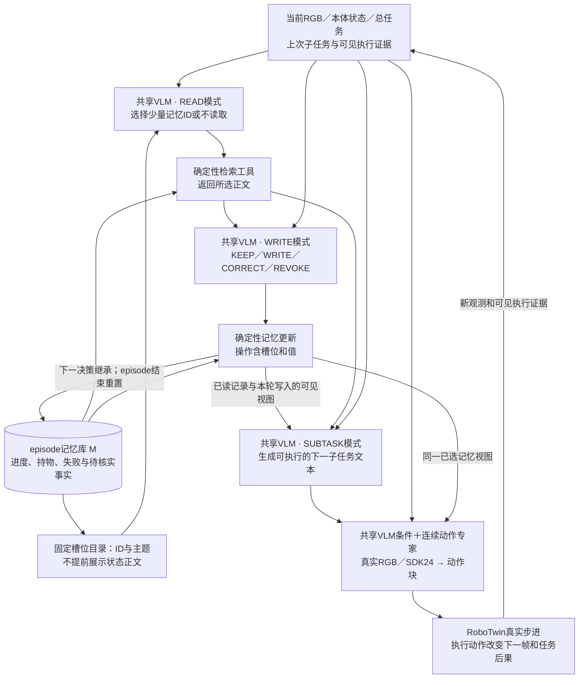
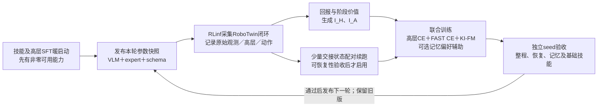

# RECAP扩展训练框架：记忆读写与高层决策的回报优化

2026-10-17用户要求将此方向纳入正式开题材料，已形成 [[04-开题报告扩展稿-图文版]] 和 [[10-研究主题/开题材料/2026-10-17/01-开题材料清单与证据索引|官方格式材料入口]]；题目沿用原名称。随后按授权接入扩展基线代码并完成87项CPU组件测试，见[[2026-10-17-RM65B-RECAP记忆联合学习代码接入与CPU核验]]；未训练、未运行新场景或评测效果，物理后果配对信用仍未实现。

2026-10-18后续实测：真实SFT加载、原动作入口对照、三loss无梯度前向与新场景SDK24／三RGB／60ms往返通过，92项CPU回归通过；同日用户完成CLI授权后Gemma3资产补齐，完整value两阶段201-bin无梯度前向通过。高层READ/WRITE/SUBTASK文本生成仍未通过，value新增投影／expert／head仍未拟合，未训练。当前证据与失败边界见[[2026-10-18-RM65B-RECAP资产准备与真实功能验证]]；不据接口或前向通过认定自主分层闭环、价值可靠或研究机制有效。

同日补充定位：源Flax在同一纯文本输入的前两步也复现异常续写，不能把问题只归因于native自回归实现，亦不据此否定所有π0.5的语言能力。全参数FM-only的源SFT训练历史支持语言失配假设，尚未隔离因果。另完成参考高层文本驱动真实动作专家／新场景的16步记录与因果重载验收；其高层不是VLM生成，任务未成功且数据被训练回放拒绝。该证据继续支持接口就绪范围，未证明自主联合策略或学习效果。

同日制定[[本机-RM65B-RECAP记忆联合学习实现计划#12. 高层SFT暖启动方案（2026-10-18，只制定，未实施）|高层SFT暖启动方案]]：先100—200个审核决策点试学，条件满足后扩至1000—2000点；仅最后层语言q/o LoRA的131,072参数作为保留原动作K/V的受控起点，必要时开放全层共享LoRA并另加K/V锚。仅为当前缓存式实现的源码推导，未训练验收；它不是“动作专家已经学会新物理表征”的证据。标签坚持可见信息和先READ再操作，隐藏核验事件不可直接作为actor已知事实。

> [!abstract] 当前建议
> 主框架采用**共享VLM、分层回报条件化、知识隔离下的FAST／FM联合学习**。先建立一个高层联合决策也接受任务回报的RECAP扩展基线，再检验少量真实分支续跑能否提供更可靠的记忆信用。VLM和动作专家均可更新；冻结仅用于每轮采集／评估快照和消融，不是长期锁死模型。
>
> 可检验的论文问题是：**当后续动作也会失误、且执行策略持续变化时，怎样评价一条记忆操作对最终物理任务的作用，减少把运动失败误归因于记忆的情况？** 组合RECAP、MEM、VaM或者增加多个loss，本身不是成立的算法创新。扩展基线已有代码及CPU组件证据；物理信用机制仍未实现，整体未训练、未证明首创或有效。

## 1. 先明确已有工作与真正需要扩展的部分

| 工作 | 原文已覆盖 | 本方案需要另行解决的部分 |
| --- | --- | --- |
| RECAP／π*0.6 v2 §IV–V | 回报→价值→优势条件；VLM的FAST和专家的FM分路训练；示范／旧新rollout／纠正复用 | 原文优势标记位于子任务之后，没有直接优化显式记忆读写及子任务生成概率 |
| MEM §III、§IV-B | 短期视觉历史、递归语言摘要、高层子任务；摘要监督与失败上下文纠正SFT | 记忆／子任务操作依据后续任务回报做策略改进与信用评估 |
| VaM v1 §3 | π0.5＋MEM式历史＋近期value缓存；价值学习和优势条件化FM；真实交互 | 固定缓存不等于学习显式检索、保留、纠正、撤销；没有覆盖显式读写与高层子任务文本生成的信用分配 |
| AD-Memo v1 §3.2 | 为记忆token与驾驶token分配不同时间范围的回报 | 其驾驶画面来自replay，动作不改变后续图像；不能直接等同机械臂的真实物理闭环 |
| GMP v2 §3.2 | 用有／无历史是否降低动作误差监督记忆门控 | 以长期物理任务后果评价记忆操作；但“按需读记忆”本身不新 |

因此有两个层次：**可运行的联合学习框架**和**值得检验的新信用估计机制**。前者是必要工程基线，不能直接当后者。

## 2. 执行架构：同一个VLM承担读、写与子任务生成



图中多个VLM框是**π0.5自身同一套参数的不同调用角色**，不是新增三个完整模型。记忆正文由外部bank保留，网络学习何时读、怎样改，再自回归生成下一步做什么的具体文本。子任务不从固定候选库中选取；检索与应用写操作是确定性工具，不要求可微。

第一版使用当前已有多视角RGB和状态，加上一条／短窗口的既往子任务与可见执行证据；**不假称当前π0.5具备MEM视频编码器**。如果短期视频编码是研究所需，应单独实现并与所有对照一致。

2026-10-18目标架构补充：用户已要求纳入MEM短期视频记忆，完整接入和SFT暖启动方案见[[本机-RM65B-MEM视频记忆与高层SFT完整接入方案]]。默认三路各四帧、480ms间隔、覆盖1.44s，在视觉端压回768个视觉token；历史状态在VLM侧独立投影。按高层协议→视频／FAST表征→专家LoRA动作对齐分阶段训练，高层／FAST更新视觉与VLM，KI-FM仅更新expert。当前上图仍代表已经接入的单时刻框架，新视频图见新方案，尚未改工程／训练。单帧K1保留锚不保证新K4分支零退化，须分别评测；新增预算不是显存实测。

同日后续按授权实施：MEM短期视频、历史状态、参数阶段及因果数据已接入，175项CPU与实际仿真／SFT兼容／梯度／隔离一步更新回退／跨进程恢复通过，见[[2026-10-18-RM65B-MEM代码接入与小规模验证]]。这是计算和接口闭环，原高层文本仍未恢复，正式SFT及学习增益未完成。此前方案段的“尚未改工程”保留为当时状态，当前以本段实测记录为准；上方单时刻图仍作历史对照。

同日下一阶段实际完成[[2026-10-18-RM65B高层协议SFT首轮暖启动与保留验证|高层protocol SFT小试]]：480条审核标签、32→128次末层q/o LoRA更新及新进程评测／恢复；四张LoRA改变，冻结哈希一致，8例原prompt下全部K/V和动作差0。val16 CE16.6408→11.7451，但EOS／协议仍0/16，未进入视频／FAST／专家联合阶段。该静态数据仅32种三图组合，纯文本规则可解480/480，不支持视觉、MEM或自主规划收益；旧段“正式SFT未完成”是此前接入阶段快照，最新状态以上述实验记录为准。

### 2.1 明确操作及信息边界

- READ给目录后输出ID集合，再注入所选正文。若一开始已把所有正文送入模型，不能声称学到了减少正文读取的策略。
- 初版目录使用固定槽位ID及物体／主题，避免“仅已完成的项目才出现”泄露处理进度。若以后增加时间、动态摘要等元信息，需视为已暴露上下文，所有对照保持一致；“未读正文”不等于“完全无记忆”。
- WRITE后，高层与动作条件只读已选记录及本轮写入形成的视图$C_k^+$，不再绕过READ自动展示全部bank正文。完整bank可作为训练critic的内部状态，但与actor输入清楚分开。
- WRITE采用受限结构：操作、槽位、值和“确认／未确认”等状态。REVOKE只撤销错误记录，不逆转物理动作；物体移动也不必然使“已处理”的进度失效。
- 首轮实验限定已验收的动作能力范围，用于避免基础技能缺失掩盖记忆／信用问题；这不要求高层输出有限技能ID。共享VLM可生成带对象、位置和关系的子任务文本。语言生成不自动赋予专家未学会的拧盖、倒液或恢复能力。
- actor只能使用实际相机、状态和自身历史。仿真内部完成标志可用于奖励、训练标签和验收，不可伪装成actor的记忆输入。
- 初版固定高层调用间隔或最长执行窗，不同时学习技能终止、检查时刻和所有记忆规则。
- 现有200文本token预算并非记忆专用。必须用真实tokenizer核算任务、目录、正文、状态、操作、子任务及条件标记的总长度；若扩大配置，要重新适配训练和显存，不直接截掉状态或动作提示尾部。

### 2.2 FM与子任务接口澄清（2026-10-17）

用户询问图中“FM”和“选择子任务”后，已明确采用生成式高层接口，并要求同步开题报告与框架图。本节记录该方案确认，不是新增实现或实验。此前将“有限技能”简写为“从子任务库选择”，容易将首轮实验约束误读为模型结构要求，现作区分。

**FM（Flow Matching，流匹配）**是连续动作生成与训练方法，不是RL算法。训练以记录的动作块、噪声和流时间构造学习样本，让专家预测沿插值路径的速度场；推理从噪声出发，用学到的速度场数值积分生成连续动作块。流时间不是机器人执行时钟。专家以VLM隐藏条件及相应本体条件生成动作，FM输出不是子任务文本或FAST token。采用知识隔离时，FM经VLM条件路径的梯度停止，VLM仍可由文本／FAST CE更新；RECAP式优势条件化可以用于FM，不要求另加残差actor。

| 接口 | 含义 | 是否为框架必需 |
| --- | --- | --- |
| 固定类别选择 | 从列举的技能ID中选择一个，再调用对应技能 | 主方案不采用；仅可作为明确标注的受控对照 |
| 子任务文本生成 | π0.5自身VLM根据总目标、观测与已读记忆，自回归生成下一条具体指令 | 本方案采用；仍需接通并验收文本训练和推理 |
| 动作能力范围 | 专家在当前本体上实际可执行哪些操作 | 两种接口均受此限制；不等于必须使用有限任务库 |

本方案确定的关系是“总目标＋观测＋记忆→π0.5自身共享VLM生成下一子任务文本→子任务及观测的隐藏K/V条件→连续动作专家→实际动作”。READ／WRITE仍使用明确工具协议；工具协议有限不等于子任务文本必须从固定库检索，也不设置子任务词汇白名单或技能ID分类头。对象、目标位置和步骤顺序可变化；首轮任务只覆盖已验收的2–3类动作能力。这些新表达及组合是否能被专家正确执行，需要数据与评测，不能由语言可生成性推出。

高层回报条件$I_H$前移至READ之前的候选扩展也可作用于生成式文本：只对实际生成的READ、WRITE与子任务token计算条件化CE，工具返回正文不作为生成标签。把类别选择改为文本生成本身不是新的RL算法，信用分配、强SFT和同预算对照仍需保留。首轮任务只覆盖少量技能属于实验范围设计，与生成式高层不冲突。

**作者机制与本地状态分开：** [π0.5官方说明](https://www.pi.website/blog/pi05)明确描述同一模型先输出高层语言动作，再由flow matching专家产生低层动作；[知识隔离官方说明](https://www.pi.website/research/knowledge_insulation)解释文本／FAST与连续专家的分路监督。此前术语澄清阶段仅更新本页，尚未改Word或插图；本轮按用户确认同步 [[04-开题报告扩展稿-图文版]]、精简修订稿及当前框架图，统一为自身VLM读记忆并生成子任务文本。该编辑没有重新加载本地检查点；现有RM65-B抓瓶SFT权重的高层语言生成、记忆读写和长程能力仍不能由原论文架构推出。

## 3. 先建立最小联合学习基线

令$b_k$为第$k$次高层决策时的可见历史／目标／记忆目录，$M_k$为生成过程外部保存的完整bank，生成动作$U_k=(R_k,W_k,\ell_k)$。其中$R_k$为读集合，$W_k$为修改操作，$\ell_k$为下一子任务。概率条件显式包含$M_k$，不表示READ提前读取正文；正文只能经工具在对应步骤进入。

$$
p_\theta(U_k\mid b_k,M_k,I_k^H)
=p_\theta(R_k\mid b_k,I_k^H)
\,p_\theta(W_k\mid b_k,\operatorname{retrieve}(M_k,R_k),I_k^H)
\,p_\theta(\ell_k\mid b_k,R_k,W_k,C_k^+,I_k^H).
$$

其中$C_k^+$由检索与确定性写操作得到。$\theta$共享，不要求三个独立actor或MAPPO。

### 3.1 条件必须放在被学习的决策之前

```text
当前观测、总任务、记忆目录、I_H
→ READ ID
→ [检索工具返回正文]
→ WRITE / KEEP / CORRECT / REVOKE
→ [确定性更新记忆]
→ NEXT_SUBTASK
→ I_A
→ FAST动作token（训练）／连续FM动作（训练与执行）
```

相对RECAP，新增的关键是把高层改善条件$I_H$放到READ／WRITE／子任务之前，而不只是放在子任务之后。初版高层共用一个条件，避免过早增加三个critic和多种全positive组合。

检索结果属于输入，不作为模型生成的CE标签；只对真正生成的操作与子任务token计算高层likelihood。高层各输出段按因果顺序可见，不能让早先READ偷看未来WRITE标签、子任务标签或$I_A$。FAST与连续动作分支保持互相不可见，不能将teacher-forcing的FAST标签传给动作专家。

训练时以未来回报构造质量条件，是return／advantage conditioning；将未来事实塞进当时的记忆、actor观测或critic状态，才是信息泄漏。质量标记不写入长期bank；重建训练上下文时不能把历史步骤事后重标的质量token冒充当时已知事实。推理使用positive条件，但不保证每种positive组合都已被数据充分覆盖。

### 3.2 同一任务回报，不同决策时间尺度

使用同一任务回报：完成收益与时间／错误成本。初版不把“摘要写得像人”当主要奖励，也不由模型自己的完成宣称发放成功奖励。读写成本可用于预算控制，并与所有对照一致。

高层critic状态记为$\bar b_k=(b_k,M_k)$；critic可读取完整内部bank或其明确定义的编码，不让READ actor提前获得正文。高层边界为$t_k$，实际间隔$\Delta_k=t_{k+1}-t_k$：

$$
\hat A_k^H=\sum_{j=0}^{\Delta_k-1}\gamma^j r_{t_k+j}
 +\gamma^{\Delta_k}V_H(\bar b_{k+1})-V_H(\bar b_k),\qquad
I_k^H=\mathbf1[\hat A_k^H>\epsilon_H].
$$

动作层按实际执行窗$n$估计：

$$
\hat A_t^A=\sum_{j=0}^{n-1}\gamma^j r_{t+j}
 +\gamma^nV_A(c_{t+n})-V_A(c_t),\qquad
I_t^A=\mathbf1[\hat A_t^A>\epsilon_A].
$$

$c_t$是动作阶段critic状态，包括当前子任务、所用记忆视图及影响后续决策的bank，不只RGB；完整bank不会因此自动进入动作actor。这些是候选的分层优势式，不是RECAP原式逐字复现。终止处不bootstrap，时间截断另行处理；折扣基于统一的控制／物理时钟，不能每个长短不同的宏步骤都只乘一次$\gamma$。

可以复用RECAP的return分箱价值监督作为起步，或用独立的阶段条件化value模型估计$V_H,V_A$。有限历史／压缩bank不保证完整Markov性，这里的value是待验证的近似。价值模型以实测return训练、优势式含bootstrap是两件事；不能因此把MC训练误称TD。混合旧策略数据估出的价值属于该经验分布，不自动等于当前联合策略的精确$V^\pi$。

### 3.3 参数与损失路由

$$
L_H=-\mathbb E_{\mathcal D}\log p_\theta(U_k\mid b_k,M_k,I_k^H),
$$
$$
L_{\mathrm{base}}=
\lambda_H L_H+\lambda_F L_{\mathrm{FAST}}(I^A)
 +\lambda_A L_{\mathrm{FM}}(I^A)
 +\lambda_S L_{\mathrm{SFT-anchor}}+\lambda_V L_V.
$$

| 参数／分支 | 学习信号与标签 | 前向／反向关系 |
| --- | --- | --- |
| 共享VLM $\theta$：高层生成 | $I_H$条件下READ／WRITE操作及完整子任务文本的CE、必要监督锚定 | 梯度更新$\theta$；工具正文只作输入，不计生成CE；不设固定子任务库 |
| 共享VLM $\theta$：FAST动作 | 记录动作块经FAST编码形成标签，采用$I_A$条件化CE | 梯度更新$\theta$，学习动作相关条件表征；FAST答案不送入连续专家 |
| 动作专家 $\phi$ | 记录动作块加噪形成FM速度场目标，采用$I_A$条件化FM及动作示范约束 | 前向读取VLM隐藏K/V，梯度更新$\phi$；K/V条件边界停止FM梯度，FM不更新$\theta$ |
| 独立价值参数 $\psi$ | 对应阶段实际Monte Carlo return分箱CE | 梯度只更新$\psi$；价值与优势标记以数据传给actor，不以value loss更新$\theta$或$\phi$ |
| 可选记忆偏好辅助 | 可信成对续跑的READ／WRITE token标准DPO式目标 | 梯度更新共享$\theta$，不直接给子任务token偏好标签；共享参数仍可能影响子任务和动作条件 |

高层子任务是自回归生成的文本序列，不是有限技能ID的分类输出。生成文本随后作为动作分支的条件上下文；离散token采样和确定性工具本身不做路径梯度。各分支由自己的标签监督，FM损失不穿过子任务文本生成去更新VLM；任务回报通过高层和动作阶段的条件标记作用于各自学习目标。训练高层文本概率、保留前向隐藏条件与控制FM反向路径是三个不同机制。

原本体动作顺序、24→32维适配、H16／实际执行部分与15×4ms接口保持版本一致。允许全参数更新，也可用LoRA作为计算预算选项，二者都不是创新本身。KI只控制backward；共享VLM更新仍会改变专家读到的条件，所以每轮必须复测低层技能。

这一基线已让读写与子任务概率接受任务回报影响，但**仍只是把RECAP式策略提取扩展到层级决策，不能宣称新算法**。

## 4. 值得检验的新机制：记忆的物理后果信用

### 4.1 为什么联合高层优势仍然不够

一次“记忆正确、选物正确、夹取滑落”可能产生低回报；一次“记忆错误、动作偶然补救”也可能产生高回报。标准共享回报并非数学上错误，但单次结果不等于某条记忆正确／错误，信用估计可能噪声很大。

候选创新不放在多加loss，而放在：**固定同一版本的后续控制策略，在少量相同物理起点只改变记忆操作，真实续跑比较后果。** 这样才能检验记忆是否改变了未来可完成性，尤其当动作专家也持续进步时。

### 4.2 成对续跑的定义与限制

令$x_k$为仅训练分支使用的完整扩展状态，含物理状态、控制器、随机状态、历史、未执行chunk和原记忆；$b_k$仍只包含actor可见信息。令$u=(R,W)$为读写联合操作，$u_0$为合法的参考操作，例如固定预算读取＋保留原记录。

$$
\Delta^M_{\kappa_r}(x_k;u,u_0)
=\mathbb E[G\mid x_k,\operatorname{do}(u),\kappa_r]
-\mathbb E[G\mid x_k,\operatorname{do}(u_0),\kappa_r].
$$

$\kappa_r$是本轮固定参数的高层及动作策略。**固定的是参数与起始状态，不是未来子任务或动作轨迹。** 下游必须允许因不同记忆而重新决策，这些行为变化正是记忆作用的中介。若强行让两边执行完全相同动作，可能人为消除记忆的贡献。

上式是相对于参考操作的效用差，不自动等于策略平均baseline下的无偏优势。参考操作不得偷看未来真值；读预算、上下文预算和可用信息需匹配。随机动作带来的方差不能凭一个正负结果消除，应使用配对随机条件／重复续跑，记录不确定性；差异不清楚时不强贴偏好。

### 4.3 一个具体可实现的辅助目标

保留第3节的高层联合条件学习，对可信的成对续跑结果，额外构造**读写操作的偏好对**。只对READ＋WRITE的生成概率计算辅助损失，不把后续动作失败直接当作“记忆写错”标签。

两候选使用相同原始$b,M$，其记忆操作概率为：

$$
p_\theta^M(u\mid b,M,+)
=p_\theta(R\mid b,+)\,
p_\theta(W\mid b,R,\operatorname{retrieve}(M,R),+).
$$

两条分支的工具正文各自由相应READ确定，不计入生成loss。$u_0$是物理续跑中的合法对照操作，而$p_{\mathrm{ref}}^M$是本轮冻结VLM在相同语法约束下的概率分布，两者不能混淆。两候选均需处于该分布的有效支持，不能拿规则策略的零概率计算log ratio。用参考模型定义：

$$
d_\theta(b,M,u)=\log p_\theta^M(u\mid b,M,+)
-\log p_{\mathrm{ref}}^M(u\mid b,M,+),
$$
$$
L_{\mathrm{mem-pair}}
=-w\log\sigma\!\left(\beta[d_\theta(b,M,u^+)-d_\theta(b,M,u^-)]\right),\qquad
L=L_{\mathrm{base}}+\lambda_P L_{\mathrm{mem-pair}}.
$$

$w$按预先定义的回报差可信度设定；暂不为READ和WRITE分别声称独立效用。先比较预定的一对合法操作，预先固定分支次数／配对种子／判定规则，避免同批噪声中反复挑最好候选后又报告过度乐观的置信度。这个损失是**DPO式标准偏好目标的候选用法，不是原创损失**。区别只能来自物理续跑如何构造与校准偏好、如何随执行策略变化刷新，以及等预算结果。它不是完整联合策略的无偏PPO梯度，也没有单调改进保证。

只对读写token计算辅助loss，不意味着只改变一个独立记忆模块；共享VLM参数的变化仍可能影响子任务与动作条件，必须做相应交叉消融。

若辅助偏好与整段高层质量标签冲突，应直接统计冲突率和收益，不能只报告辅助loss下降。保留监督锚定、语法约束和低层回测；这些约束不构成防退化保证。

### 4.4 联合学习时记忆效用依赖后续策略版本

一条“上次从左侧抓取失败”的记录，对旧专家与新专家可能有不同价值；旧标签不能视为永久事实。每轮采集／标注使用固定$\kappa_r$，同时记录VLM、expert、记忆schema、提示、归一化与控制时钟版本。训练后发布新参数，再采新数据，对一小部分重要记忆对重新评估。

旧数据可继续提供动作覆盖和SFT锚定；用旧rollout拟合的回报不能仅靠给critic输入policy ID就变成新策略的正确价值。重分析成本必须计入总预算。这是稳定训练的候选措施，不是一般off-policy问题的新理论。

## 5. RoboTwin／RLinf的复用与缺口

对应的逐文件实现方案、源码哈希与分阶段验收见 [[本机-RM65B-RECAP记忆联合学习实现计划]]。后续按授权接入自身VLM生成式子任务等扩展基线代码，CPU组件证据见[[2026-10-17-RM65B-RECAP记忆联合学习代码接入与CPU核验]]；真实训练与研究效果仍待验收。

2026-10-17只读核查现有代码和记录。原始RLinf／RoboTwin HEAD分别为本页frontmatter所列commit；本机任务副本根为 `/home/admin123/liminghe/vla-benchmark/deploy/realman_gen4/rlinf_local_5090_minppo_20261013`。下表代码路径以其中`code/RLinf`为根。

| 部件 | 已有内容 | 还需做什么／证据边界 |
| --- | --- | --- |
| RM65-B环境和动作 | `rlinf/envs/sim/robotwin/realman_env.py:153–177,336–404`有RGB、SDK24、实际步数及终止信息 | 可复用，不代表有高层宏步骤与记忆接口 |
| 现有PPO路径 | `rlinf/models/embodiment/openpi/tasks/rl.py:302–318`有动作链、prompt、旧概率等 | 用于对照；不是RECAP，不直接训练高层文本 |
| RECAP回报 | `examples/offline_rl/advantage_labeling/recap/process/compute_returns.py:54–86` | 适配RM数据、宏步骤时钟和记忆轨迹 |
| RECAP价值模型 | `rlinf/models/embodiment/value_model/recap/modeling_critic.py:129,473–502` | 有return分箱CE，尚未在RM65-B验收；需补当前子任务／记忆／阶段条件 |
| 优势标注 | `examples/offline_rl/advantage_labeling/recap/process/compute_advantages.py:813–814,911` | 有多步优势／布尔标签，现有映射没有RM65-B；需增加高层宏回报 |
| 条件化FM actor | `rlinf/models/embodiment/openpi_cfg/openpi_cfg_action_model.py:193,488–565` | 已有positive／negative／no-guide条件路由；其`:363–444`仍是FM-only，没有完整FAST＋文本CE＋KI |
| 主模型损失与文本 | `rlinf/models/embodiment/openpi/pi0.py:339–395,824–846`为FM；`modules/gemma.py:184–203`有共享词表decode | 需要高层生成、FAST标签／CE、loss mask和每层K/V stop-gradient；不是改一个freeze开关 |
| 数据schema | `rlinf/data/schema/embodied_types.py:136–159`有环境／接管信息 | 新增读集合、检索正文、写操作、前后记忆、子任务边界、持续时长和版本 |
| 中途物理分叉 | `realman_env.py:60–63,476–479`明确不支持state restore／offload | 没有现成完整scene恢复。训练checkpoint或观测缓存不能替代物理状态恢复 |

现有CFG actor继承的`rlinf-openpi PI0Pytorch`与已跑通的本机native Torch PPO是不同路径，不能把同名π0.5、667张量文件或参数键视为天然可互换。建议选定**一条明确的联合actor实现**，再做权重键、词表、相机、24维动作、norm和基础行为一致性验收；不要拼接三套入口后称完整RECAP复现。

VLM会更新时，原ACoB依赖的冻结KV不能永久复用。训练数据保留原始RGB／文本并按当前或指定快照重算，旧缓存明确版本和用途。

### 5.1 现有能力不能被扩大解释

- 已有PPO记录：4次优化器更新、448训练动作，奖励全0；验证了计算链，不是学会任务或RECAP通过。见 [[2026-10-13-RLinf-RM65B-本机5090最小PPO闭环验证]]。
- ACoB已验证专家／纠正buffer和动态学习机制，单seed无接管结果0/1，不是长程自主能力。其学习状态恢复不包含正在执行的物理世界。见 [[2026-10-15-RM65B完整ACoB仿真闭环补齐]]。
- 当前50条RM65-B示范是不同瓶型、臂和摆放下的抓起持稳，不是50种子任务；没有提供完整放回／释放／再抓下一瓶的技能库。见 [[2026-10-07-RM65B-RGB50双臂近臂抓瓶数据集]]。
- π0.5词嵌入和decode结构仍在，不证明现有动作SFT权重能可靠读写记忆或规划；先验收文本路径并补高层监督暖启动。

## 6. 最小任务：干式样品核验与归位

第一版不模拟化学反应或液体动力学。用两个外观可区分的瓶／样品物体和一个核验区域，任务为“按给定顺序，将A、B分别送到核验区并归位，每个只处理一次”。这个流程是实验室样品转运／核验的仿真代理，不能称完成真实湿化学实验。

**记忆必要性：** 归位后两瓶可回到近似原外观和位置，当前画面不直接显示哪一个已核验。成功需依赖先前事件，而不是只看到目标是否仍在桌上。必须验证这种观测混淆确实存在；若相机当前图像已充分显示进度，不能把它当记忆任务。

先补齐2–3个可执行技能及其示范，例如取送核验区、归位／释放、必要的重新抓取。当前抓起模型不能直接承担这些动作。若第一轮用脚本完成归位，只能称受控记忆诊断；正式联合VLA实验需要对脚本使用范围一致并清楚报告，不能声称整个长流程都由VLA学得。

三组验证条件：

1. **标准流程**：检验顺序、遗漏和重复，建立无扰动基准。
2. **执行失误**：抓取滑落／未进入核验区，检查是否错误写入“已完成”、能否重试。
3. **完成后场景变化**：物体移动或被短时遮挡，检查是否保留仍有效的处理进度，同时撤销失效的持物／位置记录；不要求恢复到原始布局后才能继续。

扰动幅度、时刻和seed预先固定，训练／测试划分；不用未见动力学直接混淆高层与低层失败。放置、释放和重复计数的奖励按物理事件判定，actor不读取计数器。

## 7. 训练闭环与验收顺序



| 阶段 | 主要工作 | 必须通过的门槛 |
| --- | --- | --- |
| A：模型与数据接口 | 选定actor路径；接文本／FAST／FM，构造真实数据batch | 非空正确文本输出；loss mask无工具／未来泄漏；梯度审计：FM条件路径对VLM为零，文本／FAST对VLM非零，FM对expert非零 |
| B：任务及监督基线 | 补必要技能；构造带可见历史和记忆标签的高层SFT | 基础技能有非零可复测SR；奖励与物理事件一致；同画面不同历史确需不同决策 |
| C：高层联合RECAP | 同一回报生成$I_H,I_A$，按批次迭代收集和训练 | 匹配预算下与强SFT比较；先检验是否已有足够提升，不急于增加复杂信用 |
| D：配对信用先导 | 少量同状态读写干预，固定continuation参数真实续跑 | 重建状态与短期续跑可复核；回报差的方差／置信度可接受；所有分支成本入账 |
| E：新增机制比较 | 同样分支数据下，有／无记忆偏好辅助；有／无版本刷新 | 提升不是多采轨迹、更多标签、容量或oracle输入造成；无记忆基础技能不显著退化 |

模型全程可以学习；每轮暂存固定评估快照，是为了配对可比与版本一致，不等于永久冻结主干。可先交替进行高层和动作更新以便排错，再检验同轮联合优化；没有预设全参必优于LoRA。

当前没有完整物理snapshot。若先用“相同seed重置＋重放公共动作前缀”重建分支点，要校验关节／物体状态、速度、驱动／控制器、接触求解器及warm-start、刚体睡眠状态、RNG、相机和时钟，并计入所有重放成本；不能以同seed或观测相似直接宣称精确中途反事实。不可恢复项必须披露，未通过完整恢复验收时最多称近似配对续跑。重建失败时先停留在联合RECAP基线，不伪造分支标签。

## 8. 对照与统计：把架构收益和信用收益分开

| 对照 | 作用 |
| --- | --- |
| RECAP式FAST／FM，无长期记忆 | 检查历史是否真的必要 |
| 相同读写／高层架构，监督记忆与子任务，动作侧RECAP | 排除新增通道／容量和高层SFT带来的收益；属于MEM启发对照，不冒称完整MEM复现 |
| 高层联合RECAP：同一$I_H$监督读写＋子任务 | 核查简单回报条件化是否已足够 |
| 上一行＋相同配对分支数据，不加记忆偏好loss | 两侧高层／动作轨迹同样进入普通RECAP数据池，排除额外采样／数据增广的收益 |
| 相同分支数据＋记忆偏好辅助 | 检查信用构造的增量 |
| 固定旧信用／按执行策略刷新信用 | 检查版本依赖是否真的造成问题 |
| VaM式value-cache对照、规则记忆／GMP式门控 | 排除仅需价值史或简单规则；若未复现原文，必须标作近似机制对照 |

关键因果比较使用同架构、同数据和相同可训练范围，不能依靠不同历史长度或额外教师模型制造弱基线。完整MEM／VaM若暂不复现，作为原文参照而非声称本机已击败它们。

指标包括：整程SR与seed级区间、扰动恢复率、遗漏／重复、错误完成记录率、读写成本、记忆干预敏感性、基础动作SR和模型更新后的退化。报告任务回报同时报告物理成功，不能仅展示更短摘要或训练loss下降。

总仿真预算需包含主rollout、两侧配对续跑、公共前缀重放和重分析；并报告GPU时间、标签、上下文和参数容量。另设“用同样额外成本多采普通rollout”对照。未执行的VLA proposal不算实际反事实后果，单个案例成功也不算稳定统计。

## 9. 可以主张什么，什么时候应否决

**最值得保留的候选贡献：** 面向物理闭环中顺序生成的记忆操作、子任务与flow动作，使用受控续跑校准记忆操作的下游效用，并在执行策略更新后检查其失效和刷新；验证能否以更少总交互降低运动失败对记忆学习的污染。

**不能直接主张：** 首次给记忆加RL、首次多时间尺度信用、首次VLM和动作专家共同学习、首次反事实baseline、首次偏好优化。COMA／difference rewards、DPO、分层RL、AD-Memo、MEM和VaM已有相关思想；本方案没有新的收敛证明。新的价值只能由具体适配、信用质量与等预算物理结果建立。

应否决或收缩的条件：

- 强SFT、规则或简单高层RECAP已经达到同等结果。
- 配对收益在计入全部额外仿真／重放后消失，或者普通新增rollout更好。
- 记忆偏好无法稳定预测后续物理收益，或过时标签刷新没有可测必要性。
- 只有oracle状态进入actor才有效，或当前画面本就充分暴露进度。
- 所有分支都因缺失基础技能而失败，此时应先解决技能覆盖，不能把零信号包装成记忆算法问题。

若配对机制不成立，保留经过严格验证的联合框架和实验诊断，但不将其自动升级为强算法创新。题目服从用户于2026-10-19明确最终采用的“面向实验室任务的VLA多步骤操作算法研究”；此前纠偏、记忆等题名的演变记录见[[01-开题材料清单与证据索引#8. 题名适配评估与用户定题（2026-10-19）]]。核心问题是让内部任务进度与实际执行保持一致，减少重复、遗漏和错误衔接；本页候选方法及增益仍待验证。

## 10. 来源、版本与核查边界

- 原论文：RECAP v2 §IV–V／附录A-F；MEM §III–IV；VaM v1 §3；AD-Memo v1 §3.2；GMP v2 §3.2；COMA §4；DPO §4；HIRO §3.3。
- 本地来源：[[本机-RLinf-RM65B-5090独立环境]]、[[2026-10-13-RLinf-RM65B-本机5090最小PPO闭环验证]]、[[2026-10-15-RM65B完整ACoB仿真闭环补齐]]及定向源码静态检查。
- 当前检查点为官方RoboTwin cotrain后经RM65-B动作SFT得到的80000及其转换，不能直接当原论文π*0.6或通用pi05_base。检查点来源与文本接口见 [[记忆RL方案框架-冻结π0.5与显式进度记忆]]。
- 本次仅研究方案与笔记维护。没有修改训练工程、加载GPU模型、执行仿真采集、启动训练、操作服务器或机器人；不确认新颖性穷尽，不声称本方案或完整RECAP已在本体通过。
