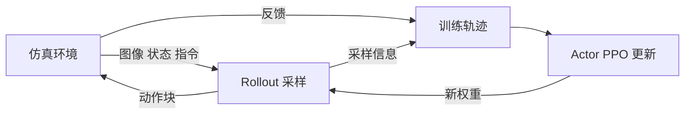

# RLinf VLA 强化学习上手：RoboTwin 与 LIBERO

## 本次问题与建议

> [!note] 后续研究路线已收窄（2026-10-12）
> 用户在RealMan接口接入后选择已有π0.5本体SFT作为主起点。当前建议直接验收RealMan的模型与学习闭环，再做Flow-SDE＋PPO动作专家后训练；下文初次“先LIBERO入门”的建议保留历史语境，不再视为当前研究必须重走的前置步骤。算法、LoRA范围、SFT/训练协议差异与课题验证见 [[π0.5-RealMan强化学习研究路线-算法与训练闭环]]。

用户选择了解 **VLA 强化学习上手（RoboTwin／LIBERO）**。先用官方 π0.5 + PPO 配方熟悉“交互、更新、保存、独立评测”，再迁移现有 RM65-B；第一次实验只选择一个环境。

**优先 LIBERO-Spatial 学训练循环；之后接 RoboTwin `adjust_bottle`。** LIBERO 是单臂 7 维控制，接口更简单；这不代表同模型、同配置的显存或总训练成本必然更低。RoboTwin 更接近当前双臂抓瓶任务，但须处理下述当前版本的权重格式问题。

> [!info] 初次静态核查范围（后续接口接入见文末）
> 2026-10-12 阅读官方文档、GitHub 固定版本源码，以及 Hugging Face 权重文件清单；RoboTwin 权重还读取了小型索引和配置。没有下载完整权重、安装环境、登录服务器、加载模型、运行仿真或训练。下面是静态核对后的操作说明，尚无本项目 RLinf 运行结果。Docker 标签没有实际拉取或验证，也没有核验目标机器资源。

## 1. 框架里谁做什么

RLinf 负责组织 VLA、环境和学习算法的训练循环；机器人仿真仍由 RoboTwin 或 LIBERO 执行。[官方执行流程](https://rlinf.readthedocs.io/en/latest/rst_source/concepts/execution_flow.html)。

| 组件 | 在 VLA 训练中的职责 |
| --- | --- |
| Env | reset 场景、产生图像／状态／语言，执行动作，记录奖励与终止 |
| Rollout | 用当前策略采样动作块，保存策略更新所需的信息 |
| Actor | 用采样轨迹计算优势与损失、反向传播、更新参数 |
| Runner | 安排采样、更新、权重同步、评测及保存 |



SFT 从示范学习动作；这里的在线 PPO 则从策略自己的交互结果学习。π0.5 是 flow 模型，配方使用 `flow_sde` 采样和价值头构成可优化策略。固定版本的 `model/pi0_5.yaml` 默认 `train_expert_only: True`，模型加载后冻结视觉与语言主干，训练动作侧和价值头；不能据“π0.5 + RL”就声称全参数后训练。[模型配置](https://github.com/RLinf/RLinf/blob/fa1579c9edfb4cb1fe8508c2100ec5a8dfe723e3/examples/embodiment/config/model/pi0_5.yaml)、[加载与冻结逻辑](https://github.com/RLinf/RLinf/blob/fa1579c9edfb4cb1fe8508c2100ec5a8dfe723e3/rlinf/models/embodiment/openpi/__init__.py)。

普通推理服务只返回动作，接入它本身不能提供 PPO 所需的训练模型、采样信息和梯度。

## 2. 固定版本与两套配方

下表版本通过官方公开 API 于 2026-10-12 查询，不代表这些组合已经在本机运行通过。

| 对象 | 核查版本 |
| --- | --- |
| RLinf `main` | `fa1579c9edfb4cb1fe8508c2100ec5a8dfe723e3`，提交时间 2026-10-10 UTC |
| RoboTwin `RLinf_support` | `dca9ec682688821c42944eacd7f5dd9bfb15396f`，提交时间 2026-09-22 UTC |
| `RLinf/RLinf-Pi05-LIBERO-SFT` | `45ccfcc4e28634f1576ebf78cab0fbe2fd82432d` |
| `RLinf/RLinf-Pi05-RoboTwin-SFT-adjust_bottle` | `fa8df6ed103db0f5549c122f3a17c00ba6426c98` |

| 项目 | LIBERO-Spatial + π0.5 PPO | RoboTwin adjust_bottle + π0.5 PPO |
| --- | --- | --- |
| 训练配置名 | `libero_spatial_ppo_openpi_pi05` | `robotwin_adjust_bottle_ppo_openpi_pi05` |
| 评测配置名 | `libero_spatial_openpi_pi05_eval` | `robotwin_adjust_bottle_openpi_pi05_eval` |
| 机器人平台变量 | `LIBERO` | `ALOHA` |
| 环境动作维度 | 7 | 14，默认 ALOHA-AgileX 本体 |
| 模型图像输入 | 主视角＋腕视角，默认 2 路 | 头部＋左右腕，3 路 |
| 官方安装包 | `--model openpi --env maniskill_libero` | `--model openpi --env robotwin` |
| 官方 Docker 标签 | `agentic-rlinf0.4-maniskill_libero` | `agentic-rlinf0.4-robotwin` |
| 原配置训练／评测环境数 | 64／500 | 256／128 |
| 原配置 micro／global batch | 128／2048 | 32／2048 |
| 原 GPU placement | actor、env、rollout 共用 `all` | 共用 `0-7`，8 张卡 |

来源：[LIBERO 训练配置](https://github.com/RLinf/RLinf/blob/fa1579c9edfb4cb1fe8508c2100ec5a8dfe723e3/examples/embodiment/config/libero_spatial_ppo_openpi_pi05.yaml)、[RoboTwin 训练配置](https://github.com/RLinf/RLinf/blob/fa1579c9edfb4cb1fe8508c2100ec5a8dfe723e3/examples/embodiment/config/robotwin_adjust_bottle_ppo_openpi_pi05.yaml)。这些是复现配方的默认值，不能作为消费级 GPU 的最小硬件要求。LIBERO 配方还显式设了 `sharding_strategy: no_shard`，不能因为 backend 名为 FSDP 就假设模型已分片。

## 3. 准备代码与环境

以下在独立的空实验目录操作，不切换现有 RoboTwin／RealMan 工程的分支。路径占位符需换成执行机器上的绝对路径；当前 Linux 笔记目录不等于 Windows 或远端部署目录。

```bash
git clone https://github.com/RLinf/RLinf.git
cd RLinf
git checkout fa1579c9edfb4cb1fe8508c2100ec5a8dfe723e3
```

优先选择官方 Docker，以下以 LIBERO 为例；RoboTwin 路线改用上表对应镜像。主机需预先具备正常的 GPU 驱动、Docker 与 NVIDIA Container Toolkit。[官方 π0.5 安装说明](https://rlinf.readthedocs.io/en/latest/rst_source/examples/embodied/pi0.html)。

```bash
docker run -it --rm --gpus all --shm-size 32g --network host \
  -v "$(pwd):/workspace/RLinf" -w /workspace/RLinf \
  rlinf/rlinf:agentic-rlinf0.4-maniskill_libero

# 在容器内执行
source switch_env openpi
```

也可在独立 checkout 中自建虚拟环境，选择一个环境包：

```bash
# LIBERO 路线
bash requirements/install.sh embodied --model openpi --env maniskill_libero
source .venv/bin/activate

# RoboTwin 路线改为：
# bash requirements/install.sh embodied --model openpi --env robotwin
```

国内网络可按官方说明给安装脚本添加 `--use-mirror`。不要把这两条安装路线同时塞进已有共享 Conda 环境。

RoboTwin 路线还需独立的兼容 checkout 和资产：

```bash
git clone --branch RLinf_support https://github.com/RoboTwin-Platform/RoboTwin.git RoboTwin-RLinf
cd RoboTwin-RLinf
git checkout dca9ec682688821c42944eacd7f5dd9bfb15396f
bash script/_download_assets.sh
cd ..
export ROBOTWIN_PATH="$(pwd)/RoboTwin-RLinf"
export ROBOT_PLATFORM=ALOHA
```

将 `env.train.assets_path` 和 `env.eval.assets_path` 都设为 `$ROBOTWIN_PATH` 的实际值，即 **包含 `assets/` 的父目录**。[官方 RoboTwin 安装说明](https://rlinf.readthedocs.io/en/latest/rst_source/examples/embodied/robotwin.html)。不要因为字段名含 assets 就填写 `$ROBOTWIN_PATH/assets`。

## 4. 准备 SFT 权重：两条路线有差异

LIBERO 权重的文件清单包含单文件 `model.safetensors` 和对应 norm stats，可作为当前版本加载格式的起点：

```bash
hf download RLinf/RLinf-Pi05-LIBERO-SFT \
  --revision 45ccfcc4e28634f1576ebf78cab0fbe2fd82432d \
  --local-dir /path/to/models/pi05-libero-sft
```

RoboTwin 官方示例权重先下载到独立源目录：

```bash
hf download RLinf/RLinf-Pi05-RoboTwin-SFT-adjust_bottle \
  --revision fa8df6ed103db0f5549c122f3a17c00ba6426c98 \
  --local-dir /path/to/models/pi05-robotwin-sft-source
```

> [!warning] 2026-10-12 静态发现：当前加载器与 RoboTwin 发布格式不一致
> 固定 RLinf 版本的 `get_model` 只寻找单文件 `model.safetensors` 或 `full_weights.pt`，找不到就直接抛出异常。上述 RoboTwin revision 只发布 3 个 safetensors 分片和索引，未包含这两个单文件入口。因而把原下载目录直接作为 `model_path` 按这段源码会失败。LIBERO revision 已包含单文件，不属于此项分片问题。此结论来自源码和文件清单，尚未实际启动模型。[加载入口](https://github.com/RLinf/RLinf/blob/fa1579c9edfb4cb1fe8508c2100ec5a8dfe723e3/rlinf/models/embodiment/openpi/__init__.py)、[文件解析](https://github.com/RLinf/RLinf/blob/fa1579c9edfb4cb1fe8508c2100ec5a8dfe723e3/rlinf/models/embodiment/openpi/checkpoint.py)、[RoboTwin 发布文件](https://huggingface.co/RLinf/RLinf-Pi05-RoboTwin-SFT-adjust_bottle/tree/fa8df6ed103db0f5549c122f3a17c00ba6426c98)。

可先在**新目录**合并分片，原权重与归一化资产保留。下面是本次编写的格式准备示例，依赖环境中的 `safetensors`；不是官方命令，也没有在完整权重上运行验证。它不转换精度，合并需容纳约 8.53 GB 张量及保存开销，峰值内存还须实际测量。

```bash
python - /path/to/models/pi05-robotwin-sft-source /path/to/models/pi05-robotwin-sft-single <<'PY'
import json, pathlib, shutil, sys
from safetensors import safe_open
from safetensors.torch import save_file

src = pathlib.Path(sys.argv[1]).resolve(strict=True)
dst = pathlib.Path(sys.argv[2]).resolve()
if dst.exists() or src in dst.parents or dst in src.parents:
    raise RuntimeError('Output must be a new directory outside the source tree')
index = json.loads((src / 'model.safetensors.index.json').read_text())
mapping = index['weight_map']
shards = sorted(set(mapping.values()))
tensors = {}
for shard in shards:
    if pathlib.Path(shard).name != shard:
        raise RuntimeError('Unexpected shard path')
    with safe_open(str(src / shard), framework='pt', device='cpu') as f:
        for key in f.keys():
            if key in tensors or mapping.get(key) != shard:
                raise RuntimeError('Duplicate key or index mismatch: ' + key)
            tensors[key] = f.get_tensor(key)
if set(tensors) != set(mapping):
    raise RuntimeError('Incomplete checkpoint')
size = sum(t.numel() * t.element_size() for t in tensors.values())
if size != index['metadata']['total_size']:
    raise RuntimeError('Tensor byte count differs from index')
excluded = set(shards) | {'model.safetensors.index.json'}
shutil.copytree(src, dst, ignore=lambda directory, names: excluded.intersection(names))
save_file(tensors, str(dst / 'model.safetensors'))
print('Prepared', dst, 'keys', len(tensors), 'tensor_bytes', size)
PY
```

该 RoboTwin 索引包含 821 个键，其中主干使用旧 `paligemma_with_expert.*` 布局；当前加载器带有相应的键转换。**合并只解决文件入口**，仍须实际验证键转换、norm stats、模型前向和动作。发布 `config.json` 声明 `action_horizon: 10`，训练 YAML 设置执行 chunk 50，而当前模型工厂从 YAML／训练配置解析 horizon，不读取该 `config.json`；这也需要在预评测中核对，不能仅凭下载成功视为配方一致。

当前仓库另提供 JAX/Orbax → OpenPI 转换入口，见 [转换器 README](https://github.com/RLinf/RLinf/blob/fa1579c9edfb4cb1fe8508c2100ec5a8dfe723e3/rlinf/utils/ckpt_convertor/openpi/README.md)。RM65-B 24 维检查点的模型形状、动作变换与 norm stats 仍需单独匹配；这里没有转换已有检查点。

## 5. 改配置，再评测、训练、重新评测

复制官方 YAML 为自己的实验配置，保留一份官方默认值以便比较。训练配置位于 `examples/embodiment/config/`，评测配置位于 `evaluations/libero/` 或 `evaluations/robotwin/`。

| 要核对的字段 | 用途 |
| --- | --- |
| `actor.model.model_path`、`rollout.model.model_path` | 首轮从同一 SFT 检查点开始；RoboTwin 指向准备后的单文件目录 |
| `cluster.component_placement` | 设置实际可用卡数；`all` 指分配范围内所有卡，不是自动证明显存足够 |
| `env.train.total_num_envs`、`env.eval.total_num_envs` | 调整仿真并行数；调试阶段减少，正式评测另保证覆盖 |
| `actor.micro_batch_size`、`actor.global_batch_size` | 控制更新显存和 batch；global 必须能被 micro × actor 进程数整除 |
| `runner.max_steps`、`save_interval`、`val_check_interval` | 先少量更新、保存和评测，再增加交互预算 |
| `runner.resume_dir` | 继续完整 RLinf 训练状态；区别于只加载模型权重 |
| `runner.ckpt_path`（评测） | 加载本次 RL 产生的 `.pt` 权重，避免误评测原 SFT |

环境并行数还需满足 env 进程数、pipeline stage 和 group size 的整除约束。[配置校验源码](https://github.com/RLinf/RLinf/blob/fa1579c9edfb4cb1fe8508c2100ec5a8dfe723e3/rlinf/config.py)。减少 GPU 时一起调整环境数、batch、offload 和分片方案；不要只把 `0-7` 改为 `0-3` 就宣称能在四卡 3090 上运行。

### LIBERO 路线

先进入 RLinf 根目录及匹配环境；下面省略需提前完成的配置修改。

```bash
export ROBOT_PLATFORM=LIBERO

# 原始 SFT 的独立评测
bash evaluations/run_eval.sh libero libero_spatial_openpi_pi05_eval \
  rollout.model.model_path=/path/to/models/pi05-libero-sft

# 修改训练 YAML 的两个 model_path 和资源配置后启动
bash examples/embodiment/run_embodiment.sh libero_spatial_ppo_openpi_pi05
```

训练后用同一评测配置、同一初始状态和推理参数复测，明确填写实际权重：

```bash
bash evaluations/run_eval.sh libero libero_spatial_openpi_pi05_eval \
  rollout.model.model_path=/path/to/models/pi05-libero-sft \
  runner.ckpt_path=/path/to/logs/experiment/checkpoints/global_step_N/actor/model_state_dict/full_weights.pt
```

### RoboTwin 路线

权重格式、模型 horizon 与动作接口核对后，先运行独立 SFT 评测：

```bash
export ROBOT_PLATFORM=ALOHA
export ROBOTWIN_PATH=/path/to/RoboTwin-RLinf

bash evaluations/run_eval.sh robotwin robotwin_adjust_bottle_openpi_pi05_eval \
  rollout.model.model_path=/path/to/models/pi05-robotwin-sft-single \
  env.eval.assets_path=/path/to/RoboTwin-RLinf

# 修改训练 YAML 的权重、资产路径和资源配置后启动
bash examples/embodiment/run_embodiment.sh robotwin_adjust_bottle_ppo_openpi_pi05
```

RL 后复测同样在对应评测命令中增加 `runner.ckpt_path=/实际保存的/full_weights.pt`。权重文件拼写以实际产物和源码为准；转换文档出现的 `full_weigths.pt` 不应原样套用。[当前权重文件解析](https://github.com/RLinf/RLinf/blob/fa1579c9edfb4cb1fe8508c2100ec5a8dfe723e3/rlinf/models/embodiment/openpi/checkpoint.py)。

> [!tip] 启动脚本参数区别
> 固定版本的 `run_embodiment.sh` 将第二个位置参数解释为机器人平台，不会任意转发后续 Hydra 参数；训练修改优先写入自己的 YAML。`evaluations/run_eval.sh` 则会转发额外配置参数。不要把评测命令的覆写写法直接套到训练脚本。[训练脚本](https://github.com/RLinf/RLinf/blob/fa1579c9edfb4cb1fe8508c2100ec5a8dfe723e3/examples/embodiment/run_embodiment.sh)、[评测脚本](https://github.com/RLinf/RLinf/blob/fa1579c9edfb4cb1fe8508c2100ec5a8dfe723e3/evaluations/run_eval.sh)。

## 6. 怎样判断确实跑通

1. 原始 SFT 在相同协议下完成闭环，保存成功与失败视频；图像、状态、动作和归一化正确。
2. 少量更新确实完成前后向，训练参数存在有限梯度和更新，轨迹中的奖励与视频相符。
3. 检查点能保存、加载并继续训练；新权重同步到 rollout，独立评测实际加载的是新权重。
4. 再在留出的场景／种子上比较 SFT 和 RL，记录成功率、任务指标、交互次数、耗时和显存。一次小样例不能证明稳定改进。

当前训练 runner 记录 `env/success_once`，评测记录 `eval/success_once`。两个启动脚本会把日志位置覆写为 `RLinf/logs/<时间>-<配置名>`，因此按实际日志路径启动 TensorBoard，不盲目套用文档中 `../results` 的示例：[训练 runner](https://github.com/RLinf/RLinf/blob/fa1579c9edfb4cb1fe8508c2100ec5a8dfe723e3/rlinf/runners/embodied_runner.py)。

```bash
tensorboard --logdir /path/to/RLinf/logs --port 6006
```

评测缩减并行数后必须重新核对测试覆盖：LIBERO-Spatial 的默认评测目标为 500 个 task／trial 初始状态；RoboTwin 默认 128 并行环境的一个 epoch 不保证覆盖 `adjust_bottle` 的全部 150 个预筛选种子。固定 reset 重复跑也不一定扩大覆盖。记录实际评测的 ID、分母和覆盖范围。[LIBERO 评测协议](https://rlinf.readthedocs.io/en/latest/rst_source/evaluations/guides/libero.html)、[RoboTwin 评测协议](https://rlinf.readthedocs.io/en/latest/rst_source/evaluations/guides/robotwin.html)。

## 7. 与当前 RM65-B／语言研究的衔接

现有训练笔记记载的是 RM65-B 24 维物理动作、32 维模型 padding、三路 RGB、H16，以及 JAX/Orbax 来源；这些是既有实验记录，本次未重新核验服务器。官方 RLinf RoboTwin 示例则是 ALOHA 14 维、PyTorch 加载路径与不同执行 chunk。迁移至少涉及模型参数转换、数据与观测变换、臂／手动作映射、归一化、horizon 和执行时钟，不能只换路径。参见 [[2026-10-07-π0.5-RM65B-RGB50官方RoboTwin全量微调]]、[[RM65-B接入RoboTwin仿真]]。

当前 RoboTwin 配方继承 `use_custom_reward: True`；包装器根据 `terminations` 构造奖励，再按设置形成相对奖励和 chunk 奖励，并未实现化学规程阶段反馈。[奖励包装器](https://github.com/RLinf/RLinf/blob/fa1579c9edfb4cb1fe8508c2100ec5a8dfe723e3/rlinf/envs/sim/robotwin/robotwin_env.py)。现有 RM65-B 记录还指出原生 `adjust_bottle.check_success` 不检查转直／持续保持，因此若研究这些要求，需要独立定义和校验反馈，不能把 `success_once` 直接当作完整语言任务完成。

如果继续采用“冻结低层技能、学习高层恢复价值”的候选方向，本次 π0.5 PPO 只是 VLA 后训练基线；没有必要为高层小网络问题直接训练整个动作专家。动态规程、过程反馈与信用分配也不会由选用 RLinf 自动获得，这是研究设计判断，尚未实验验证。关联 [[硕士开题建议-中途规程修改下的技能恢复与价值学习]]、[[化学实验室VLA开题-动态规程与语言强化学习]]、[[VLA动作专家适应-条件利用、多解生成与闭环强化学习]]。

LingBot 的公开 RLinf 示例仍为 4B／Qwen2.5-VL 路线，本次重新查阅文档；不据此认定 LingBot-VLA 2.0 已有可直接替换的训练适配。[官方 LingBot 示例](https://rlinf.readthedocs.io/en/latest/rst_source/examples/embodied/lingbotvla.html)。

## 下一步与未核验范围

- [ ] 选择一台执行机器并核验可用 GPU、显存、驱动、容器与资源占用。
- [ ] 先完成 LIBERO π0.5 SFT 独立评测，再以减少环境数与 batch 的配置完成少量 PPO 更新、保存和重载。
- [ ] RoboTwin 路线先完成分片权重准备，核对 horizon、norm stats 和键转换，再进入 SFT 评测。
- [ ] 在官方本体上通过基线后，单独验收 RM65-B 24 维适配与任务奖励。

本次只归档使用说明与静态发现，没有新增 RL 成功率、训练耗时、显存实测、真机验证或部署记录。

关联：[[具身模型训练与仿真实验平台选型]]、[[RoboTwin 2.0框架与默认任务]]、[[RoboTwin与LingBot-VLA默认流程对照]]。

## 本机代码克隆记录（2026-10-12）

按用户要求，将官方 RLinf 仓库克隆到 `/home/admin123/liminghe/vla-benchmark/RLinf`，与现有 `/home/admin123/liminghe/vla-benchmark/RoboTwin` 同级。证据类型为本机克隆后的只读验证，记录文件为 `/tmp/rlinf-clone-verification-20261012.json`（临时文件，未作为长期归档附件）。

| 项目 | 本次验证结果 |
| --- | --- |
| 核查日期 | 2026-10-12 |
| 本机绝对路径 | `/home/admin123/liminghe/vla-benchmark/RLinf` |
| `origin` | `https://github.com/RLinf/RLinf.git` |
| 当前分支 | `main` |
| 当前 commit／远端默认 HEAD | `50f22ad9a7825eeaaf4180dca5300f2fa70758be` |
| 克隆与文件检查 | 完整非浅克隆；工作区干净；Git 对象连接性检查通过；无子模块；`README.md`、`rlinf/`、`examples/embodiment/`、`requirements/install.sh` 存在 |

本次仅克隆代码，没有安装依赖、下载模型权重、运行 RL 训练或修改现有 RoboTwin。新克隆 commit 与前文静态核查的 `fa1579c9edfb4cb1fe8508c2100ec5a8dfe723e3` 不同；前文模型接口与权重格式结论仍仅适用于原固定版本。本次未重新核对新 commit 的接口、权重兼容性或运行能力，代码克隆完成不代表 RLinf 环境或 RM65-B 训练接入已通过。

## RM65-B 环境与π0.5接口代码接入（2026-10-12）

用户授权完成代码适配，保留现有24维／三相机／60ms控制合同和原入口，暂不安装依赖、转换权重或启动训练。先在隔离 worktree 实现和验证，再将审查清单中的24个文件并入现有两个仓库。以下证据是本机源代码、CPU合同测试和单环境原生仿真组件检查；不代表策略闭环或RL训练已通过。

| 代码位置 | 基础版本及本次改动 |
| --- | --- |
| `/home/admin123/liminghe/vla-benchmark/RLinf` | 基础 `50f22ad9a7825eeaaf4180dca5300f2fa70758be`；新增RM backend、π0.5 data config、训练／评测配置、测试和双语说明；改动未提交 |
| `/home/admin123/liminghe/vla-benchmark/RoboTwin` | 基础 `931ce21f4f0e63feab661f349634d5a25bd92681`；`integrations/realman_rm65b_gen4/` 下新增6个文件；原有 tracked 文件未改 |

### 已接入的边界

- **环境**：新增 `RealManVectorEnv(task_config,n_envs,env_seeds)`，提供 reset/get_obs/step/close；每个环境使用独立 spawn 进程和运行目录。RLinf 通过 `env_type: robotwin`、`backend: realman_rm65b_gen4` 选择新包装，原 ALOHA 分支保留。部分reset仅向backend传选中环境的seed。
- **观测与动作**：三路真实仿真RGB8为480×640，顺序为head／left wrist／right wrist；state是实测SDK24。动作顺序为左臂6、左手6、右臂6、右手6；臂为弧度，手为原SDK单位，控制层不裁剪raw输出。输入policy只含图像、实测状态和指令。
- **时钟与资产**：复用原 `ClockedTask24Adapter`；正常目标15×4ms=60ms，终止成功可提前停止，按真实tick报告时间。复用原URDF／meshes／机械参数；低头−0.419仅写入独立runtime派生URDF。原运行入口未改，原vendor URDF哈希保持。
- **π0.5**：独立注册 `pi05_realman_rm65b_gen4`；手输入除1000、输出乘1000；12维臂delta以同一实测state作锚点，手absolute；原24维quantile统计强制存在并校验，内部padding32、预测H16。独立配置物理 `action_dim=24`，首轮执行K1、num_steps10、三图；训练动作expert与value head。
- **奖励与终止**：默认 `success_mode=native` 复用原adjust_bottle的选侧x/z成功条件，**不检查转直或持续保持**。失败给负奖励，预算超时truncation；终止后不继续执行chunk或进入下一episode。可选lift_hold／upright_hold阈值仍需单独验证。无法取得有效终态观测时拒绝采样并要求全批reset。
- **多步chunk**：backend保留真实逐动作reward／终止位置／prefix mask／command trace；RLinf将总reward和done放在末列作为macro决策边界。执行mask尚未被PPO loss消费，首轮保持K1。动作count包含失败尝试；真实运动量以physics tick和trace为准。

默认瓶子采样是新增明确分布，不等同于重建完整Full50数据分布。`scene_spec.initial_pose` 可指定冻结初态，仅在actor创建时设置，不能证明与旧服务器Base_Task逐状态数值一致。

### 本机验证证据

| 检查 | 实际结果及范围 |
| --- | --- |
| 原RLinf目录复测 | **63 passed、3 skipped**：包装36、NumPy policy20、实际跨repo spawn5、Hydra配置2；3项skip因当前缺OpenPI，涉及真实DataConfig／完整quantile+delta+padding往返及ALOHA动态回归 |
| 原RoboTwin目录复测 | **16 passed**：实际spawn、partial reset、预算、早停、失败、trace、SDK不clip、派生URDF原件保持 |
| 原生GPU组件 | 2026-10-12 17:17:25–17:17:48（上海），现有robotwin环境／RTX5090；一环境三RGB和实测SDK24，两stationary targets共30tick=120ms；同seed reset图像和state逐值一致；关闭后进程退出；原URDF未变。**native_success=False，未加载policy** |
| 代码与配置 | Ruff lint/format、差异检查通过；实际Hydra train/eval compose、FSDP／eval model子校验通过，Ray未初始化；原Full50 norm_stats shape通过校验，SHA256 `34cbdd09c831e04549d6c4a4e2eb321fb975bdea13bb816ec8aa3a2332d1ccc5` |
| 文档 | 新增EN/ZH接口段代码名称与来源核对通过；现有环境缺Sphinx/docutils，未安装或执行文档build |

长期证据：[[30-实验记录/证据/2026-10-12-RLinf-RM65B接口接入/代码接入清单.json|24个文件清单与SHA256]]、[[30-实验记录/证据/2026-10-12-RLinf-RM65B接口接入/测试结果.txt|原目录测试输出]]、[[30-实验记录/证据/2026-10-12-RLinf-RM65B接口接入/smoke_result.json|GPU组件报告与执行模块SHA256]]。

### 下一阶段的明确前置条件

新配置位于 `examples/embodiment/config/robotwin_realman_adjust_bottle_ppo_openpi_pi05.yaml` 和 `evaluations/robotwin/robotwin_realman_adjust_bottle_openpi_pi05_eval.yaml`。设置 `REALMAN_ROBOTWIN_ASSET_ROOT` 指向原assets，`REALMAN_PI05_MODEL_PATH` 指向兼容的已转换PyTorch模型目录，`REALMAN_NORM_STATS_PATH` 指向原Full50统计；两个checkout须可被PYTHONPATH导入。当前未创建转换权重；原JAX检查点不能直接填到PyTorch model_path。

本次没有安装依赖、转换／恢复权重、加载策略、启动训练、Git提交或推送。完整OpenPI变换、模型加载与采样等价、SFT闭环、PPO参数更新、显存容量、并行GPU环境长期稳定性、RL提升及真机仍未验收。接口小配置不等于当前单卡已经足够训练。

关联：[[RM65-B接入RoboTwin仿真]]、[[2026-10-07-π0.5-RM65B-RGB50官方RoboTwin全量微调]]。

## 分层验收流程（2026-10-13，方案未执行）

2026-10-13只读复核：24个接入文件的SHA256与2026-10-12归档清单一致；现有isaaclab Python可导入Hydra／Ray／pytest，但仍缺OpenPI。本轮没有重跑79项测试、仿真、模型或训练，历史通过时间保持2026-10-12，`checked`未因方案编辑改变。

| 阶段 | 要执行的检查与通过标准 | 当前边界 |
| --- | --- | --- |
| 1. 接口合同 | 复跑两仓库测试，并启用`ROBOTWIN_REALMAN_TEST_ROOT`，避免跨仓库测试被跳过；检查partial reset、成功／失败／超时、终止停步、异常后拒绝旧观测、关闭进程 | 昨日79项通过、3项OpenPI测试跳过 |
| 2. 实际仿真 | 使用实测SDK24作保持目标，验证三路非空RGB480×640、实测state24、每正常目标15tick／60ms、reset复现、close退出；再扩展小幅单关节目标与B2多次reset，检查左右顺序、实际command trace和资源释放 | 昨日单环境两目标120ms组件通过；多环境GPU长期稳定性未验 |
| 3. 完整模型输入／输出变换 | 在匹配的OpenPI环境运行此前3项跳过测试；检查三相机顺序、手÷1000／×1000、臂delta锚点、quantile统计、24↔32与H16；统计有效范围内验证往返，超界处理按原实现核对 | 当前缺OpenPI；本轮不安装 |
| 4. 推理对齐 | 在权重转换单独完成后，将原JAX π0.5与RLinf送入同一冻结三图／state／指令／统计／10步采样，显式提供同一`[B,16,32]`初始噪声，使用eval ODE，比较完整16步物理24维输出；臂弧度和手SDK分别报告误差，逐层定位差异 | 未转换或加载权重；跨框架只设相同seed不能保证相同噪声。RL SDE噪声0.3不用于此项等价比较 |
| 5. SFT仿真闭环 | 固定`scene_spec.initial_pose`与评测seed，保持K1，在原入口与RLinf入口比较动作、实测轨迹、视频和任务成功；核对camera／控制周期／reset／采样条件，记录误差和失败模式 | 未验。默认native奖励仅检查选侧x/z；转直并保持须独立验收upright_hold阈值 |
| 6. PPO与保存重载 | 在显存允许的小配置完成1–2次更新；保存chain重算更新前logprob并对齐，loss／梯度有限，包含有效奖励和非零advantage，动作expert与value有实际梯度更新，冻结VLM保持；排除仅weight decay导致的权重变化。保存重载后固定输入／噪声输出一致，并检查optimizer／scheduler／step／RNG恢复，再继续更新 | 本次用户只问流程，未授权本轮安装、转换或训练；接口更新通过不代表成功率提升 |

现有无policy仿真验证入口可复用，结果单独写入新runtime目录：

```bash
cd /home/admin123/liminghe/vla-benchmark/RoboTwin
/home/admin123/liminghe/miniconda3/envs/robotwin/bin/python -B \
  -m integrations.realman_rm65b_gen4.rl_smoke \
  --asset-root /home/admin123/liminghe/vla-benchmark/RoboTwin/assets \
  --runtime-dir /tmp/rm65b-verify-20261013 \
  --output /tmp/rm65b-verify-20261013/result.json
```

验收看报告里的`passed`、30个physics tick、`sim_time_s=0.12`、同seed RGB/state重置一致、worker退出和原URDF哈希保持。该脚本使用保持目标，不评测抓瓶成功。前三步先完成接口与数据变换验收，再推进推理对齐、SFT闭环和PPO；RL效果须另用固定留出场景比较训练前后成功率。

## 本机真实PPO计算验收（2026-10-13，新增证据）

前述未安装／未转换／未训练是此前阶段快照。用户本轮明确授权后，[[2026-10-13-RLinf-RM65B-本机5090最小PPO闭环验证]]完成独立依赖、80000转换、SDK24／三RGB／60ms的SFT和PPO实际运行；累计4次optimizer更新，冻结VLM完整哈希一致，动作端／value真实变化，两次保存恢复匹配；更新权重参加后续采样，step3完成配对独立评测。当前bucket方案单卡峰值约29.3GiB，原patch同步曾OOM。

所有448训练动作奖励0；SFT／step3单场景均超时，不能证明任务学习或SR提升，也没有完整JAX／Torch固定噪声动作等价。当前OpenPI配置拒绝额外recompute_logprobs，未绕过守卫；同步验收为6个代表tensor＋版本，非整网传输逐值比较。环境入口[[本机-RLinf-RM65B-5090独立环境]]，主机事实[[本机-Linux-RTX5090]]。
