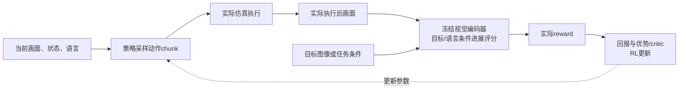

# VLA动作专家适应：条件利用、多解生成与闭环强化学习

> [!important] 已确认开题名称（2026-10-12）
> **面向实验室操作的视觉语言动作模型多模态条件控制与场景适应方法研究。** 用户明确采用此总题目；MICA为前期条件控制研究，场景变化下的多模态条件—动作对齐与RL适应为后续主要研究方向。当前载体为π0.5、RealMan、RoboTwin与RLinf，具体方法及增益尚待验证。材料入口见 [[01-开题材料清单与证据索引]]。

> [!abstract] 用户本次明确的对象
> 优先研究**动作生成专家本身**：如何有效使用上游多模态表示；如何在场景变化后调整生成分布，产生并选择可执行的多种动作轨迹。此前“扶稳、暂存、换技能”的例子偏向调度，不能代替这个问题。本次不把高层任务拆解、语义提示选择或 Harness 状态管理当成所求算法主体。

> [!important] 已确认问题范围，不等于已确认失败机理
> “多模态利用不足”“扰动后的动作分布覆盖不足”是待检验假说。不能由某次闭环失败就断言二者是主要原因；相机与状态输入缺失、坐标/归一化不一致、时延、旧 chunk 执行过长、低层控制误差等也可能导致失败。本次未核查新训练日志或运行新模型。

> [!important] 开题阶段的优先级（2026-10-12用户校准）
> 用户当前要求先确定硕士开题的**基准方向与可靠方法基础**，不要求此时找出新算法。后续讨论优先判断问题是否明确、基线能否实现、方法能否深入和拓展；新颖性审计作为后续工作。CounterAlign/TEMPO 的最新发表状态与理论范围见 [[#11. 硕士开题基准方向：发表状态、理论层次与拓展价值（2026-10-12）]]。

关联：[[硕士开题建议-中途规程修改下的技能恢复与价值学习]]、[[SARL启发的VLA强化学习选题-目标绑定与空间精化]]、[[强化学习优势的数学本质-从序贯决策到具身选题]]、[[LingBot-VLA2与π0、SmolVLA架构比较]]、[[π0.5精读-开放世界泛化与知识隔离]]。

## 1. 将直觉改成可以验证的主张

| 用户提出的直觉 | 本次校准 | 如何判断 |
| --- | --- | --- |
| SFT 只能标准场景，场景变化后不会做 | 有限、较窄的成功示范可能不足以覆盖扰动后状态；SFT 并非数学上不能泛化 | 固定任务，区分未见外观、初始布局和执行中扰动，分别测 SR |
| π0.5 靠 VLM 拆子任务才完成多步 | 原文同一个模型做高低层推理；implicit HL 不在运行时拆解仍有较强表现 | 分开高层训练监督与在线高层调用 |
| 上游信息和动作专家没有对齐 | 现有注意力已能传递条件；未必保留或使用精密控制所需信息 | 分开表征中是否有信息、动作是否对该信息合理响应 |
| 动作专家需要生成多解 | Flow/diffusion 已能表达多峰分布；不同噪声不保证产生不同且成功的路线 | 分开有效模式覆盖、选择准确性与跨 chunk 连贯性 |
| 推理中自我调节等于自己学习 | 更新观测、更新当前输出和更新权重是不同层次 | 明确哪些参数何时更新、需要什么反馈 |

[π0.5 v1 §V-E](https://arxiv.org/html/2504.16054v1)的 implicit HL 使用完整训练混合、运行不做高层推理，是该消融中的第二强配置；说明收益不能全部归于在线子任务拆解。该论文也评估未见家庭，不支持“SFT 完全无场景泛化”。这一核查不等于保证我们的小数据 RM65-B 微调同样泛化。

标准前馈调用若只读当前图像，不自动拥有长期记忆；显式历史、状态估计、循环模块或外部事实存储可以补充它。记忆缺口不能只靠动作 RL 自动消除。

## 2. 问题发生在条件动作分布内部

使用讲解符号：

$$
C_t=E_\phi(I_t,L),\qquad
A_t=G_\theta(C_t,q_t,h_t,\epsilon_t),\qquad
A_t=[a_t,\ldots,a_{t+H-1}].
$$

$I_t$ 是最新图像，$L$ 是不变任务，$q_t$ 是可用机器人状态，$h_t$ 为可选的短期历史，$\epsilon_t$ 为采样噪声，$H$ 为预测块长度。此处是统一问题表达，不是声明每个模型都把状态或历史接在同一位置。只执行其中较短前缀再更新观测，和预测 $H$ 个动作是两个设置。

第一问：$C_t$ 是否包含所需信息，$G_\theta$ 是否利用它？第二问：条件动作分布在受扰状态下是否包含有效解，如何增加有效解概率或改善速度场？高层指令和任务阶段可以固定，直接评价连续动作策略。

## 3. 丰富多模态信息怎样变成动作可用信息

### 3.1 现有连接并不缺失

[Knowledge Insulation v1 §5.2](https://arxiv.org/html/2505.23705v1)明确动作 Query 读取 VLM 的 Key/Value；stop-gradient 隔离反向梯度，不取消前向信息。方法另外用离散动作监督塑造 backbone，说明“能理解图像语言”和“具有动作可用表征”并非同一目标。冻结普通 VLM 与冻结已具备动作知识的 VLA 也不是等价实验。

对机械操作，所需信息包括指定对象身份、目标相对末端位姿、可达接近方向、障碍关系、夹持状态与刚才的执行变化。模型可能识别“这是样品瓶”，却不能稳定提供精确接近所需的信息；也可能信息可被解码，但动作端采用了位置/外观捷径。

### 3.2 可研究的接口及直接近邻

- 动作条件查询或轻量适配器：依据任务与机器人状态读取上游特征，形成 action-facing 表征，而非只扩充 token 数。
- 控制相关辅助目标：相对几何、接触/状态变化或动作后果监督，让表征区分需要不同动作的状态。
- 动作侧有限更新：适配条件读取的注意力投影或动作专家，避免同时全量修改 VLM、记忆、世界模型与控制器。

这些不是新空白。[Action QFormer v1 §III](https://arxiv.org/html/2607.14635v1)已用指令条件查询组织视觉信息并控制动作损失的表征塑形路径；其验证为导航，不是 RM65-B 双臂抓取。[LingBot-VLA 2.0 v1 §4.2](https://arxiv.org/html/2607.06403v1)已有当前/未来查询与几何、时序教师监督。后者的未来是训练目标，不是推理获得真实未来，也不能只凭辅助 loss 证明动作专家充分利用了它。

第一问不天然需要 RL：动作相关监督、接口设计或补充有效数据可能已解决。若用 RL 更新接口，应证明环境反馈改变了条件的有效使用，而非仅用另一个模块绕过原专家。

## 4. 多解生成不是简单多采几次

[Diffusion Policy 官方说明](https://diffusion-policy.cs.columbia.edu/)已有多模态动作分布与模式保持的演示。LingBot FFN 的多个 MoE 专家也不等于多个可行路线。

需要分开四件事：

1. **生成覆盖**：受扰状态下能否生成至少一个正确目标、物理可执行的候选？
2. **评价与选择**：不同候选里，能否选到能完成任务的动作？
3. **分布改进**：能否用成功/失败反馈增加有效模式概率，必要时改变动作映射/速度场？
4. **闭环续接**：相邻块是否一致；条件变化后又能否及时改变已失效的路线？

左右绕行分别可行，不代表逐块随机左右切换可行；平均两条路线也可能穿过中间障碍。不能以动作方差增加代替有效解增多。保持模式不能变成无视最新观测的锁死执行。

### 4.1 直接相关的学习路线

| 工作与固定版本 | 学习/适应位置 | 关键边界 |
| --- | --- | --- |
| [DSRL v2](https://arxiv.org/html/2506.15799v2) | 冻结 diffusion/flow，RL 学初始噪声分布以引导动作模式 | 分布太窄或缺少有效模式时，仅 steering 不保证能创造缺失技能 |
| [Q-VGM v3](https://arxiv.org/html/2606.08015v3) | 冻结 π0.5 VLM，学习 chunk critic；价值改善目标监督晚期去噪速度，更新动作专家 | 已直接覆盖“Q 引导更新 flow-VLA 动作专家”；估计依赖 critic 支持与近终点近似 |
| [QGF v1](https://arxiv.org/html/2606.11087v1) | 分别训练 BC flow 与 critic，推理时做价值梯度引导 | 推理更新输出，不更新 actor 参数；不是已验证的本地大 VLA 方案 |
| [RedFlow v1](https://arxiv.org/html/2607.27782v1) | 成功/失败 buffer 中构建动作纠正目标，再做 flow-VLA 后训练 | 固定离线数据后训练；匹配的成功动作不自动是失败状态的正确反事实 |

这些论文按本次读取的 arXiv 版本记录，不声称已经核验所有正式会议/期刊状态。以上是作者方法，本项目未复现。

## 5. 自我调节的三种不同含义

| 含义 | 部署中做什么 | 是否发生模型学习 |
| --- | --- | --- |
| 闭环重生成 | 用新图像/状态重新生成动作、更新本次前缀 | 参数可完全固定 |
| 推理时优化 | critic 选候选或引导当前采样 | actor 参数可固定，但 critic 可能先经过 RL 学习 |
| 在线/持续 RL | 收集新的执行反馈，随后更新参数 | 更新接口、噪声策略、critic 或动作专家 |

首版可以在仿真回合间更新参数，部署时固定参数闭环执行；这仍可研究动作专家学习，但不称每个控制周期在线自学习。学习需要奖励、有效探索与反馈，不会因为遇到陌生场景自动获得正确动作。

## 6. “chunk 不干净”应拆成哪些可测问题

| 表现 | 可能来源 | 指标/检查 |
| --- | --- | --- |
| 目标已移动，仍追旧位置 | 新观测未被读取、前缀缓存陈旧、条件利用不足 | 观测时间、缓存刷新、目标相对动作响应 |
| 单块内抖动、异常夹爪时序或碰撞 | 动作分布、映射、归一化、控制或训练问题 | 单位/维度核查、速度加速度、接触与夹持时序 |
| 块与块之间突然变向 | 模式反复切换、时延或接续失配 | 执行前缀衔接误差、模式切换次数 |
| 目标正确但抓取仍失败 | 几何精度、可达性、接触动力学或传感信息不足 | 正确对象率与操作成功率分开 |

[A2C2 v1 §3](https://arxiv.org/html/2509.23224v1)冻结基座，用最新观测纠正旧 chunk，采用示范 MSE 训练，不需要策略 RL。这是必须承认的非 RL 近邻：旧动作失效并不自动证明多模态不对齐。

## 7. 最小诊断与候选主线

### 7.1 固定任务，先查瓶颈

任务可用“把指定封闭样品瓶放到指定托盘”，不更改语言、不拆子任务。执行中在可恢复阶段移动目标或改变一个局部障碍；保持可达范围，避免一次实验同时加入新本体、风场、液体与自由指令修改。首次只选一种扰动。

- **条件干预**：固定噪声、机器人状态与任务，分别改变目标位置、障碍关系和无关背景。新 prefix 下动作是否合理响应任务相关变化、忽略无关变化？注意力图不能独立证明因果使用；表征 probe 的可解码性也不是充分证明。
- **候选上限**：在同一仿真状态分叉，分别完整执行 $K$ 个候选首块及后续闭环，测 best-of-$K$ 诊断上限与实际单次选择。oracle 只诊断，不是部署策略。候选均失败不证明整个数学支持集没有解，只说明当前有限预算未发现有效模式。
- **时效对照**：使用最新观测，比较短执行前缀与原执行长度，必要时加 A2C2 类监督纠正。推理延迟、观察频率和计算预算必须记录。
- **模式续接**：记录路线切换、动作连续性及真正完成 SR；不能只报告候选间差异。

best-of-$K$ 高、实际选择差，更适合先研究评估/噪声 steering；有限采样几乎全失败，则仅重排不足，需检验补充数据/探索、条件适配或动作速度场更新。

### 7.2 与两个问题同时相关的候选实现

冻结 VLM 与大部分基座，采用已有前缀连接；先尝试小型条件适配器或动作侧 LoRA，再使用共同的 chunk critic 和扰动后的交互数据学习。critic 评价同一任务、当前场景下动作及后续闭环后果，动作侧更新改变条件映射或 flow 速度场；不增加高层规划模型。

奖励依真实任务完成与动作代价设计；监督动作轨迹不是唯一改进信号。仿真奖励可使用真值对象身份和状态，但不能把这些信息暗中只提供给 RL actor；对照共享训练/观测权限。保持成功模式的参考/SFT 正则可作为候选，不保证防止模式坍缩。

“接口＋critic＋RL”组合还不是新算法。可能继续查的问题是：**局部场景改变时，怎样让动作分布对相关改变及时响应，同时保留未受影响的有效动作条件与连贯性？** 这只是候选，Q-VGM、Action QFormer、DSRL 与实时 chunk 方法都很接近；还需进一步查局部 flow 编辑、条件控制与模式保持，不能宣称创新已成立。

### 7.3 最低限度公平比较

固定数据/rollout、奖励、观测与算力预算，对比：原 SFT＋最新观测短前缀、同数据扩充 SFT/纠正训练、条件接口的纯监督版本、DSRL 类 steering 或普通动作专家 RL。若开发新方法，还需和 Q-VGM 等直接动作层学习路线作适配后的同条件比较。

报告完整 SR、目标遵循、扰动后响应时间、候选成功覆盖、选择准确性、动作连续性与推理延迟。模块消融区分“只加接口”“只做 RL”“两者联合”，避免把新增数据、更短开环或更多候选计算错归为新更新机制。

## 8. 本次结论与范围

本轮将研究对象校准为**面向场景扰动的动作专家条件利用与闭环学习**；用户优先提出两个问题，不等于已经选择某个算法或确定论文题目。第一问未必需要 RL，第二问在正确动作难标注、执行结果可评价时更有 RL 动机；RL 不保证任意分布外泛化或自动长程记忆。

2026-10-11：完成一手论文/官方项目说明核查、概念区分与诊断设计。未重新核查当前服务器或本地源码版本，未训练、修改模型/机器人配置或执行闭环实验。相关旧笔记的代码 commit 仍只对应当时静态核查范围。

## 9. 指令、当前物理场景与动作后果的联合联系（2026-10-11增补）

> [!abstract] 用户进一步明确的对齐对象
> 不只让语义子任务诱发动作，而是学习**指令指代的对象/关系、当前可观测物理状态和动作实际后果之间的联系**。动作专家应对相关的场景变化合理响应，对无关变化保持稳定。这里的“物理世界信息”不是完整世界真值；遮挡、摩擦等可能需要历史或额外反馈才能判断。

### 9.1 问题有研究证据，但不是所有失败的唯一解释

[Encoded but Not in Control v1，2026-10-05](https://arxiv.org/html/2610.06235v1)在其 π0.5/GR00T 实验中报告：目标可从表示中解码，但修改指令后仍可能选择场景中惯常目标。它支持“信息被编码但没有有效控制动作”的问题类别；probe/注意力分析不能替代本机因果验证。

Flow 调制、小型 actor 和多模态对齐不是互斥类别。前者描述策略如何参数化/更新，后者描述学习需要建立的条件依赖。只要可训练接口改变动作分布，它也是 actor 的一部分；不能仅凭“不叫 actor”构成新算法。

### 9.2 用实际物理后果定义对齐

固定任务：“把蓝标签样品瓶放到指定托盘”。希望获得的行为关系包括：

| 干预 | 物理事实与要求如何变化 | 希望动作端怎样响应 |
| --- | --- | --- |
| 同一画面，将有效目标改为红标签瓶 | 场景不变，要求改变 | 依据红瓶当前位置生成动作；不靠场景惯常目标 |
| 指令不变，移动蓝瓶 | 身份/要求不变，相对几何改变 | 更新接近、腕部姿态和夹持时序 |
| 指令不变，改变接近空间 | 目标不变，可行接近方式改变 | 生成适合当前通路的动作模式 |
| 只改变无关背景 | 相关物理状态与要求不变 | 不产生无意义的目标或路线漂移 |

这些是解释性测试设计，不是已测结果。要求的是**有任务意义的响应**，不是强制所有几何变化都造成动作向量差异；对称物体、仍有效的共用接近前缀可能无需变化。

同一个实际动作把蓝瓶移走，物理后果不随指令改写而改变；换成红瓶要求后，其任务价值可能改变。早期共用动作也可能同时服务多个目标，不能把所有换指令样本硬判成负例。对齐应允许多条动作产生同样有效的结果，而非要求唯一示范轨迹。

### 9.3 一个可实现的基础配方

**先利用真实执行转移建立联系，再让价值反馈更新动作条件读取接口。** 这是基线配方，不是已成立的创新。

令 $x_t$ 表示最新可用观察、状态、短历史与原指令，$H_t$ 为已有多模态特征，$C_\psi$ 为动作条件读取接口：

$$
z_t=C_\psi(H_t,q_t,h_t),\qquad A_t=G_\theta(z_t,q_t,\epsilon_t).
$$

首版冻结 VLM 与大部分基座，只训练现有条件注意力的小型适配器；若有限采样找不到有效动作，再检验开放动作专家少量参数或补充纠正数据。冻结生成器不保证接口能够创造其无法表达的技能。

可加一个**只在训练存在**的小型动作后果头：

$$
p_\omega(y_{t+m}\mid z_t,U_t),\qquad U_t=A_t[:m].
$$

$U_t$ 是实际执行的前缀，$y$ 可选为目标相对末端位置、实际被握持对象、物体位移或接触状态。标签先来自仿真真实转移，并与基线共享；不把不可观测真值直接送入 actor。后果头是辅助监督，不是 RL，也不宣称解决完整物理建模；无法辨识的后果应保留不确定性。

同时学习依据实际任务完成和执行代价的 $Q_\eta(x_t,U_t)$。它回答“这个动作在当前场景和要求下，经过后续闭环是否有用”，不是“像不像示范”。要求、完成判据和反馈来源固定，不能用模型对自己生成文字的认可充当真实物理成功。

实际执行 $m$ 步后，TD 目标为：

$$
y_Q=\sum_{j=0}^{m-1}\gamma^j r_{t+j}
+\gamma^m(1-d_{t+m})V_{\mathrm{target}}(x_{t+m}).
$$

不能只执行 $m$ 步，却用整个预测长度 $H$ 的虚构后果/回报训练。未执行的候选必须真实分叉执行或由明确标注的模型近似评价；不能替换动作后沿用旧 next observation。

### 9.4 让 RL 更新条件的使用，而非表征分数

一个标准的可微 actor 目标为 $J_Q=\mathbb E_\epsilon[Q_\eta(x_t,U_t)]$。仅看接口参数，其路径是：

$$
\nabla_\psi J_Q=
\mathbb E_\epsilon\!\left[
\left(\frac{\partial z_t}{\partial\psi}\right)^\top
\left(\frac{\partial U_t}{\partial z_t}\right)^\top
\nabla_{U_t}Q_\eta(x_t,U_t)
\right].
$$

也就是：执行价值通过动作生成，反馈到接口该读取哪些条件。它是标准 actor/reparameterization 梯度，不是新的 RL 定理；穿过多步 flow 可能成本高，也可将可靠的价值改善转成动作/速度监督目标，需比较已有 Q-VGM 等方法。

**critic 的观测支路应独立于 actor 可任意修改的 $z_t$**，或者在 actor 更新中阻断该支路。否则 $Q(z_\psi,U_\psi)$ 的直接状态梯度可能只是把表征移到 critic 喜欢的区域，动作并未改善。独立观察支路能避免这条直接捷径，不能消除动作侧利用 critic 误差；仍需参考行为约束、保守估计与真实 rollout 检查。

辅助后果监督让接口保留动作相关因素；RL 决定这些因素在当前要求下怎样影响长期效用。若仅监督已足够，则第一部分并不需要 RL。更高信息量不自动更好，压缩也不自动保留所有必要信息。

### 9.5 近邻已经覆盖哪些机制

| 固定论文版本 | 已覆盖的机制 | 本次必须保留的边界 |
| --- | --- | --- |
| [CounterAlign v1](https://arxiv.org/html/2608.21740v1) | observation–instruction–action 判别奖励、指令/动作重标注、nnPU、IQL 与优势加权 flow matching | 已直接超出“只选语义子任务”；离线 tuple 匹配不是实际执行所有替代动作 |
| [TEMPO v1](https://arxiv.org/html/2608.07314v1) | 冻结 VLM，两个 TD3 回路更新融合 projection 与 action expert | “RL 同时更新 bridge/expert”本身不是新空白 |
| [LARA v1](https://arxiv.org/html/2606.07100v1) | 动作专家隐状态对齐当前/未来图像学习的 latent action，联合后训练 | 已有视觉变化与动作表征对齐；不使用 RL |
| [AGRA v1](https://arxiv.org/html/2606.12217v1) | token 干预诊断 world/action 接口，将视频特征对齐 DINOv2 | 已有行动相关表示诊断；不是 reward/value 学习 |
| [SA-VLA v1](https://arxiv.org/html/2602.00743v1) | 视觉 token 融合 VGGT 空间 token，几何反馈与空间条件探索 | 空间表征＋RL 已有直接近邻 |
| [Inverse-dynamics state-aliasing v1](https://arxiv.org/html/2605.29577v1) | 当前/未来观测预测动作的辅助学习，测试去掉辅助头 | 等数据、低工程量的非 RL 对照，不可忽略 |

CounterAlign §3.3 明确：替换动作后缺少对应下一观察，因此 critic 数据不直接采用这类伪转移；它的重标注样本不全是负例。以上为作者方法核查，发表状态按预印本固定版本记录，未复现性能。

### 9.6 怎样区分真正的对齐收益

训练时打破固定“场景→惯常对象”的捷径：同场景包含多个目标要求，同一目标覆盖多种布局。加入真实受扰成功与失败转移。场景分叉要实际运行动作；只改指令评价同一个物理转移时，也应重算对应 reward/done，不伪造物理结果。

至少留出目标身份×布局组合，测目标选择、相关几何干预后的正确响应、背景干预稳定性、可行候选覆盖、实际续接 SR 与时延。注意力、probe 或辅助预测 loss 可作诊断，不能替代行为验证。

同数据比较：原 SFT＋新观察短前缀、动作后果辅助的纯监督版本、相同接口普通 RL、CounterAlign/TEMPO 等兼容近邻。若收益来自更多 rollout、几何标签或采样计算，不能归为新的对齐机制。

可能继续研究的问题是：**怎样用受控指令×场景干预和真实动作后果，纠正条件捷径，并让有限交互反馈有效更新动作端的信息使用？** 配对、辅助动力学、排序和 actor 梯度均有先例；当前仅确定候选问题与基础配方，没有确认算法创新或 RL 必要性。

2026-10-11：新增固定论文版本核查与机制审计；未训练、运行仿真、修改代码或操作真机。

## 10. CounterAlign与TEMPO的方法补充核查（2026-10-12）

按用户指定 CounterAlign v1 与此前 TEMPO v1 阅读方法和附录。二者核心方法已列于第9.5节；本次补充容易误读的训练范围和成本，不改变旧实验记录。

### 10.1 CounterAlign：主方法训练范围与资源

[CounterAlign 附录3、6、7](https://arxiv.org/html/2608.21740v1)：主方法 actor 只用原专家样本，critic 加近正例指令重标注；并非把所有错配样本都拿来训练 actor。策略沿用 π0.5 架构、全参数训练；作者报告训练参数由约3.4B增至约12.7B，默认使用8张H200。增加部分来自辅助网络，不是部署策略变成12.7B。

### 10.2 TEMPO：更新比与终止边界

[TEMPO §III–IV](https://arxiv.org/html/2608.07314v1)：5:1为动作专家与投影层的有效参数更新比，非执行/观察频率。当前指令终止即停止bootstrap，五指令链评测不等于跨指令价值备份。作者报告CALVIN SR5：FLOWER-RL 78.4%、TEMPO 81.7%；非本项目复现。

### 10.3 基础算法入口与阅读判断

- [IQL 原论文](https://arxiv.org/abs/2110.06169)：用数据内动作拟合价值，以优势加权提取策略；CounterAlign采用flow matching形式的加权动作学习。
- [TD3 原论文](https://arxiv.org/abs/1802.09477)：双critic较小估计和延迟策略更新用于减轻误差；TEMPO另加入模块间更新频率分工。

对本课题的判断：CounterAlign可作为条件一致性奖励的参考，TEMPO可作为接口/动作专家学习的参考。没有新增动力学模型、额外模块或名称就自动产生创新的结论；第9.3–9.6节的候选仍未实现。

2026-10-12：方法/附录静态核查；未下载代码、训练或部署，未核验正式会议录用。

## 11. 硕士开题基准方向：发表状态、理论层次与拓展价值（2026-10-12）

### 11.1 发表状态：修正“未核验”，不混淆录用与论文集出版

| 论文 | 本次可以确认的状态 | 一手证据 |
| --- | --- | --- |
| CounterAlign，2608.21740 | **作者官方宣布 CoRL 2026 录用**；公开核查全文仍为 arXiv v1，本次未核实正式 proceedings 条目 | [Asako Kanezaki个人主页](https://kanezaki.github.io/)国际会议列表；[实验室新闻](https://kanezaki.github.io/aklab/index-eng.html)2026年9月公告 |
| TEMPO: Semantic-Action Decoupled RL Post-Training，2608.07314 | **目前仅确认 arXiv v1 预印本**；未查到可确认的会议/期刊录用记录 | [arXiv元数据](https://arxiv.org/abs/2608.07314)，2026-08-07，Ziheng Liu、Quantao Yang |

OpenReview/PMLR精确标题检索未命中正式记录，不证明没有录用。两篇项目站本次读取失败，也不证明没有代码。网上同名 TEMPO 不自动对应本文；FLOWER 基座的 [CoRL 2025论文集](https://proceedings.mlr.press/v305/reuss25a.html)也不能替代TEMPO自身发表记录。此前“未核验正式录用”是当时的核查边界，不是声称CounterAlign未录用。

### 11.2 CounterAlign：目标有推导，整个系统无严格保证

[附录5](https://arxiv.org/html/2608.21740v1)在给定优势 $A$、行为策略 $\mu$、固定上下文分布与平均KL约束下，引用AWR结果：

$$
\pi^*(a\mid o,L)\propto\mu(a\mid o,L)\exp(\beta A(o,L,a)).
$$

再用重要性采样导出优势加权flow matching；实际省略上下文归一化 $Z(o,L)$，保留同一上下文内偏好但改变跨上下文权重。它支撑策略提取目标的合理性，不是有限数据/神经网络/学习奖励交替更新后的收敛、真实SR单调改善或OOD泛化定理。启发式重标注没有真负例保证。

[nnPU 原论文](https://papers.nips.cc/paper/2017/file/7cce53cf90577442771720a370c3c723-Paper.pdf)提供统计风险分析，但依赖正类先验、采样分布等假设；启发式筛选后的重标注数据不自动符合这些条件。[IQL](https://arxiv.org/abs/2110.06169)的理想数据支持内价值/策略改进分析，也不能自动保证估计奖励与有限网络的完整VLA训练过程。

**分析判断**：CounterAlign适合作为“从有限示范提取任务条件监督、学习奖励并改进策略”的方向参考。可深入奖励可信度、错配歧义与受扰动作覆盖；它不是完整物理建模方法。学习目标的解释性较强，但训练栈与资源较重（见第10.1节）。

### 11.3 TEMPO：清楚的经验优化机制，不是已证明的双时间尺度算法

[TEMPO v1](https://arxiv.org/html/2608.07314v1)给出两个TD3回路的目标与频率消融，未提供收敛或语义漂移界。动作专家更新会改变条件潜变量的执行后果；投影更新又会改变replay表征。论文未证明潜变量Markov充分性，也未消除这种非平稳性。

[双时间尺度随机逼近原文](https://arxiv.org/html/2412.19872v1)的典型渐近条件包含慢/快步长比趋于零、Robbins–Monro条件、噪声假设与稳定性；固定5:1频率不自动满足这些条件。因此“采用双时间尺度思想”不能替代“证明整个方法收敛”。已有TD3基础有助解释误差缓解，不赋予新耦合系统额外保证。

**分析判断**：TEMPO适合作为“条件接口与动作专家怎样协调适应”的结构参考，能建立投影-only、专家-only、joint、dual-loop对照；理论证据弱于其经验动机。可拓展潜变量漂移、更新协调与模块归因，但目前未核验完整可运行训练代码/配置，不承诺直接移植至LingBot或本机复现。

### 11.4 开题方向建议：先建立可靠起点，再逐步深入

候选基准方向：**面向场景变化的VLA多模态条件—动作对齐与强化学习适应**。先固定操作目标与一个可运行基座，检验对象/空间变化时动作是否正确响应。

建议以CounterAlign的问题定义和条件奖励思路为主要文献参考，以成熟的目标条件价值学习/策略改进为算法基础；TEMPO作为接口与动作专家协调更新的结构参考。可以先做轻量、可运行的简化基线，明确它不是完整复现作者训练栈。当前不要求先找到新算法，也不把同时复现两篇作为开题前提。

方向、具体论文训练配方与工程代码基线分别选择。基准论文未证明完整系统收敛，并不使其不能用于硕士研究；但应明示所依赖的假设和未证明范围，不能以正式录用代替技术评估。本节为选题判断，无新训练或机器人实验。

## 12. MICA-VLA与硕士开题的研究主线衔接（2026-10-12）

> [!note] 本节为原稿收到前的历史建议
> 用户随后提供MICA全文；现已核查原稿的方法、LACE实验室操作和主表结果。更新结论见第13节。此前“全文尚待核查”保留为首次讨论的证据边界，不代表当前仍未读原稿。

用户询问此前已投稿的 MICA-VLA 能否纳入当前硕士开题。进展与证据边界见 [[MICA-VLA论文进展]]：本次未找到投稿全文，具体方法和实验范围尚待原稿核对。下面只提出研究组织建议，不改变第11.4节和属性中用户暂定的方向。

### 12.1 共同问题与递进关系

以“任务条件如何实际控制动作”为共同问题，比把旧架构直接接上 RL 更自然。按此前语言约束讨论，如果 MICA 的实际贡献属于语言要求到行为的控制，可承担前期研究章；新研究关注视觉场景变化后，动作端是否使用相关的目标、空间和本体条件，以及执行反馈怎样改善动作生成。

这一递进不等于 MICA 已经完成一般语义—动作对齐，也不等于新研究必须复用 MICA 网络。已有方法与后续方法可以独立，只要问题定义、适用范围和实验结论形成清楚联系。

若希望两项工作都成为学位论文主体，建议讨论总题目“**面向语言约束与场景变化的视觉语言动作模型控制方法研究**”；现有暂定方向作为后续主要研究内容。若总题目仍严格限定场景变化与 RL，而 MICA 并未研究二者，可以把它放前期基础，避免靠改写名称制造关联。具体归属以原稿及学校要求为准。

### 12.2 拟研究章节与共同评测

建议先定义语言条件满足与场景适应，再按原稿呈现 MICA 前期方法，接着呈现后续多模态条件利用与 RL 适应方法，最后做可比范围内的综合实验。方法章数量和名称尚未确定，不因“已投稿”自动视作可直接占一整章。

可从2–3个短程操作任务建立共同评测，交叉改变语言要求与物体布局，形成标准条件、仅语言差异、仅布局变化、两者共同变化四类设置。先明确正确目标/约束满足、受扰成功率和执行精度，新增训练数据、rollout、模型和推理预算分别记录。它们是拟议实验条件，不是 MICA 原稿已报告的实验。

化学实验室可作为共同应用叙事，例如指定容器在不同位置时仍满足放置要求；已有 MICA 实验保留原场景，不改称已经验证实验室操作。具体任务与指标要等原稿核对后再选。

若只组织为两个相关方法章，可以保留各自实际协议，准确说明可比边界。若声称后续方法优于 MICA，需做统一协议比较；若声称两者组合更好，需实际组合与消融。RL 的优势仍应通过等数据监督/适当规划对照检验，纳入前期论文不会自动构成新算法创新。

2026-10-12：用户需求与当前笔记的研究结构分析；未核查 MICA 投稿全文，未训练或运行新实验。待用户提供稿件所在路径后补充具体方法、章节位置和新旧创新边界。

## 13. MICA原稿核查后的章节定位与研究递进（2026-10-12）

### 13.1 原稿确认了哪些内容

来源：用户提供的 [[MICA_VLA_ICRA2027_anonymous.pdf]]，8页；本次核查全文、方法公式与表I–III，未审计代码、原始日志或独立复现。详细记录见 [[MICA-VLA精读与硕士开题衔接]]。

PSM在输入侧以原生token embedding检索冻结训练指令锚，双门限不接受时保留原指令；SCE在动作侧读取经过当前图像上下文化的语言特征，先根据环境更新动作表示，再用语义cross-attention和FFN调制，重复8个独立模块周期。SCE使用flow matching学习，PSM无新增可训练参数；原稿没有RL或在线参数学习。

稿件已做SO-100的17个LACE实验室器皿操作任务，含目标选择、角色互换与避让，并做LIBERO-Para评测。表I报告未见措辞平均SR从42.1%到76.7%；表II报告Mirror从14.0%到86.0%。这些是稿件报告，不是本次机器人实测，也不是RM65-B结果。

因此，MICA具备作为独立方法章的内容，原来的条件性判断现在有方法与实验依据。“只有纯语言，后续才开始多模态”和“实验室验证尚未知”都需修正；但没有由此确认动态扰动恢复、完整化学流程、多步骤记忆、RL适应或严格控制稳定性。

### 13.2 同一总问题下的两项研究

共同问题：**任务要求与当前执行条件怎样共同影响动作，让机器人完成操作并符合要求？**

| 研究轴 | 变化因素 | 科学问题与证据 |
| --- | --- | --- |
| MICA已有研究 | 已知任务的措辞或同场景对象角色要求 | 输入参考选择与动作侧条件读取能否改善行为；证据为原稿LACE/LIBERO-Para |
| 后续拟研究 | 有效任务要求固定，目标/障碍布局或执行状态变化 | 执行反馈如何改善条件使用与动作生成；需要新的受扰实验、监督与普通RL对照 |

从“结构上提供条件读取路径”推进到“用动作后果检验并改善条件使用”，比再增加一次语言attention更能说明研究递进；但这只是问题组织，具体创新仍需近邻比较和受控实验确定。SCE已有多模态条件，不应假称多模态本身是新空白。

### 13.3 推荐章节与总题目

推荐讨论总题目：**面向实验室操作的视觉语言动作模型多模态条件控制与场景适应方法研究**。如果强调对齐，可讨论“面向实验室操作的视觉语言动作模型条件对齐与执行适应方法研究”，但需要定义可检验的条件—行为关系。

- 研究章一：基于指令锚记忆与语义路由的VLA条件控制，保留MICA真实方法和表I–III。
- 研究章二：场景变化下的多模态条件利用与强化学习动作适应，围绕用户当前暂定方向展开。
- 综合实验：以少量共同任务区分语言要求变化、物理条件变化及二者交叉。

这是总题目与章节建议，未自动修改本笔记的`proposal_direction`。不要求后续沿用PSM/SCE架构；如果换基座，两个方法章保持各自实际协议，不把跨基座差异全部归为新算法。正式学位成果要求与个人贡献需另据学校及原始材料核定。

### 13.4 最少需要补的衔接证据

复用角色/避让任务定义，在2–3个短任务上固定指令改变目标与障碍布局；同时保留一组语言差异作为共同评测。先做初态布局变化，再单列执行中目标位移，避免把两者合并为动态恢复。

同预算比较原SFT、受扰数据SFT、普通RL与拟方法。指标包括目标/避让条件满足、全轨迹碰撞、任务SR、终态精度和恢复时长；MICA原稿CV只统计已完成且违约的trial，不能直接等同全轨迹碰撞率。RL优势仍需通过数据与交互成本对照证明。

若声称两个方法直接组合更好，需组合版本及消融；仅作为两个相关研究章则不强制组合。SO-100旧稿结果不自动迁移到RM65-B，机器人本体变化应作为新的适配与实验边界。

2026-10-12：新增用户投稿稿件的一手阅读证据与开题组织分析；原稿报告值未独立复现，后续算法与场景适应实验未实现。

## 14. 当前π0.5与RealMan资源下的RL主路线（2026-10-12）

用户现选择现有π0.5 SFT、RealMan双臂灵巧手、RoboTwin2与RLinf作为后续研究载体，确认50episode SFT已有一定SR。具体算法与学习闭环记录于 [[π0.5-RealMan强化学习研究路线-算法与训练闭环]]；本节不修改此前暂定题目的属性，也不把接口接入写成RL学习已通过。

本次直接读取本地RLinf `50f22ad9a7825eeaaf4180dca5300f2fa70758be`加未提交RealMan适配，并复核一手算法文献。**首选Flow-SDE＋PPO，冻结VLM，更新动作专家、动作侧投影与value head，先不加LoRA。** 当前实现的PPO利用保存的随机去噪转移概率，不是把flow监督MSE当动作似然。它为“动作专家是否有效使用条件”提供直接可更新的载体。

LoRA是更新参数化，不是与PPO并列的算法；当前通用开关没有专家专属范围，需实际验target、梯度及优化器后才能用。Residual SAC/TD3更适合作为动作修正对照；DSRL学习初始噪声策略、冻结VLA，可作低更新成本的行为选择对照；GRPO在首轮不优先。选择依据是已有代码和研究对象，不是PPO必然更强的结论。

当前最重要的工程门槛是JAX权重转换、真实模型与变换、RLinf内SFT闭环、任务reward验收、一次真实PPO更新/同步/重载。已通过的接口组件不能替代这些门槛。旧JAX演示K16、约24s持续执行；RLinf小配置K1、约12s与native早停。先统一协议测SFT再测RL，避免执行反馈频率、时限与判据差异混入增益。

先做单瓶小位姿变化的抓起、转直、保持任务；它检验几何与执行适应，不能充分检验语言视觉对齐。随后增加两个候选对象与有效指令，建立“同布局换要求、同要求换布局”测试，训练反馈与成功判据都须对应实际目标。最后再新增执行中扰动事件；当前wrapper没有现成动态扰动接口。

以等预算受扰数据SFT、普通PPO与拟方法比较条件响应、目标满足、全轨迹碰撞、SR与精度。普通PPO跑通是研究基线，具体算法创新与RL必要性仍需证据。训练中的持续采样更新与部署时固定参数的闭环决策分开记录。

2026-10-12：本地源码/配置与一手文献核查、用户路线选择归档；未安装、转换、训练、远端资源占用核验或真机操作。

## 15. 回到VLA＋RL创新点：先定位动作学习的具体故障（2026-10-13）

> [!important] 用户本轮要求与结论状态
> 用户要求继续寻找VLA＋RL创新点。研究对象回到π0.5动作专家的条件利用、执行适应与参数学习。下面是近邻排重和可证伪的研究建议，不是用户确认的新方法，也未证明算法新颖性；已确认的开题总题目保留。Harness候选见 [[Harness-VLA与高层RL-非完美技能组合与扰动恢复]]。

### 15.1 新查到的直接近邻：修正此前候选的新颖性预期

| 原先可能的泛提法 | 本次固定原文已覆盖的内容 | 证据与边界 |
| --- | --- | --- |
| 相关视觉变化应引起动作变化，无关变化应不变 | **PAIR-VLA**在PPO中加入配对动作分布的不变性与敏感性目标，也评测π0.5 | [2605.13105v1 §4](https://arxiv.org/html/2605.13105v1)。敏感性项最大化截断KL；不能再将泛配对敏感性说成新空白 |
| RL保留多条有效动作路线 | **Uni-TMPO**用回报诱导的组内目标分布和forward KL匹配轨迹概率 | [2609.34688v1 §IV–V](https://arxiv.org/html/2609.34688v1)。其VLA反馈采样是执行前缀后刷新观察，不等于独立的执行误差输入 |
| 按物理进度给每个chunk信用 | **PRICE**用跨轨迹物理关系图、终局结果池和置信门控构造chunk信用 | [2609.38890v1 §4](https://arxiv.org/html/2609.38890v1)。不是普通PPO均把整段失败归给所有动作；PPO已有TD/GAE局部信用 |
| 最新视觉反馈纠正尚未执行的动作 | **VLA-Feedback**把最终去噪步作为高频视觉反馈接口 | [2609.21022v1 §III及训练附录](https://arxiv.org/html/2609.21022v1)，监督式反馈训练；A2C2也是重要非RL对照 |
| 校准critic并用LoRA提高化学操作精度 | **VLA-Precision**已有干预纠正、局部偏好排序、相对优势与动作专家LoRA | [2609.04355v1 §III](https://arxiv.org/html/2609.04355v1)，作者报告化学任务真机结果，未独立复现。未执行的原提议不用于伪造TD转移 |

本轮确认的是固定arXiv版本的方法，未逐篇核验会议/期刊录用或开源代码。既有CounterAlign、TEMPO、πRL和Q-VGM也限制了“加奖励、调bridge、调flow、加LoRA”这类泛创新表述。

### 15.2 两项仍值得诊断的具体问题

**候选A：动作专家能否有效利用自己刚才的执行后果？**

固定任务和执行频率，让策略读取最近观察、本体状态、实际已执行前缀及其后续变化，研究滑移、空抓或动作实现偏差后的连续动作调整。简短反馈投影＋现有Flow-SDE/PPO是低工程量的基线配方。只有前后差分时称“执行变化”，有明确预测目标后才能称“预测误差”。

关键对照是同样读取这些信息的普通history-PPO，以及同一接口的纠正SFT。若打乱上一动作仍不影响效果，或当前观察/更短前缀已解决，则不能声称利用了执行因果反馈。增加历史、反馈token或PPO本身都不是算法创新。

**候选B：critic提出的动作改进方向，是否真的改善物理执行？**

优先诊断这一点，原因是它直接决定价值反馈怎样写入动作专家，且可先不设计新网络。当前只是假设：受扰状态的动作价值梯度可能缺少数据支持。不能仅因任务失败就断言critic出错，也不能把该假设写成Q-VGM已被证伪。

[Q-VGM v3 §4.2](https://arxiv.org/html/2606.08015v3)从动作空间Q梯度产生候选，并按同一critic的keep-best评分构造速度场目标。它已有参考锚、双Q与晚期去噪近似。可进一步检查“预测价值提高”和“真实续作成功提高”是否一致；若不一致，再考虑**利用有限真实分叉反馈校准动作改进方向，并选择性写回动作专家**。

这里要区别价值标量与价值梯度的可靠性。有限差分、模拟器分叉、critic校准和选择性更新各自已有先例，例如 [Deep Off-Policy Iterative Learning Control，L4DC 2023 §5.3](https://proceedings.mlr.press/v211/gurumurthy23b/gurumurthy23b.pdf)。因此，只有明确的故障、针对flow动作更新的机制及独立增益成立，才适合主张方法贡献；不能只为标准技术换名称。

### 15.3 最小诊断与否决标准

从一个已有SFT成功基础的短瓶子操作开始，分别留出标准状态、目标小位移状态与实际执行失败状态。动态扰动接口、完整状态恢复及分叉可复现性尚未在本轮核验，不把它们视为已经可用。

对候选B，在同一个真实仿真状态比较原动作前缀U和critic建议前缀U'，执行后用同一冻结续作策略走完任务。记录：

$$
\Delta_Q=Q(x,U')-Q(x,U),\qquad
\widehat{\Delta_G}=\widehat{G}^{\pi_{\rm cont}}(s,U')-\widehat{G}^{\pi_{\rm cont}}(s,U).
$$

其中x是策略/critic可用信息，s是仿真分叉初态；actor不得偷看仿真隐状态。G是相同奖励、预算和续作策略下的实际回报估计，稀疏终局奖励需要重复续作或保留不确定性，单次结果不证明方向。只执行前缀时，Q和TD定义必须匹配实际执行段。

先测Q排序与真实排序是否一致，以及Q上升但真实回报下降的频率。若故障明确，才比较普通Q-VGM更新与后果校准候选；全部分叉步数、policy查询与GPU时间计入预算。仿真只在训练/诊断提供分叉，真机部署不依赖分叉。

- 候选A若不优于同信息history-PPO/同预算反馈SFT，应降低算法创新预期。
- 候选B若标准双Q、参考正则或同预算真实回放即可解决，应优先已有方法。
- 校准后若只改善critic指标、不改善部署SR/精度或增加了未计成本，不成立方法收益。
- 如需新排序/校准机制，还要与VLA-Precision局部排序、PAIR-VLA条件响应和其他兼容近邻排重；“增加一个loss”不是独立创新证明。

普通PPO主要用状态value形成优势，并非直接以动作Q梯度更新actor。因此候选B不是往现有PPO中随意添加一个Q-gradient开关；PPO可继续作为工程起点/性能对照，Q-VGM式方法是候选B的直接算法参照。

2026-10-13：新增一手论文方法核查、研究问题收窄和诊断方案；未修改训练工程、运行新实验、操作机器人或推送Git。本节建议不代表已有创新成立。

## 16. VLA-Precision精读后的创新边界修正（2026-10-13）

详见 [[VLA-Precision精读-价值校准、动作专家更新与Q-VGM比较]]。本轮改读VLA-Precision最新v3（17页）与Q-VGM最新v5（8页），并核对VLA-Precision官方代码41edacde80d8c9d8146d610202299d71b0e79f7c。第15节与此前v1/v3描述保留为历史检索范围，新版方法/成绩不要混用。

VLA-Precision的ACoB是带人工纠正的离策略flow actor–critic：TD＋偏好排序校准critic，soft-margin相对优势＋flow BC＋身体动作L2参考约束更新动作专家LoRA。代码通过完整10步flow采样链反传，不是Q-VGM式局部速度目标。相对A差等于同状态Q差，减冻结参考值本身不修复错误梯度。

Q-VGM v5已加入归一化梯度、有限端点步数与首次不改善即停止的keep-best；但判断仍来自同一critic。末期flow近似有局部光滑条件，不是未知物理任务SR保证。公开仓库目前只有README，不能描述为已可运行完整代码。

**修正第15.2候选B的新颖性预期**：MAGE（NeurIPS 2020）与Deep Off-Policy ILC（L4DC 2023）已有动作价值梯度的明确学习机制，因此“真实后果校准critic梯度→更新flow”作为宽泛算法方向不能成立创新。只保留“受扰/接触状态下，短前缀实际执行与完整flow更新之间的有限步改进可靠性”为待诊断问题；需分离critic梯度、端点近似/flow Jacobian和写回效果，比较同预算偏好排序、MAGE/Deep-ILC、Q-VGM式更新与纠正SFT。

本轮未改变用户已确认开题名称，未实现新方法、复现论文或运行仿真；原文与固定代码核查不等于机器人/训练验收。

## 17. 动作监督、未来视觉预测与执行自检（2026-10-14）

用户从RoboTwin相邻帧动作标签追问：仅用action目标训练，视觉/语言是否没有反馈；增加下一帧视觉或语义损失，能否形成自检。本节为机制分析与指定版本一手文献核查，不是新方法或实验结果。数据字段含义见 [[RoboTwin 2.0框架与默认任务]]。

### 17.1 没有独立视觉/语言损失，不等于没有梯度

用普通回归说明：$\hat a=\pi_\psi(F_\theta(I,L,s))$，$\mathcal L_{\rm act}=\|\hat a-a^*\|^2$。动作误差通过链式法则监督可训练、未断开梯度的视觉/语言融合及动作模块；输入本身没有重建目标，也可以影响动作表示的学习。若主干冻结，其参数不更新；若特征被detach，上游训练模块不能通过这条路径收到梯度。监督对象与接受梯度的模块是两回事。

动作监督不保证模型必然利用语言或任务相关视觉：固定指令、场景捷径、因素绑定和单一轨迹可能使模型忽略条件。验证条件利用应使用同场景不同指令、目标身份和反事实扰动，而非仅检查训练loss下降。

RoboTwin提供数据，不决定策略loss。π0等flow-matching策略监督带噪动作上的速度场，不能将其精确目标写成最终动作与示范动作的普通MSE；离散动作策略也可能用交叉熵。[π0论文](https://arxiv.org/abs/2410.24164)

### 17.2 预测未来视觉是动力学监督，须明确动作条件与时序

候选实现：冻结或稳定目标编码器$E$提取任务相关特征$z_t=E(I_t)$，预测器$W$读取视觉历史、本体状态和控制序列：

$$
\hat z_{t+h}=W(z_{\le t},s_t,A_{t:t+h-1},L),\qquad
\mathcal L_{\rm pred}=\|\hat z_{t+h}-\operatorname{sg}[E(I_{t+h})]\|^2.
$$

这是说明性的候选目标，不是对下述论文具体loss的逐项复述。$\operatorname{sg}$表示停止目标分支梯度；若目标编码器也任意共同训练，还需防止特征坍缩为常量。图像与关节角不能直接做数值相等比较，须映射到可比较的视觉/物体状态空间。仅由当前图像和语言预测“示范会怎样”，不足以评价不同候选动作后果；用于自检/选择时要检查预测器对动作变化的响应。

预测应绑定真实时间窗和实际执行动作。RoboTwin通用action[t]是下一采样帧记录标签，下一采样帧不等于下一物理步；不能自动假设一个关节目标包含整个时间窗的控制历史。用于动力学学习时需要核对控制、图像、测量状态的时间对齐，区分命令与实际运动，避免未来帧泄漏到输入。多视角和目标区域特征能辅助，但是否改善接触/遮挡场景仍待实验。

联合目标可写为$\mathcal L=\mathcal L_{\rm policy}+\lambda_{\rm pred}\mathcal L_{\rm pred}+\lambda_{\rm goal}\mathcal L_{\rm goal}$。独立预测器只用真实动作训练，并不会自动更新策略；辅助loss需通过共享可训练表示、显式耦合或后续规划/评价参与控制。权重、梯度干扰和训练成本需单独检查。

### 17.3 自检须区分“预测对了”与“满足指令”

离线未来监督只证明训练时对未来表征有约束。执行自检还需保留预测器或检查模块，形成“预测候选动作后果→实际执行短前缀→观察与预测比较→检查目标/约束→继续或重规划”的闭环。执行偏差$d(\hat z,E(I_{\rm actual}))$反映模型与实际变化是否一致，不自动等于任务失败、奖励或语言遵循度。

例：语言要求抓左侧雪碧，策略却抓起右侧可乐；预测器准确预测了错误抓取，预测误差可以很小，语言目标仍失败。反之，光照变化可带来较大的全图误差，但抓取本身成功。因此应另评估目标身份、是否离桌、抓持/滑落、阶段进度和语言指定约束。让模型复述输入指令或仅优化全局图文相似度，不足以证明真实结果满足指令。

低误差也可能来自预测器忽略动作、静态背景占优或特征过于粗糙；需要动作替换、失败/扰动和同图不同指令测试。高误差可能是预测器自身误差或感知变化，应校准不确定性、误报率和触发策略。闭环重规划是执行纠错；只有另有参数更新证据，才能称为在线学习/RL。

### 17.4 一手近邻与VLM能力边界

| 指定来源与版本 | 核查到的机制 | 与用户设想的边界 |
| --- | --- | --- |
| [GR-1官方仓库](https://github.com/bytedance/GR-1)，2026-10-14在线核对README | 给定语言、视觉历史和机器人状态，联合预测动作与未来图像 | 证明联合预测已有研究；不据此声称具备本项目在线自检 |
| [InternVLA-A1.5 v1](https://arxiv.org/html/2607.04988v1)，§3.2 | learnable foresight tokens通过冻结视频生成器接受未来视频监督，Stage 2联合语言、视频与动作flow损失；推理删除视频生成分支 | 未来训练监督不自动等于执行时预测画面并检查误差 |
| [V-JEPA 2 v1](https://arxiv.org/html/2506.09985v1)，§3–4 | 冻结视觉编码器，另训动作条件预测器，在潜在特征空间预测并用于MPC | 无需普通VLM本体生成整幅图；该控制配方采用图像目标，不能自动写成已支持任意语言目标判定 |

关键不是普通VLM能否“画出下一帧”，而是预测器是否能可靠预测给定动作的物理后果，表征是否保留任务关键因素，语义检查是否识别目标达成，以及闭环是否据此改善控制。VLM、视频生成器、潜在动力学头可以分工；普通视觉问答能力不直接证明可用的动作条件动力学。

对当前抓瓶载体的候选诊断：优先预测/检查目标瓶身份、瓶子位姿与离桌状态、手瓶相对关系，固定采样时间窗，再比较原策略、仅辅助预测、仅在线检查及两者结合。记录任务SR、选错目标、滑落、检测误报/漏报及额外延迟，按相同数据/预算比较。现有50条示范只能作为有限任务先导材料，不能据此宣称足以从头训练可靠世界模型；本轮未实施该候选。

本节核查日期2026-10-14，论文机制属于作者报告，损失拆解与瓶子例子属于理论/工程分析。未启动训练、增加实际数据、运行自检或控制机器人；未改变已确认开题方向。关联 [[InternVLA-A1.5精读-理解与潜在预见统一基座]] · [[VLA技术路线综述-从动作生成到世界模型与具身系统]]。

## 18. 用预测动作后果反传更新flow策略（2026-10-14用户澄清）

用户进一步明确：目标不是先预测未来表征供动作专家读取，而是将flow matching输出的action chunk与当前画面送入动作条件世界模型，将预测的未来特征与数据集对应未来帧/任务目标特征比较，再沿世界模型反传更新动作专家。第17节的辅助预测和在线检查分类不能代替这条策略优化路径。

### 18.1 候选目标与梯度路径

令$G_\theta$为可微flow积分/采样生成器，$E$为固定视觉编码器，$W_\psi$为已训练的动作条件动力学，$s_t$为本体状态，$L$为指令；$\epsilon$为与参数无关的初始噪声，$H$为真实执行/采样时间窗对应的动作数：

$$
\hat A_t=G_\theta(\epsilon\mid I_t,s_t,L),\quad
\hat z_{t+H}=W_\psi(E(I_{\le t}),s_t,\hat A_t),\quad
\mathcal L_{\rm goal}=d(\hat z_{t+H},\operatorname{sg}[E(I^*_{t+H})]).
$$

$$
\nabla_\theta\mathcal L_{\rm goal}
=\frac{\partial\mathcal L_{\rm goal}}{\partial\hat z}
\frac{\partial\hat z}{\partial\hat A}
\frac{\partial\hat A}{\partial\theta}.
$$

此式说明误差必须真正经过动作输出返回策略参数。若world head只读取共享表征、预测器只用真实动作而未接预测动作，或action被detach，都不构成用户指定的动作后果优化。可保留$\mathcal L_{\rm FM}+\lambda_{\rm goal}\mathcal L_{\rm goal}$，用原动作先验约束更新幅度；损失权重和可优化模块仍是候选选择。

完整端点目标通常需要通过全部flow采样步反传。普通FM训练中某个带噪中间动作不是可直接执行的最终chunk；使用单步干净动作近似/截断梯度时要承认近似，不能声称等价于完整端点优化。冻结world参数与停止输入梯度不同：优化actor时W权重可冻结，但前向不能包在会切断action梯度的no_grad中。动作反归一化、控制语义和连续映射也应匹配；整数SDK取整、硬裁剪和真实仿真步不能无说明地当成可微环节。

### 18.2 两种训练必须分开：实际后果与期望后果

数据$(I_t,s_t,A^*_t,I^*_{t+H})$记录的是专家真实执行动作$A^*_t$的结果，不是任意策略生成$\hat A_t$的结果。

1. **世界模型学习**：输入实际记录的$A^*_t$，用其对应真实未来帧训练$W_\psi$；可以纳入失败、扰动和其他实际执行动作，保持转移标签真实。
2. **策略目标优化**：冻结或独立保持W的动力学监督，输入$\hat A_t$，将$I^*_{t+H}$当作希望到达的示范目标，只更新actor的指定参数。

第二步即使$\hat A_t\ne A^*_t$仍可成立：目的正是寻找能到达相同视觉目标的其他有效动作。但不能把$(I_t,\hat A_t,I^*_{t+H})$直接标成已观察的真实转移去训练W；那会把期望后果写成实际后果，使预测器适应错误动作，视觉loss下降不代表策略改善。

这种目标更准确地属于基于模型的视觉目标模仿/策略优化；单纯匹配示范未来特征不自动等于PPO/TD式RL。它是模型内的后果检查，只有比较真实执行$\hat A_t$后的画面与预测，才另有现实/仿真执行校验。

### 18.3 时间窗、终点目标与可靠性

输入整个H步chunk应预测其执行后对应帧$I_{t+H}$；若只比较下一采样帧，应预测实际执行前缀后的后果。H是环境时间窗，不能与flow内部ODE步混同；RoboTwin原生action标签及实际15×4ms控制契约应按所用适配器分别核对。

若任务完成还需多个chunk，任务结束图像是更长时域目标：需要跨chunk滚动预测/策略更新，或分阶段目标，不能要求一个短chunk立刻变成整项任务终点。可行的过程轨迹和约束仍需检查，终点特征相似不保证无碰撞、不中途掉落或满足语言指定的操作顺序。

最大方法风险是策略利用W在未见动作上的错误。低预测误差不保证$\partial W/\partial A$正确；“画面好看”或重建误差小也不证明动作对目标特征的因果作用可信。需要在保留场景中比较实际执行扰动动作的后果，核查动作敏感性、局部改进方向、模型不确定性及真实任务指标。固定目标编码器、任务物体/接触关系特征、原策略正则和真实回放校准是候选控制措施，不能替代实际闭环验证。

### 18.4 已有机制与待检验贡献

- 2026-10-14进一步发现更直接的近邻：[Zero-Shot Visual Imitation，ICLR 2018](https://pathak22.github.io/zeroshot-imitation/resources/iclr18.pdf) §2.2、Eq. (3)–(4)通过前向模型预测策略动作的后果，将真实未来与预测未来的特征误差反传到策略，并联合动作预测监督；还扩展到多步和特征空间。它比仅在候选动作中做CEM选择更接近本候选，故“视觉后果误差＋动作监督更新策略”本身不能算新机制。原方法为图像目标条件的skill policy，使用自主探索的实际转移训练，非现代语言条件flow动作专家。
- [Dreamer v3论文版本](https://arxiv.org/html/1912.01603v3)的“v3”指arXiv修订版本，不是DreamerV3算法：§1、§3明确通过想象轨迹的动力学反传价值梯度训练策略，支持可微模型内策略优化的一般机制，目标为价值/回报而非本候选的flow视觉特征匹配。
- [V-JEPA 2 v1](https://arxiv.org/html/2506.09985v1) §3–4已有动作条件未来表征与目标图像距离优化；其公开论文实验用CEM规划动作序列，不是该误差反传更新flow策略参数。训练与部署框架图见 [[V-JEPA 2-AC算法框架与视觉目标规划]]。
- [Future Image Similarity Learning v1](https://arxiv.org/html/1910.03157)已有用实际动作训练未来图像预测器、按与专家图像的相似度导出动作策略；其移动机器人/critic与候选flow动作专家配方有差别。

因此“根据动作预测后果、向目标图像靠近”不是空白方向。用户的具体候选需要评估对flow动作专家的可微连接、目标时域、动作梯度可靠性及真实改善；本轮未证明首创性。

先导建议：在固定初始状态/场景和短时间窗下比较原FM、仅辅助未来表征loss、冻结W后果loss更新flow、冻结策略的W候选选择/MPC，并计入W训练和采样成本。验收使用真实仿真执行的任务SR、目标身份、物体位姿/离桌状态、过程违规和预测误差，不能只用模型内部goal loss。尚未选择具体世界模型、实现反传、采集补充数据或执行实验。

## 19. 后果特征监督的研究价值与先导否决条件（2026-10-14）

判断：有机制依据，值得小规模先导；尚不足以仅凭“FM损失＋未来特征损失”定义新的算法贡献。这是Agent基于一手文献的研究判断，不是已取得的效果或首创性证明。

### 19.1 真正可能增加的信息

动作坐标误差与任务后果并非同一种度量。同样大小的动作误差，在自由运动与抓持/释放阶段可能产生不同后果；未来任务特征可提供随状态和动作改变的敏感性。如果编码器保留任务身份、几何和持物关系，世界模型及其局部动作梯度正确，这种监督可能约束生成动作的物理后果，并允许部分不同动作到达等效目标。

对小动作偏差，假设可微动力学及特征映射局部成立，后果差近似为$J\Delta A$，其中$J=\partial W/\partial A$；平方特征误差近似为$\Delta A^\top J^\top J\Delta A$。这说明其可能增加的是状态相关的动作误差度量；不能由这个局部近似推出接触不连续区间的可靠改善。FM本身已经建模动作多模态，“解决多解”不能直接作为新增优势。

另一项潜在工程收益是把后果约束用于离线策略更新，部署省去逐步候选搜索；该收益仅对训练与测试时任务/条件匹配的候选配方成立，应测实际推理成本和真实效果，不等同于具备在线自检。严格逐帧追随唯一示范也可能限制其他成功路径，应区分动作模仿目标与任务后果等价类。

### 19.2 新颖性边界与训练稳定性修正

Zero-Shot Visual Imitation的Eq. (3)–(4)已经包含真实动作转移监督、预测动作后果一致性和动作预测项，并在特征空间反传。更换为flow动作头、DINO/V-JEPA编码器或RoboTwin载体本身，不自动构成方法贡献；需要解决具体且已有方法未解决的故障，继续排查现代VLA/WAM近邻。

原论文先预训练forward model与策略，再联合微调。因此第18节“真实转移与期望后果分开”不意味着所有联合训练都无效：真实执行数据训练动力学与一致性正则可以共存，不能把未执行的策略动作标成已观察真实转移。冻结W是当前建议的可解释基线，不是数学上的唯一有效训练方式。

潜在研究问题需收窄，例如：世界模型的动作梯度在抓持/释放与扰动状态何时可信，怎样验证其改进方向；或根据目标时域与预测可靠性安排后果监督。上述只是待检验问题，不宣称新的可靠性加权机制已经创新成立。

### 19.3 时域与终点特征风险的新证据

[The Planning Limits of Latent World Models，arXiv:2609.39235v1，2026-09-30](https://arxiv.org/html/2609.39235v1)报告：在其Meta-World与BridgeData评测中，动作条件模型对远超想象时域的目标给出的排序信号有限；将预测器替换成真实仿真器也不能消除短规划时域相对远目标的问题。作者发现较近子目标与较长想象时域更有效。此为新近预印本作者报告，不是所有模型/任务的普遍定理，也未直接测试用户的flow参数反传配方。

因此不宜先从“短chunk对齐整项任务结束画面”开始。先用对应短执行窗的未来目标，区分预测器误差、特征对任务进展是否单调、规划/训练时域是否够长，以及动力学梯度是否可靠。

### 19.4 最小可判定实验

1. 用预训练视觉编码器加轻量动作条件预测器，固定相机/场景，先验证短时间窗，不从头训练大视频生成器。训练/测试按episode或初始条件分开，保留真实转移监督。
2. 在相同初始仿真状态，比较原chunk与沿模型后果loss梯度作小幅调整的chunk；实际执行两者，检查“模型预测更接近目标”是否也使真实任务特征/过程指标改善。负方向与随机等幅扰动作为检查，重复多个状态及扰动。低视觉预测误差不能代替这一关。
3. 通过后再比较原FM、FM＋后果特征反传、同世界模型对原策略候选动作重排序；共享视觉编码器、世界模型、数据与执行horizon，单列训练/搜索额外计算成本。辅助未来特征训练可作为后续消融。
4. 以真实仿真任务SR、选错目标、滑落/接触、初始位姿变化泛化、延迟及模型误差验收，不能只报告feature loss。

如果模型内loss降低而实际误差不改善，或不优于同预算额外SFT/候选重排序，则暂缓扩大模型和训练预算；优先解决数据、动作梯度或时域问题。若在扰动/接触场景稳定改善，并相对搜索方案降低部署成本，再考虑升级为主要课题。

当前50条抓瓶材料可以作为有限任务的流程/先导样本，不能据此假定足够学习可供策略优化的可靠动力学；补充扰动/失败数据的必要性由先导结果决定。本节未训练新模型、执行扰动或修改已确认开题方向。

## 20. 用实际仿真后果构造视觉稠密奖励（2026-10-14）

用户提出进一步候选：不依赖世界模型预测，执行action chunk后获取实际仿真画面，通过DINO特征比较构造反馈，并用RL更新策略。本节保留第18节可微世界模型候选作为对照，未宣布已有实现或效果。

### 20.1 实际反馈更可信，但不自动形成可微执行链

常规仿真执行/渲染得到的观察不与PyTorch策略输出保持可微计算图。DINO作为神经网络可微，不代表其梯度能穿过外部物理仿真/渲染回到动作专家。把两个真实画面的特征差计算成loss后，直接loss.backward并不能自动优化产生动作的策略；需要可微仿真、其他梯度估计方法，或强化学习更新。

RL可以把实际观察计算出的评分作为reward，通过采样回报、value/advantage或动作critic学习更新策略，无需对仿真器求导。PPO的梯度来自策略概率与优势估计；SAC/TD3的actor梯度来自学习的Q，而不是直接穿过渲染器。对于flow策略，不能将FM的MSE当作PPO动作log-prob；需匹配Flow-SDE/Flow-Noise等已有策略更新接口。[RLinf release-v0.3官方配方](https://rlinf.readthedocs.io/en/release-v0.3/rst_source/examples/embodied/pi0.html)

图为候选训练流程；实线表示数据流，RL更新到策略的虚线不表示反传穿过仿真。实际后果只在该仿真模型内真实，不自动证明实机动力学/视觉迁移。

### 20.2 前后变化不是任务进展

仅用$\|E(I_{k+1})-E(I_k)\|$：最小化会鼓励保持不动，最大化则可能鼓励无关运动、抖动或遮挡。更有意义的是比较执行前后各自到目标/阶段目标的距离，或使用语言条件任务进展评分：

$$
d_k=d(E(I_k),z_g),\qquad
\Phi(s_k;g,L)=-d_k
$$

$$
r_k=R_{{\rm base},k}
+\lambda\left[\gamma_c\Phi(s_{k+1};g,L)-\Phi(s_k;g,L)\right].
$$

此为候选潜势型shaping，不是已验证奖励。$R_{\rm base}$应由实际成功/失败、明确过程约束及所选动作代价定义，不能让视觉相似度独占任务判定。无折扣的直观进展是$d_k-d_{k+1}$；一般折扣应使用上式，固定执行K步时可将$\gamma_c$与每步折扣$\gamma^K$对应，可变执行时长则应按实际时长处理。环境时间与flow内部积分步仍须分开。

[Ng、Harada、Russell，ICML 1999](https://people.eecs.berkeley.edu/~pabbeel/cs287-fa09/readings/NgHaradaRussell-shaping-ICML1999.pdf)给出潜势型奖励变换保持最优策略的条件；其结论依赖匹配的折扣、状态/目标定义及终止边界，不能自动推广为有限数据、神经网络PPO必然收敛更快。回合终止/吸收态潜势与截断bootstrap应正确处理。必要的暂时退让、绕障、换抓取也不应因简单单调进展假设被误判。

DINO通用特征距离并不保证任务进展：背景、机械臂像素、视角与遮挡可影响距离；不同有效终态也不必对应同一整图特征。应检查目标区域、物体身份/位姿、离桌/持物/滑落、指令要求及阶段关系。奖励模型应固定或受控更新，避免同一PPO采样batch中的评分规则任意变化；训练reward与独立成功验收需分开。

### 20.3 一手近邻：视觉奖励需要任务校准

| 来源与版本 | 核查机制 | 当前适用边界 |
| --- | --- | --- |
| [Rewarding DINO v1，2026预印本](https://arxiv.org/html/2603.16978v1)，§III–IV | 冻结DINOv3视觉与文字编码器，以patch特征、两视角和语言条件训练小型reward head；由仿真分析奖励形成状态对排序监督，纳入expert与random/非成功状态，再用于PPO | 已有“视觉语言稠密reward＋实际环境RL”的直接方向；不是原始DINO前后特征差直接当可靠进展，不据此声称RM65-B可用或两真机相机已安装 |
| [VIP v2，ICLR 2023](https://arxiv.org/abs/2210.00030v2) | 专门训练的视觉表示使目标图像距离形成较平滑的价值/奖励信号 | 表示目标是奖励/价值用途，不能把作者结果迁移成任意DINO距离都可靠 |
| [RLinf release-v0.3官方文档](https://rlinf.readthedocs.io/en/release-v0.3/rst_source/examples/embodied/pi0.html) | 提供π0/π0.5的PPO/GRPO及Flow-SDE/Flow-Noise适配 | 本轮仅在线文档核查，未重新确认本地训练依赖、策略载入、奖励或RL闭环可用 |

Rewarding DINO论文也指出模仿轨迹的视觉相似度可能偏向某一解，并在未覆盖状态缺少可靠定义；因此实际后果消除了预测器误差，但感知奖励、critic估计、探索和训练稳定性仍存在误差。稠密表示反馈频率增加，不等于信号正确或必然优于稀疏奖励。

### 20.4 当前建议与验收

建议优先建立实际仿真交互的RL基线，再检验视觉奖励替代/补充的价值：

1. 固定SFT策略、演员观察、执行K、控制时钟、任务时限及成功判据，先校准实际成功与失败样本。reward可以使用仿真真值，actor输入保持同一观察契约，不把真值暗中提供给某一策略。
2. 对抓瓶的接近、夹持、离桌、转直、保持/滑落状态，比较DINO原始目标距离、任务条件reward head与几何/接触真值；纳入成功、失败、选错目标和遮挡反例，不能只学习成功示范的帧序。
3. 比较同交互预算的稀疏成功PPO、真值稠密PPO、视觉稠密＋成功PPO；共享actor、初态/测试种子、更新预算，记录视觉reward head额外数据与计算成本。第18节世界模型反传作为需要时的额外对照。
4. 若只执行chunk前K步，执行后图像/reward对应实际K步；未执行的suffix不能当作已执行转移。训练需明确动作概率、chunk内奖励聚合、早停/截断及信用分配，生成H与执行K分别报告。
5. 验收以独立任务SR、指令正确率、稳定持握/滑落、过程约束和受扰泛化为准；reward增长、图像差变大、PPO梯度有限或参数变化本身都不证明策略完成任务。

这是基于实际环境反馈的VLA强化学习后训练，与“模型内预测后果loss”是不同优化路线。当前判断：更直接地规避世界模型预测与动作梯度误差，适合作为先导基线；是否更可靠/更高效仍取决于奖励正确性、数据覆盖和实测结果。未实现视觉reward、运行RL、修改机器人控制或更改已确认开题方向。关联 [[π0.5-RealMan强化学习研究路线-算法与训练闭环]] · [[RLinf-VLA强化学习上手-RoboTwin与LIBERO]]。

### 20.5 与VLA-Precision的重合层次（2026-10-14）

用户判断“这其实回到了VLA-Precision”。在“实际交互反馈→回报/价值学习→更新flow动作专家”这一层成立；更准确地说，这是VLA-Precision所属的VLA强化学习后训练框架，不是它独有的通用机制。第20节的DINO奖励＋PPO候选并不等于完整ACoB算法。

| 层次 | VLA-Precision v3 | 当前视觉稠密反馈候选 |
| --- | --- | --- |
| 交互来源 | 作者报告真机在线交互、人类纠正 | RoboTwin仿真实际执行与画面 |
| 反馈处理 | 实际转移TD＋纠正相对原提议的偏好排序，校准critic | DINO/任务条件进展评分＋实际成功/失败；仍需奖励校准 |
| 策略优化 | 离策略ACoB，相对优势＋FM-BC＋参考动作约束，更新动作专家LoRA | 先用Flow-SDE＋PPO等已知配方；未实现新的actor更新算法 |

证据：本轮在线复核 [VLA-Precision v3 §III-B](https://arxiv.org/html/2609.04355v3)，其critic目标为TD与偏好排序之和，actor目标为相对优势、行为克隆与参考约束；不将其标成PPO，也不将其学习回报/偏好直接等同于DINO画面loss。完整公式与2026-10-13固定代码静态证据见 [[VLA-Precision精读-价值校准、动作专家更新与Q-VGM比较]]。本轮未重新审计全部官方代码，旧任务奖励默认值及固定commit保持此前核查日期，不扩大为9任务统一配置。

当前研究重心若采用实际仿真RL，应从“有执行后果反馈就有新方法”收窄到：视觉进展评分何时可靠，能否减少人工反馈，是否在保持任务/指令正确性的前提下改善失败状态学习。仅替换DINO或更换仿真器，不自动构成方法贡献；Rewarding DINO等视觉奖励近邻还需作为对照。既有VLA-Precision价值校准与普通PPO/SFT基线应保留，本次未确认新的创新点或实际效果。

2026-10-14进一步收窄为 [[VLA-Precision扩展-可验证视觉奖励与低干预学习]]：重点是错误视觉奖励对动作更新的影响，以及如何在自主验证、人工结果标注和人工动作纠正之间分配预算。Robometer已覆盖时序进度/失败数据/自动RL，ThriftyDAgger已覆盖预算下风险接管，IVFP已有物理试探验证抓取并自动赋奖、减少人工介入；因此这些组件本身不能作为新贡献。当前只形成可否定的研究候选，未实现、未验证首创性或成本收益。
