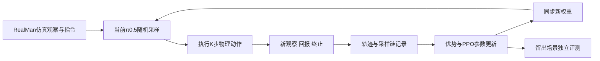

# π0.5-RealMan强化学习研究路线：算法与训练闭环

> [!abstract] 当前建议
> **以现有SFT检查点为起点，首先运行RLinf的Flow-SDE＋PPO，冻结视觉语言主干，更新动作专家、动作侧投影与价值头，首轮保持`is_lora=False`。** 它直接对应动作专家怎样使用融合条件，是当前工程量较小的主基线。LoRA是参数化选择，residual是控制结构，PPO/GRPO/TD3/SAC是优化算法，三者不能当成同一层的互斥选项。

> [!important] 实际状态
> 用户确认SFT后已有一定SR，今日独立JAX推理记录也有原训练场景的抓持表现；这支持学习起点。新增RLinf接口已通过组件检查，但未验收转换权重后的env＋policy＋PPO更新闭环。二者不矛盾。本次只读查代码、笔记与一手文献，未登录服务器、安装依赖、转换权重或启动训练。

关联：[[VLA动作专家适应-条件利用、多解生成与闭环强化学习]]、[[RLinf-VLA强化学习上手-RoboTwin与LIBERO]]、[[MICA-VLA精读与硕士开题衔接]]。

## 1. 资源与当前课题是否匹配

用户于2026-10-19明确最终采用总题目“面向实验室任务的VLA多步骤操作算法研究”。核心问题是让多步骤操作中的内部任务进度与实际执行保持一致，减少重复、遗漏和错误衔接。原“面向场景变化的VLA多模态条件—动作对齐与强化学习适应”保留为此前研究方向；以下现有本体、仿真、50条示范SFT和RLinf接口分析保留为动作端后训练的研究基础，尚不构成新题目下的多步骤能力验证。

已有SR有利于RL在探索中遇到正回报，但必须在拟训练的受扰分布中也有偶尔成功。标准场景的成功不保证大扰动也能产生学习信号；难度可从小位移逐步增加，必要时使用可靠阶段进度或少量成功/纠正轨迹。RL不保证凭空创造原策略完全无法触及的技能。

按硬件资源卡的历史记录，161有A6000、166有3090，本机仿真组件曾使用5090；本次没有重新查空闲卡、预留资源或测显存。选择此前SFT使用的A6000作为actor/rollout起点是合理建议。RL还需价值头、采样策略副本和renderer，SFT的batch上限不能直接变成RL容量结论。

资源入口：[[服务器-172.17.27.161]]、[[服务器-172.17.27.166]]。本体入口：[[RM65-B双臂机器人]]。当前完整24维接口已用上双臂与手的控制映射，但第一研究任务仍可保持短程、单瓶，避免同时扩展所有操作维度。

## 2. 本地版本和已有配置

核查路径：`/home/admin123/liminghe/vla-benchmark/RLinf`，HEAD `50f22ad9a7825eeaaf4180dca5300f2fa70758be`；RealMan适配与配置尚未提交。两个工程没有`.codegraph/`，本次采用文件工具读取。源码快照摘要见 [[30-实验记录/证据/2026-10-12-RealManRL研究路线/源码SHA256.json|六个关键文件SHA256]]。

| 项目 | 当前本地预设 | 适用边界 |
| --- | --- | --- |
| 物理状态/动作 | SDK24：左臂6、左手6、右臂6、右手6 | 臂弧度、手原SDK单位，不能用ALOHA14维配置替代 |
| 模型变换 | 手除1000、臂delta、24维quantile、padding32；输出逆变换 | 原norm stats与模型接口必须一致 |
| 观测 | 头/左腕/右腕三RGB，480×640，实测状态、指令 | 奖励使用仿真真值不等于把真值输入actor |
| 预测/执行 | horizon16，执行K1，10次去噪 | 预测长度与物理推进步数不同 |
| 时间/终止 | 普通动作60ms；成功可提前停止；auto_reset=false | 真实tick、终态与reset必须分别记录 |
| 学习 | PPO、flow_sde noise0.3、expert-only、value_after_vlm=true、LoRA=false | 预设是主基线接口，不是已运行训练结果 |
| 资源/时限 | 2train/2eval env、micro1/global2、2epochs/2steps、最多200动作 | 这是接口小配置，约12s预算未证明适合正式任务 |
| 回报 | 成功+1、失败−1、普通步0、超时0；native成功早停 | 当前没有几何/夹持过程shaping；native不要求转直或保持 |

代码入口：`examples/embodiment/config/robotwin_realman_adjust_bottle_ppo_openpi_pi05.yaml`、`examples/embodiment/config/model/pi0_5_realman.yaml`、`rlinf/envs/sim/robotwin/realman_env.py`、`rlinf/models/embodiment/openpi/policies/realman_policy.py`。绝对路径均以本段本机RLinf根目录为前缀。

原接口报告记载RLinf 63 passed/3 skipped、RoboTwin16 passed和无policy GPU组件检查；本次没有重跑。缺口包括真实OpenPI变换、JAX→PyTorch模型恢复、策略前向/闭环、PPO反向与权重同步。见 [[RLinf-VLA强化学习上手-RoboTwin与LIBERO#RM65-B 环境与π0.5接口代码接入（2026-10-12）]]。

## 3. 算法选择

| 路线 | 更新对象 | 当前定位与取舍 |
| --- | --- | --- |
| Flow-SDE＋PPO | 动作专家与价值头 | 主方案：接近现有代码，直接改变条件动作分布；需要在线采样与价值学习 |
| GRPO | flow策略，采用组相对回报 | 后续对照；纯二值回报的全失败/全成功组缺少相对信号，重复同起点有仿真成本 |
| Residual SAC/TD3 | 基座动作之外的修正actor及Q网络 | 精度/局部恢复对照；off-policy可复用转移，但增加策略与动作合同，不能证明原专家条件利用改变 |
| DSRL-SAC | 冻结VLA，学习初始噪声策略 | 可选轻量对照，改变生成器可达行为的选择；不更新原动作专家，迁移RealMan仍需适配 |

这是匹配当前问题和已有实现的判断，不是PPO普遍优于其它算法的定理。主算法确定后，再研究条件利用机制，避免首轮同时改算法、基座、接口与任务。

[πRL](https://arxiv.org/html/2510.25889v1)为flow策略构建Flow-SDE/Flow-Noise随机去噪优化；本地配置选前者。[DSRL](https://arxiv.org/html/2506.15799v2)优化初始噪声，不等于物理动作残差。示意区别为：

$$
z\sim\mu_\psi(z\mid o,L),\quad A=F_{\theta_0}(o,L,z)\quad\text{（噪声引导）};
$$
$$
A=A_{\mathrm{base}}+\Delta A_\psi(o,L,A_{\mathrm{base}})\quad\text{（动作残差）}.
$$

## 4. RL怎样更新π0.5

### 4.1 当前PPO并非直接把最终动作套入高斯分布

SFT的flow loss不是动作logprob。当前本地`tasks/rl.py:210–317`随机选一个去噪步使用SDE，其余ODE；`sampling/rl_sampler.py:56–102`从速度场构造Gaussian转移均值/方差并算条件density。rollout保存观察、latent chain、被选步、旧logprob与value。

更新时`tasks/rl.py:422–500`在同一保存latent前后状态重算当前参数的logprob；`algorithms/losses.py:253–267`构造ratio并clip，`workers/actor/embodied_fsdp_actor_worker.py`执行反向与优化。概念上的PPO目标为：

$$
\max_\theta\ \mathbb E_t\left[\min\left(\rho_t A_t,\operatorname{clip}(\rho_t,1-\epsilon,1+\epsilon)A_t\right)\right],\qquad
\rho_t=\exp(\ell_\theta-\ell_{\mathrm{old}}).
$$

**这里的$\ell$是当前实现使用的随机去噪转移log-density surrogate，不是原始flow最终解码动作的精确边缘似然。** 当前只取执行K1与24物理维做ratio；padding不进入物理动作损失。即使`joint_logprob=true`，该版本也是去噪维mean，不能改称完整路径log-density求和。

梯度路径是“回报估计优势 → PPO loss → 去噪转移均值 → 速度场 → 动作专家参数”。环境只需返回执行后果，不必可微。环境时间$t$与内部去噪步$k$不同；Bellman回报基于真实物理推进，未执行的未来chunk没有单独物理奖励。

### 4.2 第一阶段更新范围

`pi0.py:849`的`freeze_vlm`冻结SigLIP、token embedder和Gemma expert0；expert1、动作/时间投影与value head仍可训练。`tasks/rl.py:134–146`在expert-only模式下对prefix用`no_grad`。因此是动作侧参数更新，不只是额外的单层动作输出头。

冻结VLM后，专家仍能改变如何使用已提供的条件，符合当前研究目标。若关键几何信息在上游已缺失，下游更新不能凭空恢复它；先做信息可用性/条件响应诊断，再决定是否解冻接口或部分VLM。

### 4.3 LoRA的正确位置与本地风险

LoRA使被选权重成为$W_0+BA$，PPO仍提供学习目标；它不会替代RL闭环。若后续希望减小更新规模，可研究**动作专家限定的LoRA**，value head常规训练，rank8/16只作为待调初值。

本地通用`rlinf/models/__init__.py:375–432`在build/freeze后注入PEFT，没有OpenPI专家专属scope；默认`q_proj`等名可能命中Gemma的ModuleList，`all-linear`则跨VLM/vision/expert/heads。prefix仍`no_grad`时，prefix适配器不由该路径获得梯度。原生Gemma LoRA配置另有未实现分支，不能与PEFT混淆。

这是静态风险，没有实际加载LoRA验证。首轮保持`is_lora=False`；后续显式筛选expert1可支持的Linear/FFN，检查可训练参数、非零梯度、optimizer组和保存/恢复后，再声称专家LoRA可用。只有显存/更新稳定性或研究问题需要时再加入它。

## 5. 仿真交互训练闭环

1. **确定起点。** 固定SFT checkpoint、norm stats、24维映射、horizon、执行K、去噪、采样模式、物理时钟与成功判据。在相同协议下测SFT的标准和轻扰动布局，保存实际分母与视频。
2. **采样交互。** 用当前策略采样，保存观察/指令、真实执行前缀、latent chain与旧概率、value、reward、终态/截断。仿真真值可用于判定任务，不进入部署actor输入。
3. **更新。** reward与value形成GAE，PPO更新动作侧与value head。原50条示范是SFT起点；若继续混入flow监督需显式加入额外SFT项，不能当作当前策略on-policy rollout。
4. **同步与再采样。** actor新权重同步到rollout；核对版本、有限梯度、参数变化、保存重载、有效终态。PPO只在限定更新轮数内复用当前batch，不采用TD3/SAC式无限replay。
5. **独立评测。** 冻结测试种子/布局，用实际部署采样协议测SFT与RL，比较SR、精度、掉落、恢复时长、交互与计算成本；训练seed与测试seed分开。当前训练hybrid SDE、评测Euler ODE，须记录；给定初始噪声确定不等于默认所有rollout确定。

online RL指训练中持续采集新交互并更新参数；部署可以固定参数、不断重新观测决策。仿真改进不自动证明真机迁移，后续在真实本体上按同任务定义单独验证。

## 6. 当前最重要的两处协议差异

### 6.1 原JAX表现不能直接等同RLinf起点

[[2026-10-12-RealManπ0.5八万步原场景本机推理与实时画面]]是独立JAX策略、H16/K16、约0.96s每查询物理推进、持续到24s、不在native首次成功就停。新增RLinf预设是H16/K1、约12s上限、native早停。

减少执行K本身可提高反馈频率，也增加查询成本。先在同一新协议测SFT，再测RL；同时固定回合物理时限与终止标准。不能把K16→K1、时限或判据改变带来的收益归给RL。200动作小预算只是接口预设，不是已确定正式任务时限。

### 6.2 native成功并非“转直并保持”

原`adjust_bottle`选侧位置/高度成功谓词不检查转直与持续持握。当前可选`upright_hold`有代码，但物理反馈未验收；必须用视频、对象角度、真实夹持接触与连续时长校准。

最小奖励可从真正的任务完成+1、明确失败−1开始。若探索几乎全失败，再采用轻扰动课程或独立验证的阶段信号；先验证回报意义，防止只优化被误定义的success。不要同时把大量语言、距离、平滑、碰撞奖励混成无法归因的增益。

## 7. 硕士研究的最小任务与进阶

**第一阶段：单瓶初始位姿适应。** 复用现有24维本体和三RGB，固定有效指令，小范围改变瓶子初始位置/姿态，研究抓起、转直并保持。它能验证几何适应和执行质量，但一句固定指令、一个对象不能充分验证多模态指令对齐。

**第二阶段：要求×场景交叉。** 增加两个候选对象与两条有意义的目标/角色要求，先确认基座具备基本执行起点，再建立“同场景换要求、同要求换布局”的配对测试。只有任务完成与要求满足同时成立才记任务成功。条件响应行为应成为对齐证据，attention图仅作诊断。

**第三阶段：执行中可控扰动。** 在前两阶段通过后，加入规定时刻/幅度的目标移动等事件，单列扰动前状态与恢复指标。当前adapter仅有reset初态采样，没有现成动态扰动物体接口；此阶段需要新增并验证仿真事件，不默认已支持。

后续候选是“执行后果驱动的动作端条件利用”，用RL反馈检验并改善专家的信息使用。第一条普通PPO曲线是可靠基准，不是算法创新；当前不要求先构造新算法。基线至少有原SFT、同预算新增受扰数据SFT、普通PPO与拟方法，DSRL/残差作为有需要时的对照。等数据、交互和推理预算分别记录，不把新数据或更多候选采样归因于对齐机制。

## 8. 下一步验收顺序

- [ ] 恢复/转换固定SFT检查点，验完整输入输出与模型采样。
- [ ] 在RLinf完成该SFT的真实策略闭环，统一K、物理时限和成功标准。
- [ ] 验真实reward与终态，完成一小批PPO反向、参数变化、同步、保存和重载。
- [ ] 测实际峰值显存/吞吐，再扩大仿真数和更新batch。
- [ ] 完成固定测试分布下的普通PPO基线，再收窄条件利用问题。

以上为研究计划，未新增训练曲线、RL成功率、显存性能或真机验收结论。

## 9. 当前实现路线是否需要改变暂定题目（2026-10-12）

用户追问原开题题目是否仍适合。判断：**“面向场景变化的VLA多模态条件—动作对齐与强化学习适应”作为研究方向仍适合，不需要因选择π0.5、PPO或冻结VLM而推翻。** 题目规定研究问题，模型、本体、训练平台和优化算法是当前选择的实现载体；首轮普通PPO是基线，不等于全部研究内容已经完成。

“场景变化”先限定为少量目标/障碍位姿变化，初态变化与执行中扰动分开；“对齐”定义为条件变化时动作有正确、可检验的响应；“RL适应”指训练中的交互后训练，不预设部署实时更新权重。冻结VLM仍可检验专家是否更有效使用已提供的融合特征。

原题中的“对齐”需要实际研究支撑：同场景换要求、同要求换相关几何、无关变化稳定性，以及相对普通PPO的条件利用对照。若最终只做固定一句指令、单瓶位置随机化的普通PPO增益，只能支持动作适应，尚未完成原题对多模态条件—动作对齐的承诺。

若将MICA作为独立方法章纳入学位论文，可继续讨论此前建议的总题目“**面向实验室操作的视觉语言动作模型多模态条件控制与场景适应方法研究**”；原暂定方向对应后续主要研究章。此处没有新增或自动采纳另一个题目，也未修改 [[VLA动作专家适应-条件利用、多解生成与闭环强化学习]] 的`proposal_direction`。

本节为基于已核查材料的选题判断，没有新增实验或题目最终确认。

2026-10-12随后更新：用户已明确采用上述宽总题目作为开题名称，研究材料见 [[01-开题材料清单与证据索引]]。本节此前的“建议/未确认”保留为讨论历史。2026-10-19用户曾改定题名为“视觉语言动作模型多步骤操作的进度跟踪与纠错研究”，此后暂采用过“面向实验操作的VLA任务进度纠偏研究”；同日最终明确采用“面向实验室任务的VLA多步骤操作算法研究”，当前以本笔记`proposal_title`和材料入口为准。

## 10. 验证路线评审与最小对照（2026-10-13）

判断：现有路线适合作为工程闭环与普通PPO主基线。冻结VLM、更新动作专家及价值头与[πRL原论文的RL设置](https://arxiv.org/html/2510.25889v1#S5.SS1)一致；选择已有算法本身不构成新算法贡献。若总题目强调多模态条件控制，后续须用可检验的条件响应行为和方法消融支撑。

本轮只读复核本机`tasks/rl.py`、`tasks/dsrl.py`、笔记和两篇原论文，没有安装、转换、模型推理、训练或新成功率。资源卡所述GPU仍是历史记录，没有核验当前可用资源；本笔记`checked`保留原日期，本节记录本轮静态评审日期。

### 10.1 增加三个明确验收关口

1. **权重与离线推理对齐先行。** 原JAX和转换后的RLinf使用相同冻结三图、实测SDK24、指令、原统计、10步采样及显式相同的初始噪声tensor，比较完整H16／24维物理输出。先比较相同eval ODE采样；相同seed不保证跨框架噪声相同。臂弧度和手SDK分别报告误差与阈值。
2. **奖励判据单独验收。** 建立成功和失败反例：侧向举起但未直立、直立但由桌面支撑、短暂满足后掉落、正确持续持握。检查`upright_hold`真值、奖励、终止和连续时间，确保它与视频及任务定义一致。评测始终保留独立物理指标，避免直接用训练reward代替任务评价。
3. **参数更新闭环单独验收。** 更新前保存chain重算logprob对齐，检查非零policy梯度与有限value梯度、动作专家实际更新及冻结VLM保持、rollout接收新版本、保存重载。参数变化要排除仅weight decay；完成1–2次更新只证明机制可用，RL提升另行测量。

### 10.2 固定协议，拆开收益来源

主要比较应固定H、K、实际物理时限、早停规则、任务判据、输入视图／状态、采样步数、评测采样器和初态集合。尤其以**同一RLinf入口下的冻结SFT K1**作为PPO K1的直接基线；旧JAX K16／24s成功率保留为历史结果，不直接作为新协议的训练前SR。

若单独研究K16→K1，可先做未训练SFT的K消融，再比较同K的SFT／RL。增加同协议JAX与RLinf对照用于定位迁移误差。跨K时还需注意当前gamma／GAE按决策步计，不自动代表相同物理时间尺度；60ms为正常动作名义周期，实际终止时间以physics ticks计。主要部署评测使用SFT ODE与RL ODE；若检查探索采样，再另报SFT SDE与RL SDE，不能混在一条增益里。

### 10.3 将条件利用变成可测指标

| 配对测试 | 预期响应 | 要排除的捷径 |
| --- | --- | --- |
| 相同场景换两个有效目标要求 | 操作对象／目标随要求切换 | 总抓最近对象、固定抓一侧、靠训练布局猜目标 |
| 相同要求改变相关布局 | 保持目标要求，并适应新几何 | 记忆训练轨迹或固定目标坐标 |
| 相同任务改变无关背景 | 目标选择和要求保持，任务执行稳定 | 将装饰／背景当成任务提示；不要求每条随机轨迹完全一致 |

语言目标须在环境中有两个真实可行的候选对象，基座先具备非零执行起点。分别报告**目标选择正确率、选对目标后的执行成功率、联合任务成功率**，避免用抓得更稳替代指令响应证据。语言消融或错配仅用于诊断其贡献，不作为正常任务SR。attention可辅助观察，不能单独证明对齐。

### 10.4 首轮最小研究对照

| 组别 | 用途 |
| --- | --- |
| 固定SFT，新统一协议 | 确定起点，排除入口／反馈频率变化 |
| 受扰数据再SFT | 检查新增数据本身的收益；监督动作须明确来自专家、纠正或成功筛选，并记录获得成本 |
| 普通Flow-SDE＋PPO | 确定当前方法可达到的主基线 |
| 普通PPO＋拟研究机制 | 检验所提机制；再移除该机制进行消融 |

至少记录交互步数、仿真秒数、policy查询数、更新次数、GPU时间与峰值显存。最终研究曲线建议多个独立训练seed（例如3个起步），对同一留出初态集合做配对评测，报告实际回合数和不确定性；有限评测seed不能替代训练seed的重复。普通PPO闭环未验收前，GRPO／DSRL／Residual暂后置。

DSRL作为可选对照须另适配输入：当前本地`Pi0DSRLConfig.state_dim`默认8，小噪声actor／critic只读取主相机与state，没有直接读取指令和腕图；冻结π0.5生成器仍可接收原VLA条件，不能据此称整个DSRL不使用语言。应明确小网络与生成器各自的输入及成本，避免不公平归因。[DSRL原论文](https://arxiv.org/html/2506.15799v2)定义的是噪声空间学习，不等于物理动作残差；更新小网络也不自动证明整条采样／仿真链路成本更低。

## 11. A6000训练可行性与显存边界（2026-10-13）

判断：**单张RTX A6000 48GB是当前冻结VLM、训练动作专家＋value的小规模PPO验证的合理起点；两卡分开actor与rollout／仿真更便于留出显存余量。** 这是基于当前源码的工程判断，没有实测峰值或训练通过证据。[NVIDIA官方规格](https://www.nvidia.com/en-gb/products/workstations/rtx-a6000/)确认48GB显存；资源卡中的多卡A6000属于历史硬件记录，本轮未登录服务器核查占用或预留GPU。

[RLinf官方文档](https://rlinf.readthedocs.io/en/latest/rst_source/examples/embodied/pi0.html)提供共享、分离placement和减小batch／环境数、模型offload等调整方式。示例的多卡与大并行规模不能直接当作本任务的硬件最低要求。

### 11.1 当前配置的主要显存来源

- 当前actor、rollout、env全部placement为0，actor与rollout各持一份完整π0.5。以约3.3B参数计算，两份全部BF16权重的理想原始存储为`2×3.3e9×2≈13.2GB`；实际选择性精度还有FP32部分。该算式只估计权重，不是训练峰值。
- 实际`precision:null`已有选择性BF16：Gemma／SigLIP主体BF16，norm、视觉stem及动作／时间／value头保持FP32。FSDP三项mixed_precision不能直接改为BF16；当前源码只允许null或fp32。
- 冻结VLM并在prefix执行no_grad，减少反向激活和优化器状态。训练对象仍有约300M动作专家、投影／时间层与value，需要加梯度、Adam状态、FSDP缓冲、权重同步临时张量和CUDA分配器余量。
- 当前train2、eval2且训练内评测开启，EnvWorker启动时即创建四个常驻SAPIEN场景。RM backend不支持环境offload；actor／rollout的CPU offload有独立代码路径，完整GPU训练仍需实测验证。

### 11.2 建议的容量验证方式

| 资源 | 后续可验证的起点 |
| --- | --- |
| 1×A6000 | 先train env1、micro1、global2、H16/K1，暂关闭训练内评测，在独立评测进程复测；若峰值不足，验证actor／rollout阶段CPU offload，保持env offload=false |
| 2×A6000 | 候选placement为actor:0、rollout＋env:1，保留no_shard；分开训练和采样／渲染开销，并确认SAPIEN实际落卡正确 |
| 更多A6000 | 在完整闭环通过后增加采样并行或数据并行，联合核对batch、环境数与各worker整除条件 |

本地OpenPI当前强制`no_shard`，多卡不会自动把所有显存合并给同一模型。先记录模型初始化、rollout、反向＋optimizer、权重同步四个阶段的单卡峰值及吞吐，再确定规模；不要只看模型加载成功或稳定阶段的显存。

60ms是同步仿真的名义动作推进时间，推理延迟可以增加真实训练耗时，而不是必须每60ms真实时间推理一次。当前K1相比原K16会增加相同仿真时长下的policy查询数，需记录GPU时间和查询成本；不得为节省显存随意改变三相机、SDK24或控制周期。

本节未修改训练配置、安装依赖、转换权重、运行容量测试或启动训练。

## 12. 双A6000最小闭环执行方案（2026-10-13，未执行）

完整门槛、候选依赖、转换命令、独立SFT评测、双卡配置与显存/续跑方案见[[RLinf-RM65B-双A6000最小PPO闭环验证方案]]。按用户要求，本次只整理方案，未安装、修改工程代码/训练配置、转换或运行。

本轮新增静态结论：现有转换器需要处理Orbax TreeMetadata及NNX terminal `value`；RM导入链仍会被缺失CuRobo阻断，需要独立代码副本的可选依赖入口或完整规划栈。当前FP32 master optimizer校验只允许LoRA，不能直接用于本方案全动作专家；实际专家更新必须验有效梯度/权重delta。

双卡首轮建议B1、T16、global16、micro1、update_epoch1，两轮恰对应两次optimizer更新，再保存与恢复第三轮。这个采样窗每轮仅0.96秒，全零奖励最多证明计算链；完整学习信号需依据同协议SFT的奖励事件长度增加T并获得当前策略真实正/负回报。独立单环境评测要遍历种子池，不能保留fixed reset后把八轮重复初态当作八个场景。最终更新的Rollout同步及环境/Rollout RNG未恢复的续跑边界也须如实报告。

同初态seed也不自动提供同flow初始noise；当前HF入口仍默认torch.randn。计划在独立eval给每个reset ID/query/repeat控制并记录模型noise，验收后才称同噪声配对评测，ODE去噪也有随机初始noise。

### 12.1 A6000渲染与166的3090备选

RTX A6000本身支持图形渲染、RT核心与Vulkan，不能把服务器当前渲染失败或无显示器等同于硬件不支持；具体原因尚无日志/实测。166历史资源为8×3090/每卡24GiB，可先尝试两卡Actor/采样＋仿真分离，必要时第三卡单独env。冻结VLM和micro1使其成为合理的小规模PPO候选，但当前no_shard下Actor仍受单卡24GiB限制，未测峰值不能保证两卡足够。来源、历史核验日期、余量与依赖边界见[[RLinf-RM65B-双A6000最小PPO闭环验证方案#13. RTX A6000渲染能力与166的3090备选（2026-10-13）]]；本轮没有登录或测试166。
