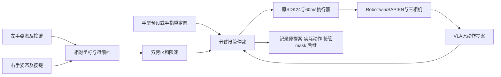

# 双臂VLA人工纠正：VLA-Precision与仿真遥操作方案

> [!abstract] 选型判断
> 保留现有RoboTwin/SAPIEN、RM65-B资产与SDK24执行器，优先替换人工输入及接管仲裁。当前鼠标入口是暂停式目标编辑，不代表仿真器只能这样操作。短期可借鉴官方双键盘连续纠正；若强调同时连续双臂操作，优先评估双6DoF手柄输入，再考虑双SpaceMouse。精细接触保留粗细档键盘微调。该判断尚未做本机可用性实验，不代表候选设备已接通。

## 1. 核查范围

2026-10-16读取论文v3、固定官方仓库、本地鼠标接口和候选项目官方文档／源码。官方VLA-Precision本地HEAD为`41edacde80d8c9d8146d610202299d71b0e79f7c`，工作树干净。其余带`main`／`latest`的远端材料是本日网页核查，未固定安装版本。父工程CodeGraph首先检索未命中相关子仓库／忽略的deploy文件后，才精确读取源文件。

本轮没有安装依赖、启动仿真／训练、操作实体机器人，未修改控制代码、原入口、模型或已采集标签。下文区分论文报告、公开代码、当前本地实现与适配建议。

## 2. VLA-Precision原来怎样人工纠正

### 2.1 论文与在线代码不是同一层说明

[论文III-D1](https://arxiv.org/html/2609.04355v3#S3.SS4.SSS1)描述同构主臂与固定任务坐标系中的6DoF增量键盘：前者适合长轨迹，后者提供粗细档精细对准；存储前统一TCP增量，标称15Hz采集。不要把控制器内部频率或服务器动作频率当成VLA推理频率。

固定代码的[双臂部署配置L66–69](https://github.com/scy-v/VLA-Precision/blob/41edacde80d8c9d8146d610202299d71b0e79f7c/configs/stage2/deployments/dual_ur.yaml#L66-L69)指定两块物理键盘、两个evdev路径，分别控制左右UR。同样键位按设备身份分臂，不是单键盘轮流选臂。

### 2.2 在线接管、交还与标注

| 环节 | 固定官方实现 | 对当前接口的启示 |
| --- | --- | --- |
| 输入 | 每臂平移3轴、旋转3轴、夹爪；粗细档 | 按住输入连续动作，避免每步Apply |
| 接管 | 移动／旋转／夹爪／stop触发，按臂替换 | 左人右VLA、左VLA右人、双人、双VLA要明确区分 |
| 单侧纠正 | 另一侧保留策略提案 | 允许真正两侧同时输入，不能只有单一gizmo |
| 交还 | chunk开始判断接管；一侧本chunk接管后松键，剩余步保持；下一chunk新观察重新推理 | 不可说成任意时刻抢占或松键瞬时继续旧chunk |
| 偏好 | 保存原提议与实际纠正；有效干预和动作差异筛选，无逐步Approve复选框 | 当前额外确认是本地设计，不是ACoB要求 |
| 成功 | 指定键盘`.`在0.5秒内双击，completion事件转奖励／终止 | 成功标签与局部纠正偏好分开 |

源码：[键位L23–48](https://github.com/scy-v/VLA-Precision/blob/41edacde80d8c9d8146d610202299d71b0e79f7c/src/vla_precision/robotics/teleoperation/dual_keyboard.py#L23-L48)、[独立分臂及接管L179–334](https://github.com/scy-v/VLA-Precision/blob/41edacde80d8c9d8146d610202299d71b0e79f7c/src/vla_precision/robotics/wrappers/keyboard_intervention.py#L179-L334)、[chunk内保持L336–455](https://github.com/scy-v/VLA-Precision/blob/41edacde80d8c9d8146d610202299d71b0e79f7c/src/vla_precision/robotics/wrappers/keyboard_intervention.py#L336-L455)、[actor保留提案](https://github.com/scy-v/VLA-Precision/blob/41edacde80d8c9d8146d610202299d71b0e79f7c/src/vla_precision/acob_stream/actor.py#L239-L308)、[排序动作差门槛](https://github.com/scy-v/VLA-Precision/blob/41edacde80d8c9d8146d610202299d71b0e79f7c/src/vla_precision/acob/agent.py#L445-L464)。

有效替换不证明纠正真实回报一定更高：排序使用专家纠正优于原提议的监督假设，没有同状态分叉验证反事实收益。建议未来用会话级训练标注选择和撤销坏片段降低误操作，而非逐个动作审批；这是适配建议，尚未实现，不追溯改写旧数据。

### 2.3 README双臂VR的真实边界

[主README](https://github.com/scy-v/VLA-Precision/blob/41edacde80d8c9d8146d610202299d71b0e79f7c/README.md#L24-L34)把[双UR VR外部工程](https://github.com/scy-v/lerobot_ur_dual_vrteleop)列在示范采集资源。该工程基于PICO 4 Ultra/XRoboToolkit，Trigger按住控制、松开停止，Grip开闭夹爪；这不等于松开自动交还VLA。主库[扩展文档](https://github.com/scy-v/VLA-Precision/blob/41edacde80d8c9d8146d610202299d71b0e79f7c/docs/EXTENDING.md#L179-L212)提供VR扩展接口，[factory](https://github.com/scy-v/VLA-Precision/blob/41edacde80d8c9d8146d610202299d71b0e79f7c/src/vla_precision/robotics/environments/factory.py#L135-L147)仍要求非键盘接入自定义factory。不能将示范采集说成已提供默认双臂VR在线ACoB。

## 3. 仿真器与双臂输入方案

| 系统 | 已公开的交互能力 | 双臂／手指边界 | 对RM65-B的判断 |
| --- | --- | --- | --- |
| ManiSkill / SAPIEN原生Click+Drag | 鼠标点选拖末端，规划后执行 | 官方定位较静态两指夹爪任务；不适合动态连续动作 | 适合检查位姿，不能解决本轮双臂操控问题 |
| ImVR / ManiSkill社区VR | 腕6D→IK、手骨架→dex-retargeting；脚踏／S键同步跟随 | 文档有第二臂配置，但README双臂release未勾选，文档称WIP | SAPIEN生态接近；不能当成熟完整双臂代码 |
| ManiSkill Quest WebXR社区桥 | 浏览器手追踪、WebRTC回传、Ability Hand重定向 | 双臂／controller标Experimental，已说明平台为Quest3+macOS | 适合作Quest输入参考，未证明Ubuntu5090双臂可直接运行 |
| robosuite / MuJoCo | 键盘、SpaceMouse、DualSense、mocap目标GUI+IK | 默认用按键切active arm；双臂环境不等于单设备同时控双臂 | 双设备需额外输入组合；迁移RM65动力学成本不值得仅为界面承担 |
| Isaac Lab 2.3 / Isaac Sim | 官方GR-1双手任务：AVP双腕姿态→Pink-IK，手指→dex-retargeting | 有双末端、灵巧手示例；仍须自定义RM65本体／手部映射及ACoB接管 | 完整XR/手指链参考价值高；整场景迁移工程大 |
| XRoboToolkit（输入层，非仿真器） | 官方MuJoCo双UR5例，左右手柄6DoF、独立Grip使能，相对基准重置 | 通用手部控制当前仅parallel，dex hand TODO；另有独立Inspire手重定向例 | 优先借用输入层，桥接现有SAPIEN，避免迁仿真 |

一手来源：

- [ManiSkill Teleoperation](https://maniskill.readthedocs.io/en/latest/user_guide/data_collection/teleoperation.html)。主文档推荐的社区VR链接不代表主库已集成完整HIL RL。
- [ImVR架构](https://liuyulinn.github.io/imvr-doc/user_guide/teleop_in_sim/general.html)、[脚踏／S键](https://liuyulinn.github.io/imvr-doc/user_guide/teleop_in_sim/floating_hand.html)、[双臂配置及WIP](https://liuyulinn.github.io/imvr-doc/user_guide/teleop_in_sim/advanced_sim.html)、[README发布状态](https://github.com/liuyulinn/imvr#-todo)。
- [Quest桥What Works](https://github.com/fracapuano/maniskill-quest-teleop#what-works)。
- [robosuite设备文档](https://robosuite.ai/docs/modules/devices.html)：keyboard/SpaceMouse的`s`切臂；DualSense方向键切臂；GUI拖mocap目标须搭配控制器。不要把物理扰动力拖拽或直接改状态当成可训练动作。
- [Isaac Lab 2.3双手GR-1示例](https://isaac-sim.github.io/IsaacLab/v2.3.0/source/overview/imitation-learning/teleop_imitation.html#demo-1-data-generation-and-policy-training-for-a-humanoid-robot)。文档提醒腕姿快速偏离会使IK跟随失败；XR并不自动解决逆解质量。
- [XRoboToolkit双UR5示例](https://github.com/XR-Robotics/XRoboToolkit-Teleop-Sample-Python/blob/main/scripts/simulation/teleop_dual_ur5e_mujoco.py)；[基类L164–201](https://github.com/XR-Robotics/XRoboToolkit-Teleop-Sample-Python/blob/main/xrobotoolkit_teleop/common/base_teleop_controller.py#L164-L201)为相对姿态／使能，L315–335为夹爪限制；[独立Inspire手Placo示例](https://github.com/XR-Robotics/XRoboToolkit-Teleop-Sample-Python/blob/main/scripts/simulation/teleop_inspire_hand_placo.py)。[客户端](https://github.com/XR-Robotics/XRoboToolkit-Unity-Client#project-overview)面向PICO；不可推定Quest直接兼容。注意其示例Grip使能／Trigger夹爪与上面VLA-Precision外部采集工程的按钮映射相反，实际接入须统一。

## 4. RLinf已有一个更直接的接管参考，但不等于本地现成功能

本日[latest遥操作指南](https://rlinf.readthedocs.io/en/latest/rst_source/guides/teleoperation.html)支持组合设备、PICO分臂使能与手套分支。[Dual Franka PICO Collection and DAgger](https://rlinf.readthedocs.io/en/latest/rst_source/examples/embodied/dual_franka_pico_dagger.html)是2×Franka真机、Franky、三相机、π0.5的SFT/HG-DAgger流程：左右Grip独立接管，采集模式松开保持，DAgger模式松开交还，记录intervene动作和标记；20维TCP-rot6d＋双夹爪布局不适用于SDK24。

其`smooth_intervene`可避免接管期间chunk推理停顿，但dummy chunk时未接管臂保持实测TCP，不能泛称另一臂一直执行新策略。[环境仲裁接口](https://rlinf.readthedocs.io/en/latest/rst_source/concepts/realworld_envs.html#arbitrate-teleoperation-in-the-environment)可参考；[仿真DAgger](https://rlinf.readthedocs.io/en/latest/rst_source/examples/embodied/dagger.html)里的expert是额外模型forward，不是VR真人。未找到现成PICO＋RoboTwin＋RM65双灵巧手＋ACoB官方闭环，也未核验本地固定RLinf版本已有latest这些接口。

## 5. 当前鼠标方式为何不顺手

本地只读源为独立目录`/home/admin123/liminghe/vla-benchmark/deploy/realman_gen4/acob_human_5090_rm65b_20261016_v1`，未改写：

- `native_mouse_viewer.py:352–380,505–509`：一个gizmo轮流选左右掌，IK先要求`success=True`、`eps=1e-5`，再做1mm／1°FK检查。不能同时纠正双臂，严格布尔前置判断还可能中断细微调整。
- `native_mouse_viewer.py:304–334,415–420,453–458,512–517`：Takeover后才可Apply，每次1–10步，Release实际暂停，需再点VLA步数；是分段目标编辑器。
- `native_mouse_viewer.py:116–120,313–319,519–548`及`human_recording.py:102–122`：单侧6个手指滑块，另有默认false的偏好审批。人工动作记录与有效纠正对因此不同；审批并非官方ACoB必需。
- 本日静态读取v2收据：151步中84人工、67策略、0纠正对，原生回合未完成，training状态`skipped_no_valid_corrections`。这里只确认结果快照，未重跑全量轨迹审计、训练或评测，也不追溯更改标签。

## 6. 面向现有合同的建议架构（未实施）

1. 双臂必须同时可输入、各有接管mask；按住使能连续控制，释放后清旧策略缓存，由新观察恢复。单侧接管时另一侧继续策略还是保持需显式配置和记录；近距离协作可先双侧保持，不能混淆模式。
2. 接管时以当前实测末端重设输入基准，保留限速和IK检查；不可将物体／机器人瞬移记为纠正动作。相对控制、低通滤波、可调运动缩放有助于精细操作，但需实测误差与延迟。
3. 动作仍为`左臂6＋左手6＋右臂6＋右手6`，保持三相机、15×4ms及原入口。额外VR双目／自由观察画面只供操作者，不自动改变VLA输入。60ms物理合同不等于推理已达到60ms墙钟实时。
4. 两个扳机仅两路连续量，不能独立表示十二个手部通道。最小抓瓶可预设预抓／握紧／松开并以扳机插值，拇指对掌用独立模式；它保留24维输出但限制人工可达手型。若研究任务需要独立指序，使用双手骨架重定向或手套＋脚踏使能，并核对因时四代手SDK映射。
5. 首选路径是连续输入与接管状态机改进，而非换仿真器。先做不含模型的双臂手动可用性验证，再验VLA接管／新观察交还、真实纠正对、完整回合及无接管评测。输入自然不保证纠正有效，更不保证SR提升。

## 关联笔记

2026-10-16后续实施见[[2026-10-16-RM65B双键盘连续纠正与手型预设验证]]：已经新增连续键盘入口与手型预设，自动验证通过；原鼠标入口保留，真人纠正与训练尚未验收。本页前文保留调研时的候选方案边界。

- [[VLA-Precision精读-价值校准、动作专家更新与Q-VGM比较]]
- [[2026-10-16-RM65B鼠标末端纠正与ACoB接管入口]]
- [[本机-VLA-Precision-RM65B最小ACoB闭环复现方案]]
- [[2026-10-15-RM65B完整ACoB仿真闭环补齐]]
