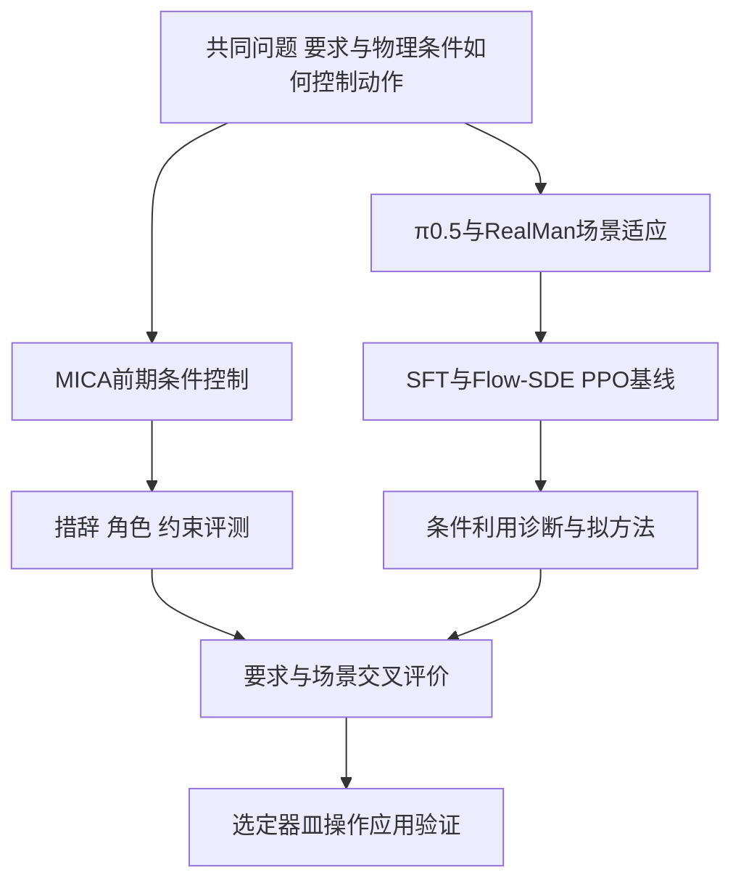

# 开题材料清单与证据索引

> [!info] 历史初稿
> 本页保留2026-10-12准备过程、文献与证据快照。2026-10-17已调整为RECAP记忆与动作联合学习，并按用户要求删除旧报告正文和中间Word，仅保留最终报告；当前入口见 [[10-研究主题/开题材料/2026-10-17/01-开题材料清单与证据索引|开题修订材料]]。本页旧实施状态不视作当前状态。

## 1. 已确认题目与材料入口

**面向实验室操作的视觉语言动作模型多模态条件控制与场景适应方法研究。** 用户于2026-10-12明确采用此名称。原“面向场景变化的VLA多模态条件—动作对齐与强化学习适应”作为后续主要研究方向，不再与正式开题总题目混用。

- [[10-研究主题/开题材料/2026-10-17/东北大学开题报告扩展稿-自身VLM记忆与子任务生成版.docx|最终开题报告]]：当前唯一保留的Word报告。
- [[04-开题报告扩展稿-图文版]]：当前Markdown正文。
- [[03-文献综述与参考文献矩阵]]：16篇一手来源、出处状态、方法与问题边界、编号参考文献。
- 本页：学校栏目映射、已有证据、素材和优先补充清单。

正式文档尚需本人填写封面、导师审阅内容、确认日期与预算，并核实学院的现行提交要求；不是已经审核通过的开题报告。学校原`.doc`模板保持不变。

## 2. 官方模板对应的准备材料

来源为 [[东北大学硕士学位论文或实践成果开题报告.doc]]，本次转换副本并阅读全部栏目。原模板没有明确给出最低字数、参考文献篇数或答辩时长，不能自行把建议写成学校硬性要求。

| 模板栏目 | 已准备内容 | 仍需本人或导师确认 |
| --- | --- | --- |
| 封面 | 完整开题名称；其余信息保留待填 | 学号、姓名、导师、副导师、学科/类别、学院、电话、开题日期 |
| 一 立论依据 | 实验室器皿操作需求、条件控制与场景适应问题、理论/应用价值 | 正式项目来源、项目名称/编号；应用任务是否与课题组目标一致 |
| 二 文献综述 | 按机制整理的现状、16篇文献矩阵、查阅范围和手段 | 按学院要求补充篇数/格式；进一步精读与中文文献检索 |
| 三 研究内容 | MICA前期内容、π0.5后续内容、科学问题、技术路线、实验与可行性 | 具体方法贡献的边界；首批任务和评价协议；个人贡献 |
| 四 研究基础 | 稿件、数据、SFT、模型仿真、RLinf组件与硬件证据分层 | 原始实验统计、实机标定、资源分配；资金来源和单价/总额 |
| 五 工作计划 | 12个月相对阶段、960小时初步估计、阶段成果 | T0实际日期、毕业安排、绝对起止日期及工作量 |

模板《填表说明》含导师指导填写、通过开题后一周交学院并上传电子版、入学两年内完成开题等文字。本次只核查用户提供的模板，没有查询学校现行管理规定；执行时间以学院和导师通知为准。

## 3. 报告的研究逻辑与术语

一句话论证：**语言规定操作要求，视觉与本体状态反映执行条件；通过条件控制与执行反馈学习，研究动作如何随有效要求和物理场景正确变化。**

| 规范术语 | 本材料中的含义 | 必须区分 |
| --- | --- | --- |
| VLA | 视觉语言动作模型 | 与高层任务编排不同 |
| 多模态条件控制 | 要求、图像与本体条件实际影响动作 | 信息可解码不等于行为有效 |
| 场景适应 | 对受控物理条件变化的执行能力 | 初态变化与执行中扰动分开 |
| SFT | 用示范动作监督微调 | 不是交互回报驱动学习 |
| Flow-SDE PPO | 改造随机去噪采样后开展PPO更新 | 概率替代目标不是原flow最终动作精确似然 |
| LoRA | 选择模块的低秩参数更新 | 不是RL算法；当前专家专属范围未验 |
| SDK24 / padding32 / H16 / K | 物理接口/模型内部维度/预测长度/执行步数 | 未执行未来动作没有独立物理后果 |

MICA对应“指令参考选择与动作侧条件利用”；后续对应“物理条件变化与执行反馈驱动适应”。普通PPO、已有框架接入、本体替换和实验室应用是基础或工程工作，不能单独列作算法创新。具体后续机制是拟研究内容，未写成已发现或已验证结果。

## 4. 研究基础的证据矩阵

| 已有材料 | 可陈述事实 | 证据级别与边界 | 原始入口 |
| --- | --- | --- | --- |
| MICA-VLA稿件 | PSM、SCE/DSR方法；LACE17任务和LIBERO-Para | 投稿稿件报告；不是RM65-B或完整化学流程结果；录用未确认 | [[MICA-VLA精读与硕士开题衔接]]、[[MICA_VLA_ICRA2027_anonymous.pdf]] |
| Full50 | 50条RM65-B专家轨迹，11,098观测动作对，三RGB和SDK24 | 物理仿真专家数据；不是50条真机数据或模型SR | [[2026-10-07-RM65B-RGB50双臂近臂抓瓶数据集]] |
| π0.5本体SFT | 已实际训练并保存8万步检查点 | 训练与检查点证据；不把loss当SR，不宣称100k最终完成 | [[2026-10-07-π0.5-RM65B-RGB50官方RoboTwin全量微调]]、[[2026-10-10-161-RealManπ0.5训练状态核查]] |
| 8万步回测 | 六个训练原起点真实模型仿真执行，存在抓持成功和失败 | 小规模原场景诊断；不是总体SR、受扰泛化或真机 | [[2026-10-12-RealManπ0.5八万步原场景本机推理与实时画面]] |
| RLinf接入 | 环境/模型合同和组件通过，79 passed、3 skipped | 未加载policy的原生组件，不是PPO闭环验收 | [[RLinf-VLA强化学习上手-RoboTwin与LIBERO]] |
| 本体与相机 | RM65-B每臂六轴、灵巧手，用户指定D435配置 | 本体/配置资料与仿真；现场腕相机、TCP和外参需验 | [[RM65-B双臂机器人]] |
| 计算资源 | A6000、3090资源及本机5090使用记录 | 历史硬件核验；不是目前独占/空闲或RL容量承诺 | [[服务器-172.17.27.161]]、[[服务器-172.17.27.166]] |

上述证据由本次读取现有笔记、稿件核查结论及长期记录整理；没有远程再测或新增训练。正式提交时，具体数值需要与原始统计和本人贡献一起核对。

## 5. 展示素材与图表准备

| 图表/素材 | 建议用途 | 来源与标注 |
| --- | --- | --- |
| 总体技术路线图 | 串联两项研究及统一评测 | 按本页下方路线绘制，属于研究计划 |
| MICA图1及图2 | 说明PSM/SCE和前期SO-100平台 | 来自用户稿件，保留“前期稿件”标注；不是RealMan |
| MICA表I–III | 说明已有方法和消融内容 | 标“稿件报告”，保留任务与指标口径 |
| 仿真本体与三视角图 | 说明后续平台与观察 | 使用当前真实仿真截图，不当现场标定证明 |
| 六场终态概览 | 同时展示模型成功和失败 | [[30-实验记录/附件/2026-10-12-RealMan80000原场景本机推理/six_training_scenes_exact_terminal_physics24s.png]]，配文“六个训练原起点诊断” |
| 模型总览视频 | 简短展示已有SFT策略能力 | [[30-实验记录/附件/2026-10-12-RealMan80000原场景本机推理/six_model80000_original_scenes_overview.mp4]] |
| 失败样例 | 明确真实问题，避免只展示成功 | [[30-实验记录/附件/2026-10-12-RealMan80000原场景本机推理/episode_0000031_model80000_four_views.mp4]]；不据单例断言唯一失败根因 |
| 专家回放 | 展示数据和执行器基础 | [[30-实验记录/附件/2026-10-11-RealMan专家回放/six_expert_replays_overview.mp4]]；必须标“专家动作”，不能混称模型 |
| 基线结果表 | 比较SFT/PPO/拟方法 | 目前待新实验，不填写预测成功率 |

当时Word初稿使用学校栏目，旧报告文件现已删除；本页路线图为可编辑Obsidian补充素材。图片和大视频保留原位置，通过链接引用，不重复复制。

## 6. 优先补齐的材料

### 提交前需要本人或导师填写

- [ ] 封面全部身份与日期信息，副导师如无则按学院要求填写。
- [ ] 项目来源、项目编号、MICA个人贡献和正式投稿状态材料。
- [ ] 经费来源、库存核对、拟购置数量与单价、总额；不得以已存在设备总价值充当新增预算。
- [ ] 学位论文预计完成时间和开题T0，将相对月份转为绝对日期，审定960小时估计。
- [ ] 明确学院现行字数、参考文献格式、答辩时长和提交程序；模板没有给出的不自行设为硬规则。

### 最有价值的补充实验证据

- [ ] 固定checkpoint、K、时限、采样方式和成功判据的SFT标准/留出场景评测。
- [ ] 视频与物理真值一致的转直、接触、持握与失败奖励校验。
- [ ] RLinf下真实模型闭环、一次PPO反向/参数变化/同步/保存重载。
- [ ] 小规模吞吐、显存和并行渲染测量，用于确定正式交互及评测预算。
- [ ] 同场景换要求、同要求换布局的首批任务定义和数据起点。

开题报告可以先陈述明确研究计划，不以开题前完成全部实验为前提。后续方法创新以诊断及强基线证据逐步收窄。

## 7. 答辩材料建议结构

可先准备10–12页提纲，实际页数按学院答辩时长调整：题目与总问题；实验室操作示例；已有路线与缺口；MICA方法和前期证据；RealMan/数据/SFT基础；两项研究内容；强化学习闭环；条件与场景交叉评价；拟创新及公平对照；可行性与待完成门槛；工作计划；讨论问题。

此处是提纲与素材准备，不代表已生成PPT。当前报告、文献矩阵和本页均为可修改材料，最终内容由本人及导师审定。

## 8. 2026-10-12初稿检查

- 按用户官方模板的一至五栏目、两项研究内容及两项科学问题组织。
- 引用16篇一手来源，正式出版、作者录用声明、预印本分开。
- 稿件结果、物理仿真、接口组件、拟实验分开，没有新增或补造RL提升。
- 保留学校模板原件；Word仅在转换副本上填写，未知信息保留待填。
- Word在LibreOffice中实际渲染为10页，已逐页检查封面、正文、参考文献、预算和计划表；99个含实质内容的段落经渲染文本核对无遗漏，16条参考文献完整。当时没有完成WPS应用内核验，不能以此代表WPS兼容性已通过。
- 学校原`.doc`及转换参考副本的SHA256与操作前一致；保留两节A4页面设置、校名图形、填表说明及签字栏。为容纳填写内容调整行距和表格分页，研究方法独立成表，完整文献条目保持同页。
- 本次涉及的6份Markdown属性、代码围栏及空白检查通过；新材料27个内部链接可解析。个人信息、资金、绝对日期及导师审定仍待补齐。

## 9. 2026-10-13 WPS标题显示问题与兼容副本

> [!important] 后续修正
> 用户明确要求学校格式不可更改，应安装原字体并修复WPS字体环境。下述字体替换方案仅作文字排障历史；旧副本和原初稿均已按2026-10-17要求删除，学校模板与最终报告保留。

用户反馈：Linux WPS弹出缺少Symbol、Wingdings等符号字体的系统提示，进一步说明缺失内容主要是标题。本机软件包版本为WPS Office `11.1.0.11733.XA`；该版本来自本次包信息读取，不代表打开文档的动态验收。

本次本机检查发现：原稿指定的黑体、仿宋_GB2312、宋体、华文新魏和Times New Roman没有对应安装字体，fontconfig选择了替代字体。源文件继承的字体表包含未使用Symbol及重复Times New Roman登记；正文没有Symbol字体引用、`w:sym`、OMML或OLE公式，Wingdings也没有文档引用。因此，截图中的符号字体提醒不能直接证明标题缺失的唯一原因。

格式审查另外发现，新增正文的部分段落、字符和单元格属性排列不符合常用OOXML顺序，且文献综述残留676.6pt的超大最小行高。这些需要修正；尚不能仅据静态检查确定哪项导致WPS实际标题缺失。

兼容副本做了以下修复：

- 字体明确使用本机已存在的Noto Serif CJK SC、Noto Sans CJK SC和Liberation Serif／Sans；清除缺失字体与未使用Symbol登记。
- 规范排列段落、字符及单元格属性，删除遗留超大最小行高；关闭正文按行网格吸附，保留原行距。
- 保留全部文字和字段、两节A4页面设置、校名图形、包内媒体与关系、16条文献、预算及960小时计划。字体外观有变化，未宣称等同学校原仿宋字形。

最终副本实际渲染10页，全部页面检查完成；99个实质段落通过渲染文本覆盖核对，标题、中英文字及π与下标完整。原DOCX的SHA256仍为`5027a0ab095cd0d9ba0c426923f1215c88afd98d15624627dd5695995a02a8a8`，最终兼容副本为`1e6c96d64cb06f2d2f197fe0edeb65f0507c7d3de602d507d3cd2aedaa20ac18`。

早期尝试的验收边界：以上是本机字体、包结构、内容一致性及LibreOffice渲染检查，**尚未在用户WPS窗口中实际打开复核**。该阶段没有安装字体或改动WPS设置，不能宣称WPS的全局Symbol／Wingdings字体警告已消除。随后用户明确学校格式不能改，兼容副本的采用建议已撤回；原字体安装结果见下一节。

参考：[WPS Linux常见问题手册](https://www.wps.cn/kingsoftcommonproblem.pdf)的3.3节说明缺少Wingdings会影响演示项目符号，该现象不能直接套用为本报告标题缺失的诊断；[Microsoft Open XML字体说明](https://learn.microsoft.com/en-us/office/open-xml/word/how-to-set-the-font-for-a-text-run)解释WordprocessingML如何指定字符字体。本次未新增研究或实验结果。

## 10. 2026-10-13 原字体安装与原报告验证

用户授权自行寻找并安装字体后，已在本机当前用户字体目录安装18个文件，包括黑体、仿宋_GB2312、宋体、华文新魏、Times New Roman、Arial及Symbol／Wingdings等符号字体。刷新缓存后，12个所需字体标签均精确匹配到本次安装目录。具体来源、固定版本、文件哈希及主机信息见 [[本机-WPS学校字体环境修复]] 和 [安装核查证据](../../../50-环境与部署/证据/2026-10-13-WPS学校字体/安装核查.json)。字体二进制未纳入笔记库。

本次**未修改学校模板或原DOCX文件**，原稿SHA256仍为`5027a0ab095cd0d9ba0c426923f1215c88afd98d15624627dd5695995a02a8a8`。安装字体后对原稿进行只读LibreOffice渲染，10页全部目视检查通过；99个实质段落文本覆盖核对无缺失，标题、正文、文献、表格与签字区完整。

该阶段建议完全退出WPS后重开原报告。随后用户确认字体提示已消失，但标题仍异常；应用内渲染诊断与最终修复见下一节。此前兼容方案只保留文字排障历史，副本已删除，不用于学校报告。

## 11. 2026-10-13 WPS粗仿宋渲染与启动入口修复

实际WPS进程已加载安装的原字体；原画面中异常文字为仿宋_GB2312加粗黑团。对同一原报告仅更换WPS进程使用的FreeType库，粗体文字即恢复。因此未改报告XML、字体、字号、加粗或行距，也未采用此前字体替换副本。

已在当前用户私有目录保存验证成功的FreeType 2.11.1，并为WPS文字／WPS2019两个用户启动项配置兼容库；系统FreeType 2.13.2未替换，DOCX默认文件关联未改变。通过原默认桌面入口实际启动，进程映射及WPS画面验证通过；原报告SHA256保持不变。

直接目视验证的范围为前4页：封面、填表说明、立论依据3个加粗子标题及文献综述5个加粗子标题已恢复清晰。未宣称10页已在WPS逐页核验。完整记录、来源与前后截图见 [[本机-WPS学校字体环境修复]]，以及 [渲染修复证据](../../../50-环境与部署/证据/2026-10-13-WPS学校字体/WPS渲染修复核查.json)。当时已将正常显示的原报告打开在WPS中；这是旧初稿的局部验收，不是2026-10-17最终22页报告的WPS验收。
