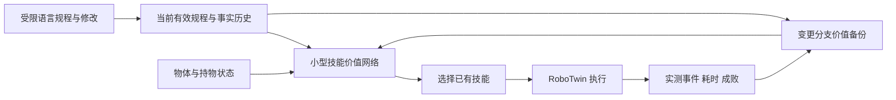

# 硕士开题建议：中途规程修改下的技能恢复与价值学习

> [!info] 最新方向入口（2026-10-12）
> 用户当前暂定方向为**面向场景变化的 VLA 多模态条件—动作对齐与强化学习适应**，见 [[VLA动作专家适应-条件利用、多解生成与闭环强化学习]]。本篇规程修改/技能恢复内容保留为此前研究候选与分析历史，不代表当前已选主线。

> [!abstract] 本次选定的建议
> **建议题目：面向实验规程中途修改的机器人技能恢复决策与强化学习。** 聚焦已抓起旧目标、但该步骤尚未完成时，怎样选择放回、暂存、换手或接续，让修改后的整个流程合规完成且代价较低。先冻结低层原语，仅学习小型技能价值函数；不同时研究自由语言解析、液体动力学、世界模型和全量 VLA 后训练。这是方向建议，尚不代表用户已经确定题目。

> [!important] 算法新颖性边界
> 候选方法为“历史一致的规程变更分支价值备份”：在同一真实物理转移上枚举少量合法修改分支，以正确概率加权后续价值。**反事实复用、期望备份及自动机不是新思想**，CRM/QRM 与相关 TD 理论已覆盖其通用基础。当前可以明确提出机制、条件与实验，不能宣称已成立的首创算法。若将动态修改加入扩展 RM 后，标准 CRM＋期望备份就能完全复现候选方法，则方法应归为该框架的应用/扩展，不能靠名称包装成独立算法创新。

> [!important] 2026-10-11 文献核查后的收缩
> **中途切换导致失败的现象已有直接实验；持物恢复、用户追加/取消要求也已有监督或免训练方法。** 不能将“会改指令”作为独立 RL 创新。尚需验证的是：部分修改后，在共同的事实历史、有效要求、技能库与总预算下，RL 是否能更好地完成全部有效规程并降低恢复代价。详见 [[#10. 问题是否存在、非RL是否已解决（2026-10-11文献核查）]]；本次没有证明 RL 必要性或候选算法新颖性。

> [!note] 化学实验室需求的进一步校准（2026-10-11）
> 实际需求依据更强的是**任务取消、样品替换或设备异常后，完成当前物理收尾并继续其他有效任务**。这不等于反应过程中任意改试剂/配方，也不意味着必须用 RL。现有药瓶场景只验证抽象恢复决策；化学工作流需求与已有关联方案见 [[#11. 这种能力在化学实验室是否需要（2026-10-11应用需求核查）]]。

> [!important] Harness 与 RL 的职责校准（2026-10-11）
> 用户进一步指出：状态、记忆和流程续执行更适合 Harness；希望考察外生扰动后的恢复。**保存状态本身不能支撑 RL 算法创新。** 物理恢复更接近交互学习，但也可由反馈控制、监督纠正和规划完成；目标通常是恢复到能继续任务的状态，而非完整还原原场景。详见 [[#12. 固定目标下的环境扰动恢复：Harness与RL边界（2026-10-11）]]。这是讨论中的方向校准，尚未确定新题目或完成算法设计。

> [!important] 用户进一步收窄到动作专家（2026-10-11）
> 前面的恢复例子偏向技能调度。用户当前优先关注**多模态条件如何被动作专家有效利用，以及受扰状态下如何生成、选择并闭环续接多种有效动作**。独立整理见 [[VLA动作专家适应-条件利用、多解生成与闭环强化学习]]。本文既有规程修改/恢复调度保留为历史候选，不代表当前已确定主线；动作对齐不足与生成覆盖不足也尚未被本地实验确认为主要失败原因。

关联：[[强化学习优势的数学本质-从序贯决策到具身选题]]、[[化学实验室VLA开题-动态规程与语言强化学习]]、[[目标语义保持空间精化-RL算法定义与RoboTwin最小验证]]、[[RoboTwin 2.0框架与默认任务]]。

## 1. 一个具体任务贯穿开题

原规程：先把药瓶 A 放到红垫，再把 B 放到蓝垫，最后把未使用药瓶留在原区、双臂回位。已完成的 A 不重复处理，瓶体不可倒下。

在 B 已被抓起、尚未放到蓝垫时，用户修改：**“后面的 B 改成 C，其余要求不变。”**

机器人已持有 B，物理状态不能随改指令重置。可选路径包括：

- 放回 B 后抓 C；
- 暂存 B、先处理 C，再归还 B；
- 保持 B，用空闲手处理 C，再归还 B；
- 必要时经过中间暂存/重抓，改变持物手与通路。

不同布局下，最近暂存点可能阻挡 C 或占用之后的操作区域；放回 B 较慢却可能提高后续成功率。需要至少两次依赖前次执行结果的技能选择，避免把问题退化成一次选择后立即评分的 contextual bandit。

首版只允许每回合一次明确修改，修改未完成步骤的对象或目的地；在原子技能结束处生效。例如抓取结束仍在持物状态，这属于多步骤流程中途修改，但不声称支持控制周期内打断轨迹。已经完成或不可逆发生的事实不能被撤销。

这里模拟的是实验室样品物流、身份与操作顺序，不是化学反应、液体计量或真实污染动力学。工具接触历史可日后扩展，初版不同时加入。

## 2. 为什么值得考虑 RL，什么情况下不用 RL

| 方法 | 能解决什么 | 本题需要检验的不足 | 必须承认的边界 |
| --- | --- | --- | --- |
| 最新指令刷新＋规则重规划 | 正确目标替换、固定恢复顺序 | 不同物理状态下，固定恢复路径的长期代价/成功率是否不同 | 若简单规则已解决，则 RL 主线必要性不足 |
| 监督学习/行为克隆 | 从示范学习恢复动作或技能选择 | 当前持物与未见修改组合缺少覆盖；最优恢复动作比最终结果更难标注 | 等成本 DAgger/纠正示范可能同样有效，不能宣称监督无法解决 |
| 符号/几何规划 | 已知前置条件、无碰撞路径与任务顺序 | 未知的技能执行后果、稳定性和状态相关成功概率不由逻辑合法性自动给出 | 若模型可靠，规划可以直接求解，RL 无原则性优势 |
| 学习技能模型＋期望搜索 | 从同样数据估计技能成功/耗时再重规划 | 模型误差、组合搜索成本与有限交互下的效果 | 属于重要强基线，也可视为 model-based RL；不能只比较弱规划器 |
| 技能级 RL | 用实际结果学习现在选择对后续合规成功的影响 | 反馈、覆盖、复位是否足够；是否真正存在多步权衡 | 无法凭空学出低层不会的技能，不保证比以上方法省样本 |

本题的 RL 依据是 **结果评价较便宜、恢复路径难逐步标注、动作改变后续可操作性且执行后果未知**。语言修改本身不是依据。也不预设规划或监督“原则上不够”。

## 3. 只训练哪一部分

首版规则解析固定表达，输出对象、目的地、修改范围。解析器不计为算法贡献，所有方法共用。

状态 $x=(z,h,p,k)$：

- $z$：物理状态；机制诊断先用仿真真值，实际低维输入可包含位姿、速度、关节、持物手及区域占用。
- $h$：事实历史与必要事件，例如 A 已完成、B 被哪只手持有、过去是否发生不可逆违规。
- $p$：当前有效规程及仍需完成的要求，不能只有一个任意版本编号。
- $k$：时间/技能预算、是否已发生本回合唯一修改。

理论以充分状态为条件。简化位姿与持物编码不自动满足 Markov 性；状态估计/历史不足时需要补充，而不能把理论保证直接套给压缩输入。

动作 $u$ 是一个**参数已固定的技能**，例如左手抓 C、把左手所持 B 放回原区、把 B 放到左暂存点。初版每个状态保留约 6–10 个可执行候选；这是候选目标，不是现有官方接口数量。动作掩码只处理共同前置条件，不能给新方法额外 oracle 恢复答案。

普通基线用小型 DQN/Double DQN。低维输入时，两层 128 或 256 的 MLP 通常为万到十万量级参数；具体参数量随输入/候选数计算，不是 VLA 的数十亿参数。首版离散动作不需要对 flow-matching VLA 求动作 log-probability。

低层先用 RoboTwin 规划原语。高层机制通过后，再替换为冻结且已验证可靠的 VLA 技能。规划原语结果不能直接称为 VLA RL 后训练结果；接入冻结 VLA 也不表示其权重被 RL 更新。

## 4. 一个核心算法候选：历史一致的变更分支价值备份

### 4.1 分开物理结果与规程更新

一次固定技能得到真实结果 $\xi=(z',e,d)$：下一物理状态、事件和持续时间。先根据执行时有效的 $p$ 评价这一段动作，累计折扣奖励为 $R$；更新事实历史 $h'=\operatorname{append}(h,e)$。

随后在技能边界接受编辑 $c$，包括“无修改”。将其作用于**剩余要求**：

$$
p'_c=\operatorname{Edit}(p,h',c),
\qquad x'_c=(z',h',p'_c,k'_c).
$$

不能修改 $z'$、擦除真实历史或把旧动作追溯改成在新规程下执行。若保留完成位，需要按事实和生效边界计算残余任务状态，而非简单清零全部进度。

物理结果共享的条件是：给定充分物理状态与参数固定的技能，编辑在技能完成后生效；编辑不会改变该段已执行的动作、动力学、对象或传感器。若动作定义为“完成当前目标”而实际轨迹随编辑变化，则不能将其当成同一 $u$ 复用。

### 4.2 从采样一次修改，改为对合法分支求条件期望

训练环境公布合法编辑集合 $\mathcal C(x,\xi)$ 与分布 $q(c\mid x,u,\xi)$。它可以包含依据事件触发的规则，但只能使用真实可获得的条件；首版分布由实验协议给定，不推断真实研究人员意图。

普通采样目标：

$$
Y_{\rm sample}=R+\Gamma(d)(1-D_c)\bar V(x'_c),
\qquad c\sim q.
$$

其中 $D_c$ 为相应分支的终止标记，$\Gamma(d)$ 是技能时长对应折扣，$\bar V(x)=\max_u Q_{\bar\theta}(x,u)$；Double DQN 可替换为在线选择、目标网络评价。奖励 $R$ 必须与这个时间折扣约定一致。

候选目标：

$$
Y_{\rm branch}=R+\Gamma(d)
\sum_{c\in\mathcal C}
q(c\mid x,u,\xi)(1-D_c)\bar V(x'_c).
$$

用 MSE 训练 $Q_\theta(x,u)$，目标停止梯度。当前技能执行时只有当时有效的要求；将未来编辑边缘化，不是把最新目标追溯到当前动作的即时奖励。

首版只改变这个备份算子，先不额外重标当前规程或添加多个损失。一个真实物理结果多算几次小网络前向，无需复制仿真分支、重放整段接触或训练世界模型。**虚拟编辑只能给出下一规程状态，不能制造未执行技能的物理结果，也不能替代探索。**

部署用当前观测到的规程选择技能，不提前看到实际未来消息。训练知道的是总体编辑分布；部署分布改变会影响价值，需单独测量。

### 4.3 可核查的数学性质

固定当前 $x,u$ 和目标网络、编辑分布正确、分支有效时：

$$
Y_{\rm branch}=E[Y_{\rm sample}\mid\xi],
\quad E[Y_{\rm branch}]=E[Y_{\rm sample}],
$$

$$
\operatorname{Var}(Y_{\rm sample})
=\operatorname{Var}(Y_{\rm branch})
+E[\operatorname{Var}(Y_{\rm sample}\mid\xi)].
$$

因此消除的是**给定相同物理结果后，随机指令修改造成的目标方差**。没有删掉前置动作对后续可恢复性的真实影响，也没有保证网络收敛或最终 SR 更高。这是条件期望/全方差公式的应用，不是新数学定理。

若所有编辑只有一个分支，或各分支后续价值相同，该项收益为零。若广泛备份到未覆盖的分支，critic 初值/外推误差可能抵消低方差收益；相关风险在 Adaptive Tree Backup 文献中已有分析，不能只看方差就断言更快。

若采用估计分布 $\hat q$，令分支值 $W_c=(1-D_c)\bar V(x'_c)$ 位于 $[W_{\min},W_{\max}]$，则本次自行推导：

$$
|Y_{\hat q}-Y_q|
\le\Gamma(d)(W_{\max}-W_{\min})
\operatorname{TV}(\hat q,q).
$$

这说明错误编辑分布会引入偏差；不是真实用户修改分布已知的证明。只允许枚举所有合法分支再正确归一化，不能删除困难分支后仍声称优化原分布。

## 5. 真正需要争取的贡献与近邻

拟研究的是：**部分规程修改下，能否构造保持真实历史、义务生效边界与目标分布的技能价值更新，以更少真实交互学会合规恢复？**

| 近邻 | 已覆盖的内容 | 本题必须检验的额外内容 |
| --- | --- | --- |
| CRM/QRM，JAIR 2022 | 同一物理转移用于多个 RM 状态的反事实学习 | 动态编辑如何映射保留事实的残余规程；显式编辑转移是否带来区别，还是直接被扩展 RM 吸收 |
| Expected/Tree Backup、ATB | 样本与期望备份、方差和覆盖的权衡 | 本题的外生编辑分支及适用条件；不能宣称发明期望备份 |
| HER、LfH | 以其他/已实现目标重标轨迹 | 当前方法保留原事实与真实目标生效时刻；不能把错目标当本任务成功，相关方法仍应是经验利用基线 |
| Successor Features/GPI | 奖励结构复用与任务转移 | 残余规程与历史条件化要求不一定是固定状态特征上的简单线性权重变化；不能笼统称换目标价值复用首创 |
| SwitchVLA | 执行状态条件化前进/回退/切换 | 本题学习恢复路径的长期价值与交互效率；“支持改指令”已有工作 |
| Temporal GRPO | 按可检测阶段比较轨迹并分配局部信用 | 本题将编辑转移纳入价值备份，而非仅划段；其离散高层适配需明确是 adapted baseline |
| StructRL（2609.36352） | 前置依赖与节奏条件的阶段奖励 | 所有对照共用过程判据，方法收益必须来自更新机制而非更多奖励 |
| CCA，ICML 2021 | 用满足独立条件的未来信息构造信用估计 | “外生变化不是动作错误”的一般信用思想也已有基础，不宣称首创该解释 |

注意有两篇同名 StructRL：本表指 **Online Structured Reinforcement Learning for Long-Horizon VLA Tasks，2609.36352**，不是动作空间结构化噪声论文 2608.15139。

截至本次核查，没有证据证明候选超过已有方法。最重要的反证是：**等预算扩展 RM＋CRM＋相同期望备份完全解释全部收益。** 如发生，应将其归为清晰的应用研究或重新寻找算法问题，不能继续叫新算法。

“一个规程解析器＋DQN”“修改前梯度全部归零”“新增语义奖励”“增加双 critic”“只更新最新子任务”均不作为本题创新。

## 6. RoboTwin 最小验证及本地接口依据

### 6.1 当前源码核查

本地根目录 `/home/admin123/liminghe/vla-benchmark/RoboTwin`，2026-10-10 静态读取；该工程没有 `.codegraph/`，按约定使用普通源码读取，未自行索引。

| 当前文件 | 已读到的可复用内容 | 边界 |
| --- | --- | --- |
| `envs/move_pillbottle_pad.py` | 药瓶 `080_pillbottle`、目标垫、抓取—抬起—放置原语 | 默认一瓶一垫、固定整回合，不是动态规程场景 |
| `envs/pick_dual_bottles.py` | 双瓶生成、双臂分别抓取 | 原任务成功定义不能替代完整新规程 |
| `envs/handover_block.py` | 换手/交接动作示例 | 对药瓶的交接未验证，首轮可以不加入 |
| `envs/_base_task.py` | `grasp_actor`、`place_actor`、`move`、`get_obs`、`set_instruction` | `set_instruction` 仅改字段；不会自动清动作缓存或建立 RL 奖励 |
| `scripts/eval_policy_xpolicylab.py` | 按 chunk 逐动作执行，依赖 `eval_success` 和步数结束 | 动态修改需清旧 chunk；不能沿用单步任务提前终止逻辑 |

虽然 Base_Task 继承 gym.Env，当前任务代码使用 setup/play_once/take_action 风格；本研究仍需独立技能级 reset/step wrapper 与过程奖励，不能认为已是即插即用的标准 RL 环境。本次未系统审计所有 XPolicyLab RL 工具，也不声称整个项目没有 RL 支持。

`move` 的规划失败会把 `plan_success` 置为假，后续原语可能直接跳过。首版将规划失败记录为真实失败并结束回合，不随意清标记假装恢复；若研究失败后的原地重规划，需要另外实现并验证安全恢复。

### 6.2 只改一个场景

从药瓶取放派生独立研究任务：三药瓶 A/B/C，红蓝目标垫与一个可变暂存区域。先用官方常用 Aloha 双臂与夹爪；已有 RM65-B 灵巧手接入不作为这一机制验证的依赖。

每回合 4–8 个技能决策，最多一次对象替换或目标垫替换。初版编辑在抓取/放置原语返回后处理，不做控制周期内中断。手中有旧物、暂存区占用及剩余预算必须进入状态。

用真实几何/接触执行造成的差别评价策略。若原语在全部布局下确定且无代价差别，规则已能解决，应如实停止该假设；不为证明 RL 优势而人为给正确规则添加随机失败。

事件奖励：完整有效规程合规成功、真实不可逆违规、真实耗时/技能次数。先不要学习 VLM 奖励模型。若加阶段完成奖励，所有基线使用相同判据及相同数值；目标改变本身不发失败惩罚，历史违规不因改目标擦除。

### 6.3 对照分两层

**A. RL 是否值得用：** 最新指令＋固定放回规则；符号/几何重规划；同样物理轨迹训练技能成功/耗时模型＋有限层期望搜索；等专家时间的 BC/DAgger；同规程状态、奖励和技能的普通 DQN/Double DQN。

**B. 算法候选是否有效：**

1. 普通采样备份；
2. 动态规程状态＋CRM 经验复用，编辑仍采样；
3. 仅变更分支备份；
4. 扩展 RM＋CRM＋期望备份的完整组合；
5. 同状态与奖励的阶段信用方法适配，用于说明不是已有局部信用的重命名。

第 4 项可能与候选本质等价，必须正面检查。直接复现所有大 VLA 近邻不是先导实验必需；阶段奖励/信用的离散适配需要标明，并不能冒充原论文严格复现。

控制同一技能库、可见状态、解析器、候选掩码、事件奖励、真实交互次数、重置与模型选择预算。方法额外前向、更新次数与墙钟时间单独报告。虚拟分支不计成额外真实环境样本，也不宣称获得免费未执行动作反馈。

### 6.4 评价和可证伪假设

- 修改后完整合规 SR，以及未修改要求的保持率；
- 修改到完成的真实耗时、额外技能次数、恢复失败率；
- 随真实物理交互次数变化的学习曲线；
- 固定同一 Q checkpoint 和物理转移，枚举合法编辑后测目标方差与均值，验证数学机制；
- 变更频率为零/低/高、时机变化、未见对象—目的地组合、编辑分布偏移；
- 无修改任务是否退化，以及错误规程重标带来的目标偏差。

**H1：** 在存在后续可操作性权衡的布局中，技能级 RL 比固定恢复和同预算监督更有效；模型学习＋规划作为强反证基线。

**H2：** 编辑分布正确时，候选与采样目标均值一致、目标方差更低；价值分支相同或无修改时该收益消失。

**H3：** 在同样状态、反馈、真实交互和计算报告下，低方差能转化为更快学习，而非只是拟合一个较平滑的目标。

H2 是标准条件期望性质的应用；H1/H3 必须实验。只有 SR 提升且没有机制检验，不足以建立算法贡献。

## 7. 工作量与停止条件

| 阶段 | 最小工作 | 验收依据 |
| --- | --- | --- |
| 先导 1 | 一个场景、技能封装、明确编辑与事件协议 | 原子技能成功率/耗时及失败归因；证明存在两条恢复路径的后果差别 |
| 先导 2 | 小型 DQN 基线、规则/规划/监督对照 | RL 必要性是否成立，技能失败是否掩盖高层决策 |
| 先导 3 | 更换一个 TD 目标、分支合法性与均值/方差检验 | 无错误历史重标、无真实未来消息泄漏；正确分布下等均值 |
| 后续 | 多种布局/修改组合、冻结 VLA 替换原语、RM65-B 验证 | 先分别验证技能成功，再验证高层效用；不混淆底层与方法收益 |

建议先用每方法数百回合筛查，再按每次技能执行计真实交互，选择是否扩展至数千次技能、三个训练种子及独立评测布局。数目是预算建议，不是已运行配置或足够收敛的保证。

若原语已可靠，先导可按 2–3 周安排；这是工作计划估计，实际耗时取决于复位、规划与场景构建，不承诺训练时长。新工作主要是一个任务文件、技能级 wrapper、规程/事件管理、训练目标和评测统计；不必先改 6B 主干或训练液体世界模型。

停止或收缩条件：规则已接近上界；同预算模型规划更好且没有明确学习收益；监督纠正更便宜有效；分支目标方差并非瓶颈；扩展 CRM 完全等价；底层技能不可靠。不能通过降低基线信息或抬高近邻复现成本来保留创新叙事。

## 8. 可用于开题的简短表述

> 本课题面向实验规程在执行中发生部分修改的场景，研究机器人如何利用已发生的操作事实与当前物理状态，选择合规且低代价的恢复技能序列。拟在冻结低层技能的基础上，通过执行反馈学习恢复决策的长期价值，并研究利用规程修改结构构造历史一致的价值备份，减少外生指令变化带来的学习目标方差。通过受控双臂仿真比较规则、监督、模型规划与现有强化学习方法，检验其交互效率及适用边界。

以上为研究计划，不是成果摘要。可以先按题目开题，方法名称与首创性须在近邻等价性检查和先导证据后确定。

## 9. 本次证据范围

2026-10-10：读取已有笔记、核查上述原始论文的相关方法/摘要与本地任务、执行入口；数学等式和 TV 界为本次自行整理推导。CRM、ATB、CCA 为已发表基础；SwitchVLA、Temporal GRPO、StructRL、LfH 的此处依据是所链接作者预印本，不推断其顶会接受状态。

本次没有实现新任务、训练策略、运行仿真或连接真机，没有使用服务器资源。尚未获得 SR、时间收益或新颖性成立的项目证据。

## 10. 问题是否存在、非RL是否已解决（2026-10-11文献核查）

### 10.1 两个问题必须分开回答

用户追问：既然担心“等成本教师监督或规划已经解决这个问题”，当前 VLA 文献是否能说明问题真实存在？

本次判断：**执行中换指令引发的失败真实存在；监督、免训练干预和分层系统已解决其中一部分；相同总成本下 RL 对本题的不可替代性尚无证据。** “存在困难”“某个非 RL 方法仍会失败”“RL 比原始 SFT 好”都不能推出“RL 优于等成本强教师或规划”。

这里是代表性原始论文的定向核查，不是系统综述、元分析或对全部工作的穷尽排查。数字只在各论文自己的模型、任务和协议内比较，不能横向当综合排名；也没有测量该问题在真实化学实验室中的发生频率。

### 10.2 直接涉及指令变化的证据

| 工作与来源 | 作者实验/方法报告 | 对本课题的含义与边界 |
| --- | --- | --- |
| [SwitchVLA v1](https://arxiv.org/html/2506.03574v1)，2025-06-04，§3.4、4.1，表1 | LIBERO-Goal：作者实现的 π₀ 无切换 SR 92.3%，接触中切换仅 8.3%；以回退/前进轨迹监督训练后，SwitchVLA 接触中达到 50.9%。 | 有直接切换失败证据，且监督学习有效；含拿着旧物时先放回的案例，不能再把持物恢复当空白。成功定义侧重退出 A、完成 B，未独立评价部分修改后全部未取消要求。 |
| [ReSteer v1](https://arxiv.org/html/2603.17300v1)，2026-03-18，§III-C、IV、VI | 以阶段匹配的目标示范构造切换过渡，再对成功切换 rollout 做迭代 BC；厨房包含拿起碗后由水槽改到架子。 | “交互收集＋改进策略”也可以仅靠监督训练；没有 RL 就不能闭环适应的说法不成立。主要评估新任务完成和原单任务能力，未单独计残余义务、返工和占用代价。 |
| [Causeway v1](https://arxiv.org/html/2609.30913v1)，2026-09-25，§III-B、IV、V-A，表I | 从前任务留下的状态换指令易失效；71 个跨对象任务对、三个切换时机中，π₀.₅ 从 26.0% 提高到 61.6%。方法在冻结 VLA 解码表征上施加阶段条件化干预，不更新参数。 | 强证据指向状态与策略可接手范围的不匹配，免训练方法已能改善。重入目标取自 B 的示范，持旧物可先释放；排除五对 A 会移走 B 目标配置的任务，判据主要看 B 成功。不能等同于保留原规程全部有效要求。 |
| [Hi Robot，ICML 2025](https://proceedings.mlr.press/v267/shi25d.html)，[v2 正文](https://arxiv.org/html/2502.19417v2)，§4.3、5.3、附录C.4 | 分层 VLM→VLA 用监督训练，真实测试“剩下的别收”“再加一个 KitKat”等反馈；作者仍报告缺少记忆导致长上下文困难、忽略乳糖不耐受要求而拿奶酪，以及掉物后的 OOD 恢复失败。 | 用户执行中改变要求不是 RL 独占能力；同时持续约束和恢复仍有缺陷。这些失败不自动说明价值学习是最佳解，也可能需要更好的状态、记忆或纠正数据。 |

这些工作覆盖从直接换目标、阶段匹配恢复到开放反馈的不同层次。**本次未看到它们在严格相同设定下比较“部分修改＋历史保持＋未取消义务＋多个恢复序列长期代价”以及等成本 RL/监督/规划；这不是无人研究过的证明。**

### 10.3 化学流程与长任务也已有强非RL方案

[RoboChemist，CoRL 2025](https://proceedings.mlr.press/v305/zhang25i.html) 使用七种原语完成五种化学流程，结合监督学习的二次尝试、VLM 过程检查和重试；例如依据指示剂变化决定是否继续加酸。它支持“监督恢复＋条件停止＋监控”这一已有路线，未单独验证外部用户中途部分改规程。原文附录仍有监控误判、约束违规和无法恢复的执行失败，不能据此宣称 RL 必然更好。[作者正文与附录](https://arxiv.org/html/2509.08820)。

[RoboHarness v3](https://arxiv.org/html/2607.18060v3) 通过执行记忆、策略路由、Memory Bridge 和重规划处理环境扰动与技能交接，无需联合重训全部底层策略。它说明运行系统本身可以带来恢复收益；所编排技能包含既有 RL 策略，不能称为全链路从未使用 RL。其证据不等于本题的用户部分修改评测，记忆更新、额外推理和重试也有成本。另见 [[RoboHarness精读-异构策略编排与记忆桥]]。

因此，“用于化学实验室”“长任务中出现失败”“增加一个规划层或重试模块”均不能单独作为创新点。

### 10.4 RL 与监督比较：现有论文并未统一核算总成本

| 原始来源与定位 | 对照结果或设计 | 能说明什么，不能说明什么 |
| --- | --- | --- |
| [RLT v2](https://arxiv.org/html/2604.23073v2)，§VI Q2、图6、附录 | Ethernet 上 DAgger、DSRL 的 SR 与 RLT 相近；RLT 的平均完成步数约为原策略一半。DAgger 用原始示范及 RLT 收集的同一批接管数据微调。 | SR 未必是 RL 的额外价值，速度可能是。该 DAgger 是固定数据对照，不是独立滚动采集纠正；没有证明等总成本最强监督无法获得相同速度。 |
| [BEE v1](https://arxiv.org/html/2609.27450v1)，表II/IV、附录C–E | 手机充电精密阶段：Base 90.0±5.0%，DAgger 63.3±5.8%，BEE 100±0。比较按总计 90 回合：BEE 约 20 纠正种子＋70 在线；DAgger 90 在线。 | 此实现有真实 RL 增益，但不是整个多步充电流程的 100%。共同初始化已有 200–900 示范，各方法 GPU 和接管比例不同，复位人时未完整计入；回合等量不等于总成本等量。 |
| [SARL v1](https://arxiv.org/html/2606.31958v1)，§5、附录A.2/A.5 | 学语言候选的 Q 值，比所测 ICL VLM 规划器更有效；但真实对照的语言示范、候选决策频率并未完全匹配。 | 支持学习策略执行特性后选择语言有价值，不代表所有强规划器均不足。它修改内部子指令、总任务固定，不能作为外部用户部分修改原规程的直接证据。 |
| [VLA-OPD v1](https://arxiv.org/html/2603.26666v1)，§4、表2 | LIBERO-Long：纯蒸馏 78.9%，蒸馏＋GRPO 90.2%，教师 90.7%；教师是 SimpleVLA-RL。 | 教师存在时监督已获得相当能力，RL 仍有增益。但学生“一条示范/任务”不包含教师取得成本，不能把有 RL 教师的学生蒸馏说成从零消除 RL。 |

应分别报告**已有教师时的增量成本**与**从零建立教师的总成本**。总成本至少包含：初始示范、真实技能执行与复位、人类纠正/标注时间、教师查询、训练计算、部署推理与重试。相同 epochs、训练 steps、batch 或回合数只控制其中一项。不同成本无法无依据压成统一金额时，报告共同预算与成本明细，并比较性能—成本曲线。

### 10.5 对选题的修正：先证实剩余问题，再选算法

如果任务只有“放下 B、再拿 C、完成新目标”，以上文献已经足以构成强近邻，**不建议以此支撑一个独立 RL 算法创新**。更具体的待验证问题是：

> 当只修改未完成步骤时，如何在保持已发生事实与其他有效要求的前提下，用有限交互学会恢复序列，并减少恢复耗时、返工和后续失败？

药瓶示例需要同时评价：C 到正确目标区；A 的已完成结果保持；未使用的 B 最终归还；双臂回位；瓶体未倒下。只看 C 成功可能漏掉其余要求。暂存 B 是否阻挡后续、先放回是否更可靠，必须由真实几何和执行结果产生，不能为了 RL 叙事人为制造规则失败。

先导对照采用共同的 $x=(z,h,p,k)$、当前编辑、技能库和有效要求，不给 RL 独有的记忆或判据：

1. 固定放回规则＋符号/几何重规划。
2. 阶段条件化重入/监督恢复：参考 SwitchVLA、ReSteer、Causeway 的思路封装技能级基线，明确是适配版，不冒称严格复现。
3. 同专家时间与数据预算的 BC/DAgger；若重规划能自动给标签，必须纳入低标注成本教师。
4. 同执行数据学技能成功/耗时模型，再做短视界期望搜索。
5. 同状态、奖励、真实交互的普通 DQN/Double DQN；候选新备份必须额外胜过该基线与扩展 CRM 对照。

先检查简单任务：若补足上下文和阶段条件后问题基本消失，应归因为状态/数据覆盖，不强行称价值学习问题。随后才检查存在多个后果不同的恢复序列时，RL 是否改善“完整合规 SR—耗时—训练/人力成本”的权衡。无需先复现所有大模型，也不靠仅击败裸换 prompt 建立价值。

否决条件保持不变：同预算规则、监督或模型规划已达到相同或更好的完整合规与恢复成本；或收益只是来自新方法独占的历史/奖励/候选技能。在这些条件下，应放弃“RL 必要”的叙事，考虑监督恢复或执行系统方向。

### 10.6 新发现的算法近邻：MAVIC

[MAVIC v3：Robust Instruction Compliance in Cooperative Multi-Agent Reinforcement Learning](https://arxiv.org/html/2605.12655v3)，2026-06-10 版本，已研究宏动作被指令打断时的 Bellman 边界修正，用旧指令延续价值替换新指令的 bootstrap 贡献。实验为 Box Pushing、Warehouse、Overcooked 等合作环境，不能当作具身 VLA 真机结果。

**“修改指令边界上的价值更新”本身也不是无人触及的空白。** 但其各指令保持时的价值目标，与本笔记真实编辑分布下整个有效流程的目标不同；不能直接断言算法等价，也不能照搬取消未来指令贡献。标准 Bellman 对包含编辑状态的真实决策过程并不因“换指令”自动错误。下一步新颖性核查必须同时面对 MAVIC、CRM 与期望备份，先明确优化的是哪个目标。

### 10.7 本次增补的证据状态

2026-10-11：在线核查原始论文、表格、附录与正式论文集。Hi Robot 的 ICML 2025、RoboChemist 的 CoRL 2025 出处已核到；其余此处按所链接作者预印本及明确版本记录，不推断接受状态。所有性能数字均为作者报告，本项目未复现。

本次仅增量整理文献与修正研究判断，没有运行 RoboTwin、训练 RL、操作服务器或机器人，没有确认算法新颖性，也没有完成等总成本实验。关联 [[VLA技术路线综述-从动作生成到世界模型与具身系统#12. 后训练核心技术判断（2026-10-11增补）]]。

## 11. 这种能力在化学实验室是否需要（2026-10-11应用需求核查）

### 11.1 需要的具体能力

**需要，但应用动机应收窄为受约束的流程调整、物理收尾与剩余任务连续执行。** 固定 SOP 不以频繁人工改目标为前提；现有证据也不足以说明研究人员经常在正在进行的反应中随意替换试剂。语言是传达获准取消/改派的接口，恢复能力本身也可由结构化指令或故障事件触发。

| 实际情形 | 本次对应用适合度的判断 | 与当前候选问题的关系 |
| --- | --- | --- |
| 固定 SOP、重复单批实验 | 中途换目标通常不是首要动机，应先保证可靠执行与异常处理 | 如果恢复路径固定且已知，规则处理更直接 |
| 多样品、共享仪器或批量流程 | 与任务取消、受影响样品替换、设备释放及其余样品继续执行直接相关 | 最适合当前技能级恢复研究，但已有工作流系统是强基线 |
| 反应过程反馈控制 | 实际需要按温度、颜色、终点等调整执行 | 多数保持原目标，属于条件执行/过程控制，不自动等于用户改目标 |
| 自主反应优化 | 常由上一轮结果决定下一轮条件 | 跨回合实验设计不能算成同一回合的规程编辑 |
| 人在环探索性实验 | 可能修改尚未执行的取样、送检或样品处理要求 | 需以目标实验室记录确认具体频率和代价，不能仅靠设想 |

表中“适合度”为本次研究判断，不是对化学实验室整体的频率统计。

### 11.2 实际系统中的需求证据

- **AlabOS（Digital Discovery 2024）**：§3.2.1 规定运行中任务取消的停机处理；§3.2.3 允许人工移除/替换受影响样品、重置设备，随后继续其他样品。表2的 2,658 次 Diffraction 任务中，4.74% 出现异常；规则及人工参与的处理已能恢复其中约75%的异常。这是特定 A-Lab 的作者运行报告，不能当作所有化学实验或语言修改的频率。[正式出处](https://doi.org/10.1039/d4dd00129j)，[作者正文](https://arxiv.org/html/2405.13930v2)。
- **Opentrons Flex 官方文档，Error recovery**：执行异常后提供补液、换吸头、重试、跳过、取消等选项；取消时也考虑保留吸头内液体与弃头位置。证明停止任务仍需处理当前物料状态，避免直接重跑的损失；这是产品功能说明，无异常频率或 RL 对照。[官方说明](https://docs.opentrons.com/flex/touchscreen/protocol-run/#error-recovery)。
- **Leonov 等，Nature Communications 2024**：用传感器与预定义规则实现温度反馈下的动态加料、颜色终点判断及故障检测；另一个优化层依据结果选择下一轮参数。它同时说明在线自适应的需求，以及过程反馈与跨回合优化的区别；未证明自由语言配方编辑需求或 RL 优势。[原论文](https://www.nature.com/articles/s41467-024-45444-3)，[公开全文](https://pmc.ncbi.nlm.nih.gov/articles/PMC10858227/)。
- **ChemIDE/XDL 执行文档**：普通暂停/停止等待当前 base step 完成，紧急停止则不能恢复。这支持把首版修改限制在可处理的技能边界；不能把语言修改等同立即打断任意物理过程。[官方文档](https://croningroup.gitlab.io/chemputer/xdl/usage/execute_xdl.html)。

这些例子证明该类执行需求存在，也证明已有规则、资源管理与人工恢复方案。它们没有验证本笔记的 RL 方法，更没有证明用户所在实验室迫切需要它。

### 11.3 更可信的最小化学工作流示例

将第1节的抽象“B 改成 C”解释为**封闭样品的备样后送检/归档流程调整**，而非正在反应时把 B 试剂换成 C：

> A 已完成送检并进入待归档状态；机器人正持有待检 B。操作者发出：“B 暂不检测，放到待复核区；先送 C，其余样品流程保持。”

机器人须正确安置 B，再处理 C，并继续 A 的归档与其他未取消要求。暂存、直接归还或利用空闲手接续可能具有不同后果；它们的差别必须来自真实空间占用、技能成功/耗时或后续返工，不能人为削弱规则基线。原子技能结束后接收指令符合当前最小验证范围，不声称可中断加热、反应或任意动作周期。

该例包含暂缓/改派语义；第1节原设计仅允许对象/目的地替换。如采用此应用收缩，需先明确合法编辑与剩余要求的更新规则，不能宣称当前已有对应实现。

首版可用封闭空瓶与标签、检测架/待复核区/归档区代替真实材料。需要评估样品身份、任务依赖、已完成结果保持、当前持物/占用及全流程收尾；否则只是换上化学外观的通用取放。此示例是本次建议，未在实际实验室观察或运行。

真实化学中，已经加入物料或发生反应不能靠改指令/机械回位撤销；修改后仍可能保留清理、弃样或记录要求。若后续纳入开封、接触等历史，其事实必须单独记录；当前封闭空瓶验证不能声称测了污染、反应可逆性或计量精度。化学替代与处置方案应来自获准规程，恢复策略只在可执行候选内选择。

异常、反馈与外部编辑在数据中分开：原目标不变的重试不是规程修改；故障被转化为获准任务取消/改派时，才构成当前模型的编辑事件。不能把所有恢复数据混成“用户修改指令”。

### 11.4 是否值得成为核心硕士选题

更符合上述证据的候选表述是**“面向实验室任务取消与改派的机器人连续执行与恢复决策”**，目前只是对应用动机的收缩，不替用户确定或改名题目。

先在目标流程核验三个事实：确有取消/改派/恢复需求；错误安置或遗漏收尾会影响后续样品；存在至少两条实际后果不同的可执行恢复序列。建议收集操作者的典型记录：触发原因、发生阶段、已处理样品/物料、人工恢复步骤、耗时和损失，并与当前 SOP 比较。

若每次“归还 B，再送 C”都可靠且代价可接受，规则足够；若可靠技能模型＋短视界搜索已达到相同成本，也不应坚持 model-free RL。只有状态相关、未知的执行后果和延迟代价确实存在，且执行反馈能改善决策，才继续检验价值学习与候选更新机制。

**需求存在、值得做学习、必须用 RL、算法有新颖性，是四个不同结论。** 本次证据只建立需求类别和相关现有实现，其余仍待目标流程调查与受控实验。

2026-10-11：核查原论文、作者全文和官方文档；没有访问用户化学实验室、访谈实验人员、操作机器人或实现新流程。本笔记第1节仍保留为机制验证的历史设计，不将其升级成真实化学需求验证。

## 12. 固定目标下的环境扰动恢复：Harness与RL边界（2026-10-11）

### 12.1 用户的新判断与本次修正

用户提出：保存状态与记忆、取消/改派后的流程管理更适合 Harness-VLA；RL 更应考察人移动目标、碰撞或机械臂失误打乱场景后的恢复。

**前半判断基本成立，后半需要两个限定：扰动不自动要求 RL；恢复不一定要还原原场景。** 先前应用故事对状态管理的强调过重，若没有未知执行后果和恢复序列的长期权衡，仅记住哪些步骤完成、重新规划剩余步骤，不足以构成 RL 主线。

| 层次 | 需要解决的事 | 合适的位置 |
| --- | --- | --- |
| 执行组织与状态管理 | 当前目标、已完成阶段、持物与资源占用、历史要求、暂停和续执行 | Harness、任务状态机、数据库与执行监控；保存记忆不必用 RL |
| 扰动检测与旧动作失效处理 | 新观察是否与动作预期不符，何时截断缓存/重新推理 | 反馈、阈值或监督监视器；所有对照共享该接口 |
| 恢复控制与决策学习 | 扶正、退出接触、重抓、局部移障、交还控制的结果与后续代价 | 可用规则、监督、模型规划或 RL；RL 适用性由结果反馈与多步权衡决定 |

Harness 是运行组织架构，RL 是学习策略/价值的方法，不能当作互斥路线。恢复策略可被 Harness 调用，记忆后的动作选择也可以学习；但不能将一套日志和状态机包装成 RL 算法。

### 12.2 为什么通常不应强制复原整个场景

固定任务仍为“把 B 放到蓝垫”：若 B 被移动后仍直立、可达，重新定位并从新位置抓取即可；若瓶体横倒，可先扶正或重抓；若通路被占，可局部移障。只有原位或特定布局属于任务要求/有效技能的接手条件时，恢复该布局才有意义。持续外力还可能要求持续反馈控制，不能假设一次复原后环境就保持不变。

恢复目标应是**满足当前约束、保留有效进展、且后续策略能完成任务的状态集合**，而非扰动前图像或全部物体坐标。示意定义：

$$
\mathcal C_{g,h}=\{s:\Pr_{\pi_{\mathrm{base}}}(\text{剩余任务合规完成}\mid s,g,h)\geq\rho\}.
$$

$g$ 为不变任务，$h$ 为必要事实历史，$\rho$ 为研究者指定的成功概率阈值；此处只是问题定义，不代表已拥有准确的概率预测器或 oracle 集合。恢复终点必须由真实续执行验证，不能仅凭状态相似度宣布可接续。

已完成的正确操作不应全部撤销；物料混合、泄漏、污染等不可逆后果也不能靠动作回放复原。本阶段仍只考虑可恢复的机械扰动，不声称解决真实化学不可逆处置。

### 12.3 原始研究的支持与反证

| 工作 | 与本次判断直接相关的证据 | 边界 |
| --- | --- | --- |
| [VLA-Corrector v1](https://arxiv.org/html/2607.01804v1)，2026-07-02，§3、4.3、附录E | 监督训练潜在动力学监视器，偏离时截断旧 chunk，再做推理纠正，冻结 VLA。PiPER 真实扰动组含人移动物体、放置目标或插入目标，π₀.₅ SR 40.0%→68.3%；不使用策略 RL。 | 每回合一次、相机内、物理可恢复的阶段扰动；不是任意乱场景。它直接否定“外生扰动只能靠 RL”，也不要求把目标搬回旧坐标。 |
| [Recovery RL](https://arxiv.org/pdf/2010.15920)，§II–IV | 学风险 critic 与恢复策略，回到低风险区域；原文明示强制完全 reset 可能不现实/低效。 | 安全恢复，不能直接等同于冻结 VLA 的完成概率。作者同时提供 model-free 和 dynamics＋MPC 恢复，规划与 RL 可组合。 |
| [Residual RL，ICRA 2019](https://arxiv.org/pdf/1812.03201) | 反馈控制配合 SAC 残差学习，补偿接触与控制偏差，并适应不同几何完成插入。 | 初态随机化及控制偏差不等于每类执行中突发扰动均被验证；“残差 RL 修精度”已有先例。 |
| [Leave No Trace，ICLR 2018](https://arxiv.org/abs/1711.06782) | forward/reset 策略与 reset value，用于减少训练时人工复位并避免不可逆状态。 | 自动训练的 reset 与部署时固定任务恢复不同，不能推出所有扰动必须先回到初态。 |
| [RoboHarness v3](https://arxiv.org/html/2607.18060v3)，§7、附录B | 执行时测试重新藏块、部分拆毁结构等扰动，利用重规划与策略交接继续任务；其真机由 TAMP 与 π₀.₅ 组成。 | Harness 也能处理物理状态变化；更广的策略库包含已 RL 后训练策略，不能称整个框架从未用 RL。 |

VLA-Corrector 的 [作者 GitHub](https://github.com/ZJU-OmniAI/vla-corrector) 已核查公开页面；README 中的会议标签属于作者标注，此处性能依据固定 v1 原文，不将它升级为本次已核验的正式论文集结果。以上数字均为作者报告，非本项目复现。

### 12.4 RL 在哪里更有理由

只有“环境位置变化”时，重新观测＋重规划通常是必须比较的基础方案。RL 更有理由的条件是：

- 接触、摩擦、重抓或扶正的后果难以准确建模，成败却能从执行反馈获得；
- 恢复动作改变后续可操作性，需要至少两次相关决策；
- 暂时看似接近原状态的动作可能导致之后失败，存在延迟成本；
- 正确恢复序列难逐步标注，但完整成功、恢复耗时和失败结果可评价；
- 已有技能与真实交互覆盖允许有效探索。

RL 不只学“如何摆回去”，也可学什么时候接管、采取多大纠正、什么时候交回基座。若只选一次恢复技能立即得到评分，更接近 contextual bandit；若动力学已知且短视界规划有效，也没有 model-free RL 的原则性优势。反馈控制/MPC、纠正 BC/DAgger 与价值学习都应面对同一信息和预算。

通过 GitHub 插件静态读取的 [Recovery RL README](https://github.com/abalakrishna123/recovery-rl) 明确列出 `qrisk.py` 的 critic/model-free 路径与 `MPC.py`、`VisualMPC.py` 的 model-based 路径；文件 blob SHA 为 `6a11100e237c6da625349edc814e70b9dd34720e`。另读取 [DSRL README](https://github.com/ajwagen/dsrl)，通过学习去噪初始噪声分布引导冻结 diffusion/flow 策略，blob SHA 为 `58e9d328ed4139eccf58f7d69cf5090a8000a52b`。这些是实现路线资料，不是已确认可以直接接入本地 LingBot/RoboTwin 的证明；blob SHA 不是仓库 commit。

### 12.5 一个更贴近RL的低工程先导问题

候选表述：**“固定任务下，受扰状态中的低代价恢复与策略续接”**。首版使用封闭药瓶/空瓶，一个目标瓶、一个目标垫与有限暂存空间。保持原语言目标与目标对象身份不变，在未完成阶段引入一次受控平移/倾倒或局部通路占用，保留已经完成的阶段。先只选一种扰动，不同时模拟风场、液体或真实碰撞损伤。

共同 Harness 负责观察、历史与旧 chunk 截断；冻结可靠的低层技能，比较直接重新推理、规则重抓、监督恢复、模型规划与小型技能 RL。候选技能可包括直接接续、退让后重抓、局部整理、终止；必须分别实现并验证，不假定当前 RoboTwin 已有稳定扶正/恢复接口。

每种方法共享可见状态、扰动检测与缓存刷新、动作权限、技能库、终止条件和真实交互预算。给 RL 独有扶正技能、真值状态或更快观察，会把系统/权限收益错归为算法收益。

评价完整任务 SR、有效进展保持、恢复耗时、额外技能次数、恢复后的基座成功率及重复接管。先证明直接重新观测/推理仍有真实不足，再检查恢复路径的长期后果；“旧 chunk 一直执行”只能作为故障诊断基线，不能作为唯一对手。

该方向比纯记忆管理更贴近 RL，但尚未建立新算法。恢复 critic、options 终止价值、残差学习与 reset policy 都已有基础；PPO＋恢复奖励、恢复前后切换、或新增一个 Harness 模块本身不算算法贡献。相关理论入口为 [[强化学习优势的数学本质-从序贯决策到具身选题]]。

### 12.6 GitHub与版本边界

GitHub 搜索存在多个同名 RoboHarness：`LZY-1021/RoboHarness` README 对应 arXiv:2603.24060；`BinceQu/RoboHarness` 对应另一份“Simple Harness”项目。这两份 README 都不能冒充本库精读的 arXiv:2607.18060v3 实现。本节对后者的判断依据该固定论文版本，未将同名仓库的功能/数字套入。

2026-10-11：本次完成原文与公开仓库说明的只读核查、概念修正与笔记增补；没有下载或安装项目、修改训练配置、运行 RoboTwin/RL、操作机器人。此前规程修改方向保留为历史候选，本次讨论不代表用户已最终确定环境扰动方向。

## 13. 化学实验室场景：恢复动作的后果与多步取舍（2026-10-11）

> [!example] 证据类型与场景范围
> 以下是解释序贯决策的**假设操作场景**，不是已观察的实验室事故、论文验证结果或本机实验。使用封闭样品瓶、空试管和轻质支架描述机械恢复；不涉及反应、泄漏处置或化学配方。其作用是提出可以被实验否决的假设，不能据此宣称 RL 已有收益。

### 13.1 当前取出成功，却损害后续取样

主流程为“依次将样品瓶 A、B 从支架移到各自指定位置”。扰动后 A 斜卡在支架边缘。

- 路径甲：直接提拉 A。动作少；但若接触带动支架，B 的位置、姿态或可达性也会变化，后续可能需要额外恢复。
- 路径乙：空闲手扶稳支架，再调整抓取并取出 A。当前恢复多几步，却可能保留 B 的可取状态。

**后果的评价对象是 A、B 全部放置完成，而不只是 A 已经被取出。** 空闲手扶稳的作用是示例中的候选动作，必须实际实现与验证，不能假定本机已有该技能。若直接提拉的接触影响能够准确建模，规划也能选择路径乙；RL 的候选价值在于从不同接触、摩擦和摆放条件下的执行结果，学习何时值得付出扶稳成本、何时直接取出已经足够。

### 13.2 最近暂存点，可能增加后续重复操作

主流程为“将目标瓶送到指定工作区”。扰动后，目标瓶位于支架后方，一个空容器占据接近通路。

- 路径甲：把空容器放到最近空位，再抓目标瓶。当前动作短；若该空位恰好占用最终工作区，随后必须再次搬走空容器。
- 路径乙：把空容器放到更远、但不占用剩余流程空间的暂存区，再抓目标瓶并完成放置。

这里体现**恢复动作改变后续可操作性，最近距离不是完整流程最低代价**。但“知道工作区不能占用”首先属于 Harness/规划中的任务约束。若几何、技能耗时和成功率已知，规划就足够；只有不同搬移路径的执行可靠性、接触影响或重试代价难预测时，交互学习的价值才需要进一步检验。这个例子不能单独证明 RL 必要。

### 13.3 退一步，可能比连续纠正更快完成

主流程为“把空试管插入支架指定孔”。插入偏差使试管抵到孔缘，同时轻质支架发生小幅位移。

- 路径甲：继续微调并尝试插入。眼前距离很小；但不合适的接触可能继续推移支架，使后续误差更大、反复尝试更多。
- 路径乙：撤出接触、扶稳或重新定位支架、重新对准，再插入。刚撤出时距离反而变大，却可能提高最终插入成功率。

RL 可以学习：依据相对位姿、最近尝试是否取得进展以及可用接触反馈，何时继续局部调整、何时撤出、何时调用扶稳。接触信息若不存在，就必须承认观察不完整，并让基线获得相同的可用观测与历史；不能给 RL 独有的真值接触状态。当前只有相机不代表已有力觉、触觉或可靠接触估计。

这与 [Residual RL](https://arxiv.org/abs/1812.03201) 所研究的难建模接触与摩擦问题有概念关联；原论文不是该化学实验室空管场景的验证。固定“插入失败就撤出并扶稳”若已经可靠且代价低，规则控制仍然是合理方案。

### 13.4 RL 怎样把后续失败反馈到早先恢复动作

对于上述场景，不能仅奖励“取出了 A”“移走了障碍”或“试管离孔更近”。奖励应评价整个有效流程的完成，并计入时间、重复搬运或尝试成本；物体损坏等必须禁止的行为应由约束处理，不能假定任意奖励权重都能保证避免。

技能级的标准价值表达可以写为：

$$
Q^\pi(s,a)=\mathbb E\!\left[R_{\mathrm{skill}}+\gamma^\tau V^\pi(s')\right].
$$

其中 $a$ 是恢复技能，$\tau$ 是其持续步数，$R_{\mathrm{skill}}$ 为执行期间的折扣累计收益，$s'$ 为技能结束后的状态。后续价值包含剩余任务的执行与可能继续恢复，而非仅衡量恢复终点像不像初态。这是已有半马尔可夫决策/Bellman 表达，**不是本项目提出的新算法**。

例如路径甲虽然快速取出 A，但随后 B 多次抓取失败，这些后续低回报可以经价值备份影响更早的动作评价；路径乙较慢但整段流程可靠，可能获得更高价值。前提是交互覆盖足够、观测/历史支持判断、奖励确实对应完整任务，而不是保证少量试验就能找到正确因果。

演示用假设数字（非测量）：若直接恢复的整段成功率为 0.60、平均总耗时为 12 秒，先整理再恢复的成功率为 0.90、平均总耗时为 20 秒，定义示意目标 $J=100P(\mathrm{成功})-\mathbb E[T]$（$T$ 按秒计，对应示意权重为每秒扣 1 分），则两者为 48 与 70。这个计算只说明如何权衡；奖励权重、真实成功率和耗时都需要另行确定。规划若拥有相同且准确的结果预测，也会选择后者，优势并不专属于 RL。

### 13.5 如何证明作用，而不是编出一个奖励故事

在相同扰动、观测、技能和交互预算下，同时比较固定恢复规则、几何/技能结果规划、等成本纠正 BC/DAgger 与普通 RL。至少报告整段流程成功率、平均总耗时、重复操作次数、恢复后的基座续执行成功率；局部恢复 SR 单独报告。

若 RL 只提高局部动作精度，却没有改善完整流程，则没有证明“长期取舍”的收益；若规划或监督已经达到相同效果，也不能宣称 RL 必需。若提出新方法，还需在同样完整任务奖励下优于标准 RL；把奖励从局部换成终局不自动构成算法创新。

2026-10-11：本节为机制解释与假设分析；重读 Recovery RL、Residual RL 摘要以核对研究边界，未对上述场景进行仿真或实机验证。
