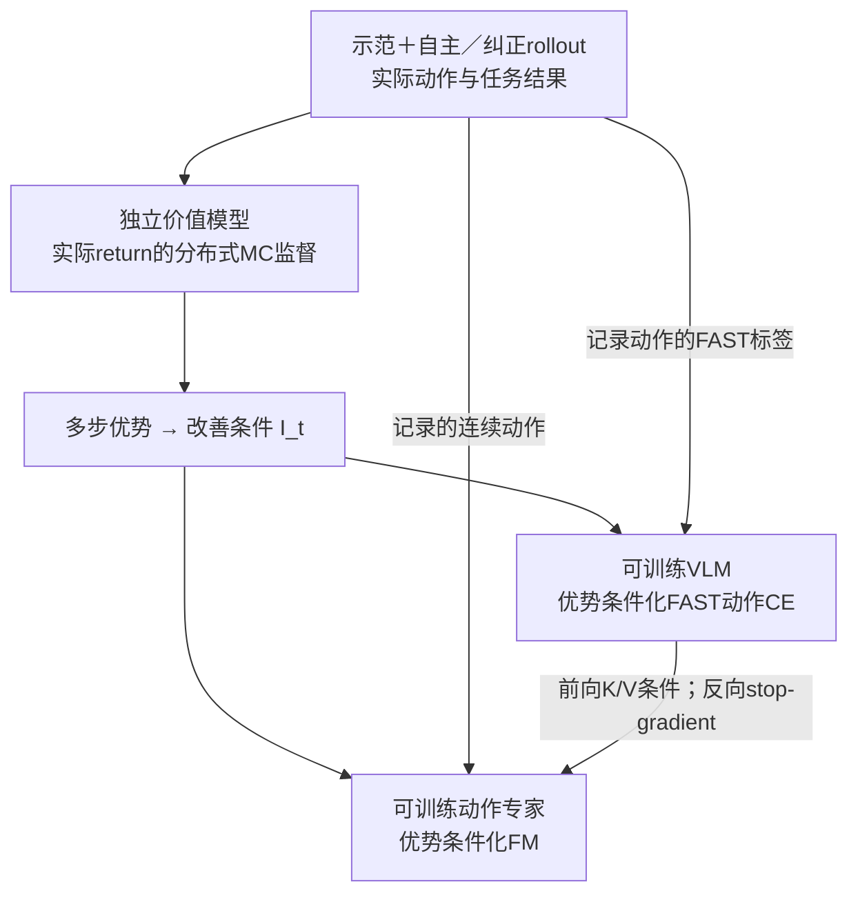

# 记忆RL方案框架：共享VLM与分路联合更新

> [!abstract] 当前图的研究范围
> 主方案允许自身VLM与动作专家按职责联合适应，知识隔离控制不同目标的梯度路径，具体见第8节。第1–5节两图保留2026-10-16初版的冻结受控基线，用于隔离记忆收益，并非要求最终系统冻结。固定规则也不是π0.5的架构要求；高层接口与现有权重边界见第6–7节。文件名保留初版以维护已有双链。本笔记是拟议研究框架，不是MEM原图、已实现系统或已成立的新算法；训练交互使用RoboTwin，RM65-B为后续迁移验证对象。

> [!note] 最新训练框架
> 2026-10-17按RECAP重构的完整方案见 [[RECAP扩展训练框架-记忆读写与高层决策的回报优化]]，包含高层联合优势条件、FAST／KI-FM、配对记忆信用候选、本地RLinf组件缺口与最小任务。本页保留讨论演变和冻结对照，不将旧图视为唯一主架构。
>
> 同日用户进一步确认：主方案由**π0.5自身VLM读取记忆并自回归生成下一条子任务文本**，不从固定子任务库选择；首轮仅限制已验收的2–3类动作能力，保留结构化READ／WRITE和固定高层调用节奏。高层文本CE与FAST CE更新共享VLM，连续FM更新动作专家，并在隐藏K/V处停止FM梯度；独立MC回报价值模型只更新自身。最新正文与框架图见 [[04-开题报告扩展稿-图文版]]，训练目标及离散文本无路径梯度边界见 [[RECAP扩展训练框架-记忆读写与高层决策的回报优化#3.3 参数与损失路由]]。这些是已确认的研究设计，尚未实现或验证；以下历史冻结图不据此改写。

## 1. 初版受控基线：执行闭环

紫色是要训练的记忆策略；蓝色是初版固定／冻结的处理模块。这里的短期窗口服务于记忆策略，**不声称已有π0.5 checkpoint具备MEM视频编码器**。低层继续读取其原有当前RGB、本体状态和文本指令。长期记忆经子任务指令间接影响动作，不直接拼成原模型不存在的输入张量。

## 2. 初版受控基线：RL训练闭环

```mermaid
flowchart TB
    R["执行闭环采集当轮策略轨迹<br/>z_t、m_t、u_t、旧策略log概率、终止与执行时长"]
    T["仅训练／验收：仿真事件与真实完成结果<br/>不作为部署策略输入"]
    F["任务回报<br/>完成收益；漏步、重复和无效执行成本"]
    B["On-policy rollout缓冲<br/>保持采集时的旧策略概率与记忆状态"]
    C["Critic Vψ＋优势估计<br/>评价记忆操作对后续任务的作用"]
    U["PPO更新 μφ<br/>可加监督暖启动／SFT锚定"]
    D["发布更新后的记忆策略<br/>执行端π0.5与选择器仍冻结"]

    R --> B
    T --> F
    F --> B
    B --> C
    C -->|"优势 A_t"| U
    B -->|"操作与旧策略概率"| U
    U -.->|"只更新记忆策略参数 φ"| D

    classDef train fill:#f2eaff,stroke:#8055b4,color:#231536;
    classDef reward fill:#fff2df,stroke:#bc8434,color:#4c3213;
    classDef state fill:#f3f5f7,stroke:#7d8791,color:#26313c;
    class C,U,D train;
    class T,F reward;
    class R,B state;
```

Critic是训练辅助网络，随训练更新，不要求部署。梯度来自PPO的策略目标，**不穿过物理环境、固定选择器或冻结VLA**；图中的发布节点与执行图中的μ是同一个记忆策略的不同参数版本。训练rollout缓冲与episode长期记忆是两个不同对象。

## 3. 接口与时间下标

$$
u_t\sim\mu_\phi(\cdot\mid z_t,m_t,g),\qquad
m_t^+=\mathcal W(m_t,u_t),\qquad
\ell_t=H(m_t^+,g).
$$

执行低层动作并获得新观测后，下一决策继承 $m_{t+1}=m_t^+$。更新后的 $m_t^+$ 与下一轮开始时的 $m_{t+1}$ 不是两个独立记忆库。

初版 $u_t=(operation,slot,value)$，不能只有操作名称而没有被更新的对象和值。建议先使用少量可审计字段，例如对象是否处理、当前持物、某条记录是否待复核；字段值来自可观测证据或有限候选，不从仿真真值直接读取。状态应区分“未确认”与“已完成”，不能把没有看到成功自动记成失败／未执行。

“撤销”是撤销错误的记忆记录，不会逆转已经发生的物理动作。高层固定规则如何使用这些字段，应在RL和SFT基线中完全一致，不能悄悄增加规则能力。

## 4. 初版受控基线的训练与最低对照

1. 用可核验事件监督记忆操作，得到SFT暖启动；低层技能先独立验收。
2. 保持相同记忆结构和低层，采集闭环交互，用PPO优化记忆操作；按实际决策间隔累计奖励与折扣。图没有声称现有RLinf已经支持这一接口。
3. 比较固定规则、监督记忆、纠正SFT与记忆RL；观测、容量、技能、交互及标注预算一致。主要指标为任务SR、漏步／重复、错误记忆比例、恢复效果与成本。

初版显式记忆完整存入transition时，可按PPO规则做小批次训练；不因“有记忆”就必须使用RNN。若之后给记忆策略新增循环隐状态，才需进一步处理序列采样、burn-in和截断时间反传。PPO不能被画成任意长期replay学习。

## 5. 实现前提与边界

- 冻结π0.5不表示已具备所有子任务和恢复动作；当前技能缺失时要先补足，记忆RL不能补出不存在的控制能力。
- 本图不训练动作专家LoRA。后续若加入，应作为独立实验阶段并做交叉消融，区分记忆改善与低层动作变强。
- 需要有历史能区分、当前画面难区分的任务，否则策略可能无需记忆。真值仅供奖励、监督标签与独立验收，不供部署actor或固定选择器偷看。
- 外部记忆不保证恢复完整Markov性；图是部分可观测条件下的可实施候选，不是收敛或性能保证。
- 近邻关系与新颖性边界见 [[RL强化记忆-从Agent到VLA的文献与证据边界]]，尤其AD-Memo与VaM；本次没有声称首创，也没有实际训练或运行机器人。

关联：[[MEM精读-短期视觉与长期语言记忆]]、[[强化学习优势的数学本质-从序贯决策到具身选题]]。

## 6. 为什么初版用了固定选择器：π0.5高层接口校准（2026-10-17）

**修正：固定规则选择器是为隔离记忆收益加入的实验脚手架，不是π0.5没有规划能力，也不应表述成完整方案必须额外安装的模块。** 原图未充分解释这一点。

### 原论文与当前公开推理链

[作者报告] π0.5原论文§III、§V-E明确由同一模型进行高层文本与低层动作推理：

$$
\hat\ell_t\sim\pi_\theta^{HL}(\cdot\mid o_t,g),\qquad
A_t\sim\pi_\theta^{LL}(\cdot\mid o_t,\hat\ell_t).
$$

这里HL／LL表示调用模式，共享模型权重，不是两套互不相关的VLM；高层调用慢于低层。高层生成当前子任务，低层动作专家执行。原论文也比较了推理时不生成显式子任务、但训练时保留高层监督的implicit HL，不能把预训练中出现过子任务标签等同于部署时已经运行高层生成。

[官方固定版本静态核查] openpi commit `215abfb217dbac7d5f1273282331b9b1866c0479` 的README第8行明确公开实现只支持π0.5训练／推理的flow matching头；`Policy.infer`第90–106行调用`sample_actions`返回动作，没有在该入口生成子任务文本。这只限定核查版本的公开路径，不证明模型权重彻底没有语义能力，也不推断所有后续版本都相同。

[本地归档静态核查] 我们归档的RM65-B 80000部署链同样由外部提供`prompt`，然后调用动作推理。因此“已有π0.5 SFT检查点”还不等于“论文完整高层已可调用”。来源：[[2026-10-12-RealManπ0.5八万步原场景本机推理与实时画面]]及其`runtime80k.py:74–77`、`service80k.py:58–84`归档。本次未检查服务器活进程或重新运行推理。

### 固定规则究竟控制了什么

初版以确定性 $H(m_t^+,g)$ 让相同记忆稳定对应相同指令，从而比较规则写入、SFT写入与RL写入时尽量不混入高层生成变化。这是**实验控制选择**，并非唯一办法：冻结一个已验证的学习型高层，同样能隔离其参数更新，且更贴近VLA系统。

需区分：**固定规则**是人工确定分支；**冻结高层模型**是参数不更新，但仍会依据观测、目标和记忆动态生成子任务。若规则H只读记忆，RL还可能通过伪造进度间接操纵任务选择，获得的SR不能自动归因为记忆更准确；需同时审计事实一致性并限制指令接口。

### 更贴近目标的候选架构

若研究目标是强化VLA对长期记忆的使用，更自然的候选是：**记忆策略更新长期记录 → 冻结的、已验证的高层VLM读取当前场景＋总目标＋记录生成子任务 → 冻结的π0.5低层执行**。规则H保留为对照，而不作为完整系统的必要结构。

$$
m_t^+=\mathcal W(m_t,u_t),\qquad
\hat\ell_t\sim P_\eta^{HL}(\cdot\mid o_t,g,\operatorname{serialize}(m_t^+)),\qquad
A_t\sim\pi_\theta^{LL}(\cdot\mid o_t,\hat\ell_t).
$$

这是**拟议扩展式，不是原π0.5公式**。$P_\eta^{HL}$可在具有可用高层接口时来自同一π0.5，也可先用独立且冻结的VLM；后者是外置高层，不能称复现了原论文统一模型。新增记忆上下文是否会被正确利用、指令是否匹配RM65-B已有技能，都须验证，必要时补充相应监督适配。现有公开动作服务器不会因增加这条公式就自动具备文本生成接口。

作为受控消融，可只用PPO更新记忆策略，冻结高层与动作策略，比较相同高层下的SFT与RL记忆；完整候选也允许联合更新，见第8节。规则基线与学习型高层之间的差异不能作为RL收益。以上均为方案修正，未实现、未训练或闭环验证。

来源：[π0.5原论文](https://arxiv.org/html/2504.16054v1)、[固定版本README](https://github.com/Physical-Intelligence/openpi/blob/215abfb217dbac7d5f1273282331b9b1866c0479/README.md#L8)、[Policy.infer](https://github.com/Physical-Intelligence/openpi/blob/215abfb217dbac7d5f1273282331b9b1866c0479/src/openpi/policies/policy.py#L90-L106)。关联：[[π0.5精读-开放世界泛化与知识隔离]]。

## 7. 当前权重能否共用自身VLM生成子任务与读取记忆（2026-10-17）

**结论：共用自身VLM在结构上可行，不必额外部署独立VLM；但现有检查点尚不能认定为即接即用的高层规划器。需要先补解码并离线验证，再决定额外SFT。** “公开接口只输出动作”“底层保留文本投影”“当前权重能可靠根据记忆选子任务”是三个不同命题。

### 7.1 本机实物权重与固定源码

[本机文件头核查] 现存转换文件为 `/home/admin123/liminghe/vla-benchmark/deploy/realman_gen4/rlinf_local_5090_minppo_20261013/models/pi05_80000_openpi/model.safetensors`，13,413,809,848字节，667个tensor条目。只读取74,352字节header，未加载大张量：

- 保留 `llm.embedder.embedding.weight`，形状 `[257152, 2048]`、F32。
- 未发现独立命名的`lm_head`／`text_projection`，**不表示文本输出结构被删除**。固定JAX实现的`Embedder.decode`用输入embedding的转置做词表投影，是权重共享形式。
- header SHA-256为 `70ed84e5447eca1f4a75af9f64b457654ff51ecbd5320bc01783fb7ea3b1f555`；该值仅校验header，不是13GB整文件的内容哈希，也不验证语言能力。

[归档源码静态核查] OpenPI commit仍为`215abfb217dbac7d5f1273282331b9b1866c0479`：

| 位置 | 核查结果 |
| --- | --- |
| `models/gemma.py:141–154` | 词嵌入与decode共享词表投影 |
| `models/pi0.py:106–136` | 图像／语言构成双向可见的prefix，已有文本输入通道 |
| `models/pi0.py:189–214` | 当前训练只返回flow MSE，没有子任务文本CE |
| `models/pi0.py:233–269` | 当前推理缓存prefix后执行flow动作采样，没有逐token生成子任务 |
| `models/pi0_config.py:37–41`、`models/tokenizer.py:23–46` | 默认π0.5为200个文本token；总任务、记忆、离散状态和模板共享预算，超长截断 |
| 全50训练配置`full50_pi05_config_161_v3_batch.py:107–118,384–408` | 从官方RoboTwin cotrain 29999初始化，全量参数微调；不是冻结通用pi05_base，未增加高层文本目标 |

因此动作全量SFT可能改变原有语言生成能力，但本次没有实测，不能断言已经遗忘，也不能断言完整保留。当前50条成功轨迹和动作损失不足以证明学到了“总任务＋历史记忆→下一子任务”。参数能读入记忆文本，不等于已经学会判断记录的可靠性和使用时机。

### 7.2 先补接口，还是先训练

| 目标 | 是否要新VLM | 工程与训练边界 |
| --- | --- | --- |
| 让自身VLM读取短文本记忆，直接条件化动作 | 不需要 | 可先通过现有prompt通道做离线／仿真对照；正确利用记忆仍需验证，必要时补带记忆的动作示范 |
| 显式生成自然语言子任务，再执行 | 不需要 | 增加高层模式、正确的因果文本后缀、词表decode、逐token采样与EOS；现有权重能否直接用，需探针确认 |
| 可靠处理实验室多步流程、错误记录和恢复历史 | 不需要 | 应预留场景＋目标＋记忆→子任务的SFT适配；是否以及多少训练足够，不能由架构或其他人的经验保证 |

高层输入的图像／目标／记忆仍可作双向prefix，**生成的子任务后缀才采用因果解码**；不能将每个prefix位置的hidden各取一次argmax当作模型的推理过程。高层生成后，再以当前图像／状态＋所选子任务调用动作分支。同一套基座可分两次调用，避免第二套完整VLM参数，但会增加高层推理开销，KV也不能跨不同条件盲目复用。

[官方与社区证据分级] [仓库贡献者在#647的回复](https://github.com/Physical-Intelligence/openpi/issues/647#issuecomment-3282710188)确认公开实现当时只支持动作解码。[#670提问者修正自己代码后](https://github.com/Physical-Intelligence/openpi/issues/670#issuecomment-3315460208)报告pi05_base有简单子任务生成能力；[#701复现者](https://github.com/Physical-Intelligence/openpi/issues/701#issuecomment-3368789079)另说明默认检查点输出不完善，并尝试高层训练。这些是社区自报，不是官方可靠性保证，未在我们的RoboTwin cotrain→RM65-B全量SFT权重上复现；不能移植其训练步数或SR结论。

### 7.3 推荐的最小次序

1. **不动机器人，先验收文本路径。** 核对tokenizer、最后有效token位置、生成mask／KV位置、EOS和文本回读；避免将解码错误误判为能力缺失。
2. **对照已有初始化与RM65-B SFT权重。** 对相同画面／总目标，改变“已完成／未完成／错误记录被撤销”的短记忆，检查下一子任务是否正确随之改变；测试需确有不同的正确答案，并检查子任务属于低层可执行技能。仅能说通顺英文不算通过。
3. **不足时做高层SFT。** 准备图像＋总目标＋记忆→下一子任务标签。优先复用backbone配高层LoRA／adapter；高层启用adapter、低层关闭，可共用基础参数且减少低层被改动，但切换代码与生成指令兼容性仍需验收。若共享更新backbone，可用子任务CE＋原动作flow损失并验证低层退化，冻结动作expert本身不能防止条件特征漂移。
4. **高层能使用记忆之后，再比较SFT记忆与RL记忆。** 在隔离记忆收益的消融中使用相同冻结高层与低层；联合更新主方案另设匹配更新范围的SFT对照，避免把新增文本训练或更强规划器的收益误计为memory-RL收益。直接读记忆生成动作也是可选对照，并不强制增加显式子任务阶段。

以上为文件头／源码／官方仓库讨论核查与工程建议，未修改推理工程、未加载GPU模型、未生成本机子任务文本、未额外训练或连接实体机器人。实际核查入口见 [[本机-RLinf-RM65B-5090独立环境]]、[[2026-10-12-RealManπ0.5八万步原场景本机推理与实时画面]]。

## 8. 不必冻结VLA：知识隔离与分路联合更新（2026-10-17修正）

**冻结是初版实验控制，不是记忆学习或VLA＋RL的必要条件。** 若目标包含“动作专家更好利用多模态条件”和“记忆、决策、动作共同适应”，把整套VLA始终冻结会限制可研究的范围。主候选调整为允许各模块更新，同时明确监督与RL信号作用到哪里；这不等于全量更新必然优于LoRA／分块更新，也不自动构成新算法。

### 8.1 π0.7的知识隔离没有冻结整个VLM

[原论文核查] [Knowledge Insulation §5.1–5.2](https://arxiv.org/html/2505.23705)及[π0.7报告PDF p.3 §III](https://www.pi.website/download/pi07.pdf)描述：VLM通过FAST离散动作及其他文本／视觉语言目标学习；连续动作专家读取VLM激活，但其梯度不回传VLM。两者可以同轮训练。

因此应称为**联合训练过程中按损失隔离梯度**，不是先让所有损失更新所有参数，再将知识分开。用骨干参数$\theta_b$、动作专家参数$\theta_a$和相关条件K/V记作$c_b$，机制示意为：

$$
v_{\theta_a}=f_{\theta_a}(a_\tau,\tau;\operatorname{sg}(c_{\theta_b})),\qquad
\nabla_{\theta_b}L_{\mathrm{FM}}\big|_{\text{该条件路径}}=0.
$$

$$
\theta_b\leftarrow\theta_b-\eta_b\nabla_{\theta_b}L_{\mathrm{FAST/text}},\qquad
\theta_a\leftarrow\theta_a-\eta_a\nabla_{\theta_a}L_{\mathrm{FM}}.
$$

这是整理后的示意式，不是π0.7原文编号公式；实现时须覆盖每层相关K/V及排除其他共享参数绕路。**全量可训练**描述哪些参数允许改变；**知识隔离**描述哪种损失允许改变这些参数，二者可以并存。LoRA仅改变参数化与更新范围，也不自动等于KI。

另需校准：π0.7 PDF p.6 §VI-A将π0.6*的RL过程中采集数据作为额外示例，并称其为行为蒸馏；不能据此称π0.7已经做了全参数RL。报告也没有公开逐参数trainable mask，不能推断每个参数在每一阶段都更新。p.15 §X还将自主RL改进列为后续方向之一。

### 8.2 我们的联合学习候选：每一块都可训练，但学习信号有分工

| 参数组 | 可用目标 | 需要说明的边界 |
| --- | --- | --- |
| 自身VLM／其中的高层与记忆输出 | 子任务、记忆文本CE；优势条件化FAST动作监督；可选高层／记忆策略RL | RECAP式奖励信息可经FAST目标训练骨干，不必另加PPO；但这不自动等于给记忆写入／子任务选择直接做RL信用分配 |
| 动作专家 | flow行为克隆；适配连续flow策略的动作RL目标 | 使用KI时，其损失经K/V回骨干的路径被阻断；不能同时宣称该路径的动作RL已改善骨干表示 |
| Critic | 对应时间尺度的价值学习 | 若共享骨干，其梯度是另一个变化通道，需要明确；初版可独立以便定位影响 |

可以先以高层／记忆CE和动作FM联合SFT建立可用接口，再进行分块交替RL并重新采样轨迹。主方案允许VLM及expert更新，冻结版保留为消融；是否全参或LoRA由匹配预算的效果验证决定。本次没有指定一个已实现的全模型PPO配方。

**不能只解除freeze标志再加KI就称为完整联合RL。** 若只有动作expert获得RL loss，且对骨干所有相关路径stop-gradient，骨干不会由这条路径直接学习。但上一轮据此要求VLM必须另设高层／记忆策略RL目标，范围过窄：RECAP可将同一rollout的回报经价值和优势条件，分别送入VLM的FAST动作目标与专家的FM目标，让两者都学习。不同分支需要有效学习信号，不必每支各配一个PPO／GRPO，也不要求多个独立奖励。若要放开连续动作梯度回骨干，才改变了严格KI路径，需要另做对照。

### 8.3 KI仍然不能保证能力固定或联合PPO成立

- 即使expert不更新，骨干更新仍会改变它读取的条件激活，因此低层行为仍可能改变。KI限制backward，不锁定forward特征；需复测原抓取技能、语言跟随和带记忆任务，SFT回放／KL锚定仅是约束手段。
- 若同一骨干既生成高层文本又服务低层条件，更新高层会同时改变低层分布。只计算高层PPO ratio并截断低层梯度，是分块代理目标，不能无说明地称完整联合策略的无偏梯度；要明确各时间尺度概率、信用分配、flow策略目标和重采样方式。
- 公平对照至少分开“冻结VLA＋记忆RL”“更新骨干、expert固定”“骨干与expert分路更新”，并为主方案配置相同可训练范围的SFT对照；预算允许再测无隔离联合更新。参数更新范围、更多数据和新增辅助监督不能一起混记为RL贡献。

核查范围：本次读取官方π0.7报告、联网核对KI原论文，并修正研究方案；未在当前OpenPI中实现stop-gradient、FAST／文本联合目标或联合RL，也没有训练与闭环性能证据。当前固定版本的flow-only微调不会因`pi05=True`自动具备完整KI配方。

### 8.4 π*0.6／RECAP正是同一经验、分路学习的例子

2026-10-17重读[RECAP v2 §IV–V及Algorithm 1](https://arxiv.org/html/2511.14759v2)。π0.6是基座，π*0.6是经验后训练结果，不能将两者名称和训练阶段混用。

1. 汇集示范、当前／历史策略rollout与可选人工纠正，使用任务结果和执行成本构造回报。
2. 独立分布式价值模型以实际轨迹return分箱的CE训练，原文§IV-A Eq.1为Monte Carlo目标，**不是TD critic训练**。
3. 计算动作优势并构造改善指示 $I_t=\mathbf1[\hat A_t>\epsilon_\ell]$。后训练使用多步回报加未来价值减当前价值；该优势含bootstrap，不改变上一步价值网络的MC训练性质。
4. 同一个$I_t$条件化VLM的FAST动作预测与连续专家FM；推理选择positive条件，再采集并迭代。训练同时使用positive／negative数据，不只是筛成功轨迹做普通SFT。

该图省略高层文本监督、其他共训目标及采集调度。反馈经“回报→价值→优势条件→CE／FM损失”影响参数，不需要物理环境可微，也不需要连续FM梯度穿透VLM。图中FAST标签不作为专家输入，专家读取的是内部激活。

**VLM主干不是高层子任务选择的同义词。** §V-B／Eq.4将$I_t$放在子任务文本之后、两路动作之前，并明确只影响动作likelihood。因此主干作为FAST动作预测器直接利用该优势信息；高层子任务文本仍有其CE监督，共享参数更新可间接影响它，但原文这条路径不能当作已给子任务选择或记忆操作分配长期RL信用。如果研究要直接优化后两者，应另定义对应的优势条件化／价值加权目标或策略梯度目标，而不默认采用多个独立PPO。

这条分路经验学习应作为当前候选的主要基线之一，而不把“主干与动作专家都更新”本身当新颖性。更多已有核查见 [[VLA-Precision后续自进化选题-近邻排重与先导验证#11.2 π*0.6并非所有梯度贯穿全模型]]。本次只核原论文，未复现或改变现有训练代码。

## 9. 多目标不等于MAPPO，允许离线数据复用

### 9.1 一个任务回报可以训练多个决策分支

设历史$h_t$含当前可见信息，$u_t$是记忆操作／子任务，$a_t$是物理动作，则可分解为

$$
\pi(u_t,a_t\mid h_t)=\mu(u_t\mid h_t)\,\pi_L(a_t\mid h_t,u_t).
$$

同一任务目标 $J=\mathbb E[\sum_t\gamma^t r_t]$ 可为各分支提供信用，不要求多个奖励或多个独立RL算法。不同时间尺度可以采用不同优势估计与价值baseline；CE、FM、价值损失的数量不决定agent数量。若高层只输出连续条件特征而没有生成／采样文本动作，不能凭空计算高层token PPO。

[MAPPO原论文 §3.1–3.2](https://arxiv.org/html/2103.01955)面向多agent的Dec-POMDP，训练使用全局信息的critic，执行时各agent按局部观测行动。当前单机器人“高层生成条件→低层执行”的结构更自然属于带记忆的分层策略；技能时长不同时可按SMDP处理。Critic不是另一个决策agent，双臂也不必拆成两个agent。可以研究多agent建模，但不能仅因模块多就认定MAPPO天然适合或可直接套用。

### 9.2 RECAP与off-policy的准确关系

[RECAP §II、§IV、§VI-C3](https://arxiv.org/html/2511.14759v2)采用迭代离线RL：当前策略采集新rollout，但训练可混合示范、旧策略与新策略数据，通过优势条件化提取改进策略。采集来自当前策略，不等于训练整体是on-policy PPO；能用历史数据，也不表示其MC价值模型就是SAC／TD3的off-policy Q Bellman更新。其设置下的PPO对照也不能外推为PPO普遍无效。

[HIRO §2.1、§3.3](https://arxiv.org/html/1805.08296)已展示两层TD3的off-policy学习，同时指出低层更新后高层旧goal的宏转移会失配，并提出连续目标校正；这证明分层与off-policy可以兼容，不能把它的连续目标重标原封不动套成语言子任务重标。

当前路线可优先比较“聚合回放＋价值学习＋优势条件化FAST／FM”，保留已接通的PPO／ACoB作范围明确的对照，而不为多模块专门引入MAPPO。这是算法选型建议，尚非本平台性能结论。

### 9.3 记忆／高层加入回放后的最低要求

- 保存原始可见观测／必要历史、当时记忆及操作、实际子任务、实际执行的动作块部分、任务结果、人工介入标记、终止／截断类型、持续时长和策略版本。算法需要重要性比率时再使用对应行为策略概率，不能把FM误差当log-prob。
- 高层每个决策跨$k$个物理步时，使用相应累计奖励与$\gamma^k$，而不是把所有子任务视为等长一步。
- 编码器或记忆策略改变后，只存旧隐藏向量可能不足以重构当前策略的信息；保留足够历史或使用合适的序列／burn-in机制，并保持训练时因果可见范围。
- 低层更新会改变相同子任务的执行后果；可先交替更新、使用较新高层数据或适用的校正，不能假定旧高层价值永远有效。有限动作覆盖、分布外价值误判仍需评测。

上述是原论文与理论接口核查，未实现多agent、分层off-policy或RECAP训练。共享回报、知识隔离、数据复用与可训练参数范围是不同设计轴，不应打包成一个未经验证的算法优势。
