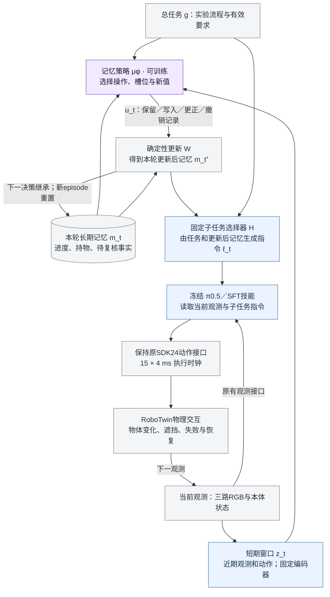
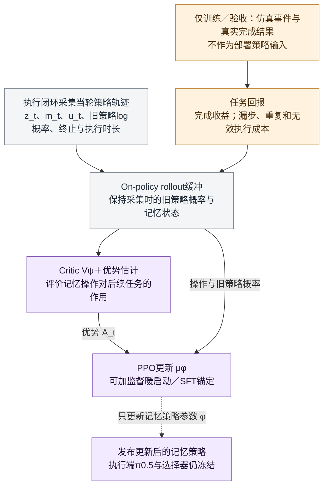

# 记忆RL方案框架：冻结π0.5与显式进度记忆

> [!abstract] 当前图的研究范围
> 初版固定低层π0.5及子任务选择逻辑，训练小型记忆操作策略，检验它能否根据后续任务结果改善进度记录的保留、更新和纠错。它是拟议研究框架，不是MEM原图、已实现系统或已成立的新算法。训练交互使用RoboTwin；RM65-B为后续迁移验证对象。

## 1. 执行闭环

紫色是要训练的记忆策略；蓝色是初版固定／冻结的处理模块。这里的短期窗口服务于记忆策略，**不声称已有π0.5 checkpoint具备MEM视频编码器**。低层继续读取其原有当前RGB、本体状态和文本指令。长期记忆经子任务指令间接影响动作，不直接拼成原模型不存在的输入张量。

## 2. RL训练闭环

Critic是训练辅助网络，随训练更新，不要求部署。梯度来自PPO的策略目标，**不穿过物理环境、固定选择器或冻结VLA**；图中的发布节点与执行图中的μ是同一个记忆策略的不同参数版本。训练rollout缓冲与episode长期记忆是两个不同对象。

## 3. 接口与时间下标

$$
u_t\sim\mu_\phi(\cdot\mid z_t,m_t,g),\qquad
m_t^+=\mathcal W(m_t,u_t),\qquad
\ell_t=H(m_t^+,g).
$$

执行低层动作并获得新观测后，下一决策继承 $m_{t+1}=m_t^+$。更新后的 $m_t^+$ 与下一轮开始时的 $m_{t+1}$ 不是两个独立记忆库。

初版 $u_t=(operation,slot,value)$，不能只有操作名称而没有被更新的对象和值。建议先使用少量可审计字段，例如对象是否处理、当前持物、某条记录是否待复核；字段值来自可观测证据或有限候选，不从仿真真值直接读取。状态应区分“未确认”与“已完成”，不能把没有看到成功自动记成失败／未执行。

“撤销”是撤销错误的记忆记录，不会逆转已经发生的物理动作。高层固定规则如何使用这些字段，应在RL和SFT基线中完全一致，不能悄悄增加规则能力。

## 4. 两阶段训练与最低对照

1. 用可核验事件监督记忆操作，得到SFT暖启动；低层技能先独立验收。
2. 保持相同记忆结构和低层，采集闭环交互，用PPO优化记忆操作；按实际决策间隔累计奖励与折扣。图没有声称现有RLinf已经支持这一接口。
3. 比较固定规则、监督记忆、纠正SFT与记忆RL；观测、容量、技能、交互及标注预算一致。主要指标为任务SR、漏步／重复、错误记忆比例、恢复效果与成本。

初版显式记忆完整存入transition时，可按PPO规则做小批次训练；不因“有记忆”就必须使用RNN。若之后给记忆策略新增循环隐状态，才需进一步处理序列采样、burn-in和截断时间反传。PPO不能被画成任意长期replay学习。

## 5. 实现前提与边界

- 冻结π0.5不表示已具备所有子任务和恢复动作；当前技能缺失时要先补足，记忆RL不能补出不存在的控制能力。
- 本图不训练动作专家LoRA。后续若加入，应作为独立实验阶段并做交叉消融，区分记忆改善与低层动作变强。
- 需要有历史能区分、当前画面难区分的任务，否则策略可能无需记忆。真值仅供奖励、监督标签与独立验收，不供部署actor或固定选择器偷看。
- 外部记忆不保证恢复完整Markov性；图是部分可观测条件下的可实施候选，不是收敛或性能保证。
- 近邻关系与新颖性边界见 [[RL强化记忆-从Agent到VLA的文献与证据边界]]，尤其AD-Memo与VaM；本次没有声称首创，也没有实际训练或运行机器人。

关联：[[MEM精读-短期视觉与长期语言记忆]]、[[强化学习优势的数学本质-从序贯决策到具身选题]]。
