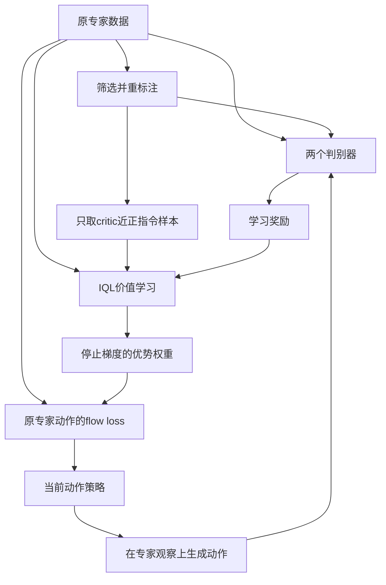

# CounterAlign精读：反事实奖励与离线VLA后训练

> [!abstract] 阅读目标与当前开题
> 用户于2026-10-12暂定方向为**面向场景变化的 VLA 多模态条件—动作对齐与强化学习适应**。本笔记解释CounterAlign的方法实现，并补充GAIL、nnPU、IQL、AWR和flow matching的数学背景；先建立基准理解，不要求此时提出新算法。

> [!info] 本次证据范围
> 已读固定v1主文、方法、算法与附录；下面将**论文明确流程、基础算法教学推导、自拟示例和实现建议**分别标明。GitHub仓库名搜索未找到可核实实现，作者项目站本次工具未能读取；这不等于断言未开源。没有读取到作者训练源码，没有安装或运行训练。

关联：[[VLA动作专家适应-条件利用、多解生成与闭环强化学习]]、[[π0.5精读-开放世界泛化与知识隔离]]、[[强化学习优势的数学本质-从序贯决策到具身选题]]。

## 1. 先抓住论文自身的流程

[CounterAlign §3及附录算法4](https://arxiv.org/html/2608.21740v1)以专家三元组“指令、观察、动作块”为基础，学习对抗判别器与重标注判别器。换指令/动作产生筛选后的负例；联合替换有歧义，作为未标注数据。判别分数构成奖励，IQL产生优势，优势加权flow更新策略。训练阶段不新增环境rollout。

主方法的三个数据入口不同：判别器使用错配/生成样本；critic使用原真实转移与高相似指令重标注；actor仅使用原专家动作。替换动作不能沿用旧下一观察。公式与基础算法解释如下。



图是笔记重绘，表示信息/更新关系，不是作者模块源码图。生成动作仅用于对抗分类，不表示执行了新物理转移。

## 2. 数据接口与自拟瓶子例子

讲解记号：$L$ 为指令，$o$ 为图像等观察及本体信息，$A$ 为动作块，$o'$ 为实际执行后的下一观察。概念数据接口为 $(L,o,A,o')$；这是数学结构，不宣称作者使用某种已核验的文件格式。

下表是**自拟例子**，不是论文采集的瓶子任务，也不代表每个替换一定物理错误：

| 样本 | 内容 | 理解目的 |
| --- | --- | --- |
| 原专家 | 抓蓝瓶＋当前画面＋抓蓝动作 | 原始条件与动作的示范对应 |
| 换指令 | 抓红瓶＋同画面＋抓蓝动作 | 暴露动作与要求可能不一致 |
| 换动作 | 抓蓝瓶＋同画面＋外来抓红动作 | 暴露动作与场景/目标可能不一致 |
| 同时换 | 抓红瓶＋同画面＋外来抓红动作 | 可能匹配，但外来动作未必适用当前机器人姿态 |
| 同义或近似要求 | 拿起蓝色样品瓶＋原动作/下一观察 | 对真实转移可以重新评价不同要求 |

“换过”不是“真实失败”。共用接近动作可能服务两个目标；外来抓红动作也可能抓空。只有实际转移才能证明物理后果，分类标签与真实执行结果要区分。

## 3. 怎样选重标注样本

论文附录1–2给出的筛选是启发式。所谓指令相似度通过候选指令关联的示范观察和动作计算，**不是文本embedding相似度**。已标注负例选中等相似范围，critic近正例选高相似范围。具体阈值与观察特征提取器未充分披露，不能填成已知默认值。[附录1–2](https://arxiv.org/html/2608.21740v1)

概念上，需要区分候选检索、相似度计算、标签用途和真实转移记录。实现时给每个合成样本保留原episode/index、替换字段、筛选分数与消费模块，才能查清标签噪声；这是笔记建议，不是已核验作者数据schema。

## 4. 对抗判别器：学习专家与策略动作的区别

这是基于[GAIL](https://arxiv.org/html/1606.03476v1)的二分类教学解释。令 $P$ 是专家样本，$B_\pi$ 是策略样本，采用“专家为1”的约定：

$$
\mathcal L_{\rm adv}
=-\mathbb E_P\log D_{\rm adv}(L,o,A)
-\mathbb E_{B_\pi}\log[1-D_{\rm adv}(L,o,A)].
$$

它区分的是样本来源，不能将输出解释为经物理试验校准的成功概率。策略样本甚至可能有效。GAIL通常研究交互轨迹的模仿；这里要牢记第1节的离线数据范围。

标准实现可以从logits计算稳定BCE，并在更新判别器时阻断生成动作对actor的梯度。是否使用这些具体做法，需作者源码或明确的自建配置确认。

## 5. 重标注判别器：正例、负例与未标注

[nnPU原论文](https://arxiv.org/html/1703.00593v2)解释了未标注集合包含正负两类时的风险估计。下面是基础算法展开，**不是宣称CounterAlign源码采用了这些具体loss参数**。

令 $P,N,U$ 为正例、已标注负例和未标注集合，$\eta$ 是正类先验，$\ell(D,y)$ 为分类损失。一种标准非负PU风险表达为：

$$
R_{\rm nnPU}
=\eta\mathbb E_P\ell(D,1)
+\max\!\left(0,\mathbb E_U\ell(D,0)-\eta\mathbb E_P\ell(D,0)\right).
$$

直觉是从“把未标注当负例”的风险中扣除其正类贡献，避免把所有模糊样本硬判错。它需要相应分布和先验条件，不能保证纠正所有错标签。

CounterAlign另混合已标注分类项与熵正则。其v1未完整展开基础loss、PU先验和数值配置。实现时应明确这些选择。熵约束用于避免输出过度饱和，分类目标仍需保留；不能只把所有分数训练成0.5。

## 6. 奖励究竟是什么

论文的奖励结合两个判别器的log分数：

$$
\hat r(L,o,A)
=(1-w)\log D_{\rm adv}(L,o,A)
+w\log D_{\rm rel}(L,o,A).
$$

这是学习到的条件/示范奖励，不是另外加入环境成功奖励。[CounterAlign Eq.3](https://arxiv.org/html/2608.21740v1)

**教学数字，非作者参数或实验结果**：若 $w=0.5$，一组分数为 $(0.9,0.8)$，奖励约为 $-0.164$；另一组为 $(0.9,0.2)$，奖励约为 $-0.857$。奖励较高表示较受奖励模型认可，负数不表示一概失败。

取log需要数值保护；裁剪范围是实际实现选择，要独立记录，不能假称论文已给默认值。

## 7. IQL：从学习奖励得到Q、V和优势

本节依据[IQL原论文 §4](https://arxiv.org/html/2110.06169)解释数学机制。上下文 $x=(L,o)$，动作 $A$，下一上下文 $x'=(L,o')$。Q评价执行动作后的累计价值；V通过expectile倾向拟合数据内较好的动作价值，不靠actor在数据外找最大值。

基本TD形式为：

$$
\mathcal L_{Q_i}=\mathbb E[(\operatorname{sg}(\hat r+\gamma V(x'))-Q_i(x,A))^2].
$$

取目标双Q的较小值 $\bar Q=\min(\bar Q_1,\bar Q_2)$，用非对称平方loss学习V：

$$
u=\operatorname{sg}(\bar Q(x,A))-V(x),\qquad
\mathcal L_V=\mathbb E[|\tau-\mathbf1(u<0)|u^2].
$$

当 $\tau>0.5$，V低于Q时惩罚更重，使V偏向较高的数据内价值。这是expectile，不是成功概率分位数。目标网络更新可写为 $\bar\theta\leftarrow(1-m)\bar\theta+m\theta$。

式中的停止梯度是标准实现说明。CounterAlign正文TD式未明确terminal mask和物理步折扣；它对下一chunk观察使用一次 $\gamma$。若自建实现加入 $(1-d)$、改变执行前缀或采用按物理步折扣，必须明示为实现补充，不能假称忠实复现其未公开代码。

## 8. AWR：优势如何变成学习权重

[AWR](https://arxiv.org/html/1910.00177v1)通过行为约束的策略改进导出优势加权提取。讲解定义：

$$
\mathrm{Adv}(x,A)=\bar Q(x,A)-V(x),\qquad
b(x,A)=\exp[\beta\mathrm{Adv}(x,A)].
$$

优势评价相对当前基线价值的改进程度，不等于判别器概率。所有权重为正，所以低优势减少学习强度，不是用负权重反向排斥动作。

**教学数字**：若 $\beta=1$，优势为 $1,0,-1$ 时，权重约为 $2.718,1,0.368$。不能把这些值当作者默认超参数。

有限数据与估计价值可能使权重不稳定，实际需要记录裁剪、归一化等选择。这些是工程决策，原文披露边界见第11节。

## 9. Flow matching：原专家动作怎样被重新学习

依据[Flow Matching原论文](https://arxiv.org/html/2210.02747v2)的条件概率路径思想，用最简单的线性路径教学：干净动作块为 $A$，初始噪声为 $x_0$，生成时间为 $s$。

$$
x_s=(1-s)x_0+sA,\qquad u_s=A-x_0.
$$

网络 $v_\omega(x_s,s\mid L,o)$ 拟合从噪声走向数据的速度。将第8节的权重引入，就是：

$$
\mathcal L_\pi
=\mathbb E\left[
\operatorname{sg}(b(x,A))\,
\|v_\omega(x_s,s\mid L,o)-u_s\|^2
\right].
$$

它仍是监督式速度拟合，但学习强度由RL价值决定。$s$是生成/去噪时间，不是机器人执行时间；$\tau$是expectile参数，不要混用。

这里的停止梯度是实现建议；CounterAlign主actor数据范围以第1节为准。因此新增条件监督间接经奖励、价值和权重影响动作学习，而不是直接把错配动作作为目标速度。

## 10. 将各部分放进一个训练循环

以下是笔记编写的**概念伪代码**，不是作者源码、可执行复现程序或已经测试的实现。`update_*`应落实为上面对应loss；设备、shape、数值稳定与共享参数优化器仍需单独配置。

```python
# prebuild_pools performs the paper's filtered relabeling.
neg_pool, unlabeled_pool, critic_pool = prebuild_pools(expert_data)

for iteration in training_iterations:
    expert_batch = sample(expert_data)
    generated = actor.sample(expert_batch.observation,
                             expert_batch.instruction)

    # Generated actions are classification samples; no environment step.
    update_adversarial_discriminator(expert_batch, generated.detach())
    update_relabel_discriminator(expert_batch,
                                sample(neg_pool),
                                sample(unlabeled_pool))

    transition_batch = sample(critic_pool)
    reward = learned_reward(transition_batch).detach()
    update_q_networks(transition_batch, reward)
    update_expectile_value(transition_batch)
    update_target_q_by_ema()

    # Actor targets remain the original expert actions.
    policy_batch = sample(expert_data)
    advantage = compute_advantage(policy_batch).detach()
    update_actor_with_weighted_flow_matching(policy_batch, advantage)
```

共享参数的两个判别器loss需要一致管理；Q/V也一样。是否合并loss一次step、怎样避免共享embedding被多个优化器冲突更新，原文未给可核实源码。伪代码顺序不代表这些实现细节已经解决。

## 11. 已知实现与尚待核实事项

**原文已知**：辅助网络采用共享VLM、独立head；策略架构保持π0.5，全参数微调。参数规模和资源已记于 [[VLA动作专家适应-条件利用、多解生成与闭环强化学习#10.1 CounterAlign：主方法训练范围与资源]]，不把整个训练栈大小当部署actor大小。

**本次未核实**：观察特征提取器、筛选阈值、PU先验、各loss系数/学习率、terminal/padding/chunk边界、权重裁剪和共享优化器管理。不能因论文写“默认π0.5配置”，就推定所有辅助网络配置已完整给出。

原文算法最终返回policy。部署只使用actor、不继续使用判别器和critic，是根据算法和策略结构作出的合理推断，未由公开部署代码确认。部署时更新观察不等于在线更新权重。

## 12. 为什么这与当前开题有关

**分析判断**：这条路线把“当前指令和场景下动作是否合适”变成学习反馈，再用价值改变条件动作学习。它给出一个可以深入的基准问题；并不直接证明动作专家获得完整物理理解，也不直接提供扰动后所有新动作。

当前先掌握数据分流、奖励、价值与策略更新的联系。后续若做简化实现，所有自选配置与原文差异独立记录，不将教学伪代码称作者复现。先导实验和方法扩展均未执行。

2026-10-12：完成原文及基础算法阅读、教学推导与笔记静态检查；未下载训练工程、训练或操作机器人。

## 13. 引言的研究动机摘要（2026-10-12）

以下是简短摘要与分析，**不是引言的逐段译文**。[原文§1](https://arxiv.org/html/2608.21740v1)从昂贵示范与BC缺少负向条件监督切入，关注指令改写、位置与场景变化下的脆弱性；作者考虑从旧示范的条件错配中提取奖励监督。

**阅读分析**：它将“数据不足”进一步具体化为“如何增加每条数据提供的有效反馈”。这里的动机没有把长程记忆或VLM—动作专家接口认定为唯一根因；当前开题可以借鉴这个问题定位过程，再检验自身模型的实际瓶颈。

理解用自拟例子：若训练时蓝瓶总在左侧，机器人可能学到固定左抓而未建立指令—对象对应；换位置或要求就暴露捷径。这个例子不代表作者采集过该瓶子实验。

2026-10-12：重读引言、核对摘要范围，未进行实验。若用户随后提供引言原文，可在用户提供文本范围内另做翻译。
