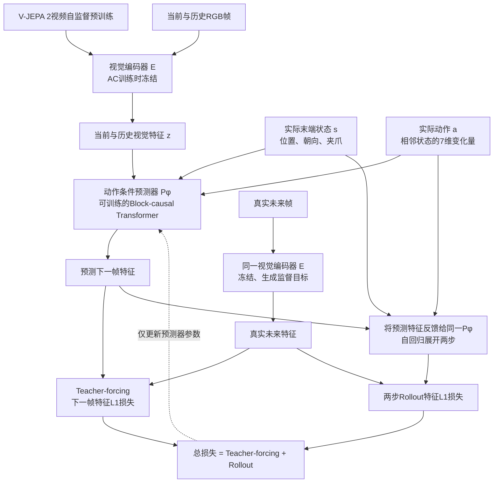
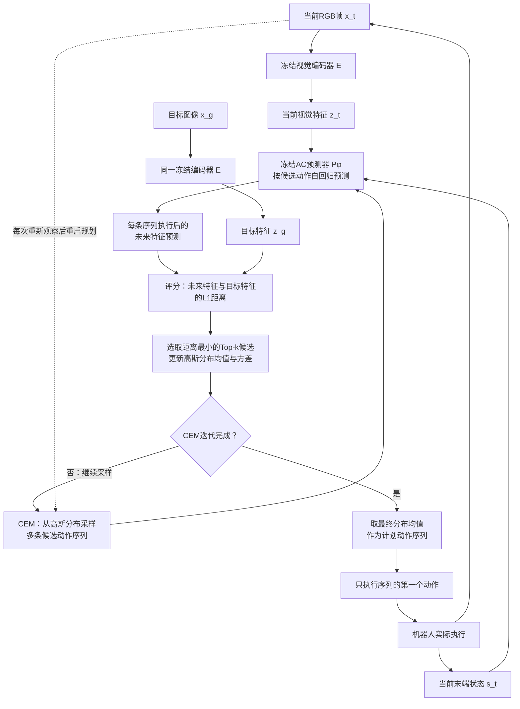

# V-JEPA 2-AC算法框架与视觉目标规划

按原论文§3、Figure 6–7重绘的概念框架，不是官方原图，也不是本项目已运行实现。AC表示action-conditioned。视觉编码器先由V-JEPA 2的视频自监督预训练获得；以下重点是机器人数据上的动作条件后训练与部署规划。

## 动作条件训练

图中两个E共享同一组冻结权重。Teacher-forcing使用真实历史特征预测下一帧；Rollout分支将预测特征反馈给同一预测器，训练两步展开。论文Figure 6为说明画出四步，实际训练rollout loss使用T=2。总损失只更新AC预测器及其输入输出映射，不更新视觉编码器。

$$
\mathcal L_{\rm AC}
=\mathcal L_{\rm teacher-forcing}^{L1}
+\mathcal L_{\rm rollout}^{L1}.
$$

原论文DROID后训练以4 fps抽取16帧片段，末端状态和动作各为7维；状态包含基座坐标下的位置、extrinsic Euler朝向及夹爪状态，动作由相邻状态的变化构造。论文具体视觉特征为ViT-g输出16×16×1408；预测器约300M、24层、16 heads、hidden dim 1024。输入动作、状态及展平patch特征分别线性映射，按时间交错；patch使用时空3D-RoPE，动作/状态token只使用时间位置。Block-causal attention允许同一时间块及此前块的条件信息，禁止读取未来真值。

“未标注”在该配方中指不要求额外任务类型、奖励或成功标签，不代表只有无动作视频；机器人状态/动作条件仍来自DROID记录。此7维末端增量接口不能直接等同于本项目24维臂角/手SDK契约。

## 部署：用视觉目标规划动作

图中E与Pφ均冻结。每次规划以当前视觉特征、末端状态及目标图像特征为条件；目标图像用于评分，不需要作为预测器“真实未来”的输入。通过CEM（Cross-Entropy Method）调整候选动作序列的采样分布，完成迭代后取最终分布均值，仅执行第一动作，重新观察再规划。

$$
\mathcal E(A_{1:T};z_t,s_t,z_g)
=\|P_\phi(A_{1:T};s_t,z_t)-z_g\|_1.
$$

CEM在这里是候选动作的采样优化方法，不是神经网络训练的交叉熵损失。部署不通过上述目标误差更新编码器/预测器，也没有内置flow动作专家参数更新。预测的是视觉特征，不要求先解码整张未来RGB图像；论文控制实验采用图像目标，不据此宣称已支持任意语言条件目标判定。

## 与用户提出的flow后果监督的区别

| 项目 | 原论文V-JEPA 2-AC | 用户候选 |
| --- | --- | --- |
| 动作来源 | CEM采样和优化的动作序列 | Flow Matching动作专家输出chunk |
| 评价信号 | 预测未来特征与目标图像特征的L1距离 | 对应示范未来/任务目标特征误差 |
| 更新对象 | CEM采样分布，部署模型权重冻结 | 误差经冻结世界模型反传到flow参数 |
| 控制闭环 | 执行第一动作后观察并重新规划 | 尚待实现和定义部署方式 |

这里不把“动作条件预测未来”当成用户候选的新颖点；待检验的是flow策略参数更新、梯度可靠性与真实任务改善。详见 [[VLA动作专家适应-条件利用、多解生成与闭环强化学习#18. 用预测动作后果反传更新flow策略（2026-10-14用户澄清）]]。

来源核查日期2026-10-14，机制来自指定v1论文，图为Agent据论文重绘；官方仓库README仅用于确认官方实现入口，未审计当前代码commit。未安装V-JEPA、下载权重、训练、运行规划或连接机器人。关联 [[RoboTwin 2.0框架与默认任务]] · [[VLA技术路线综述-从动作生成到世界模型与具身系统]]。
