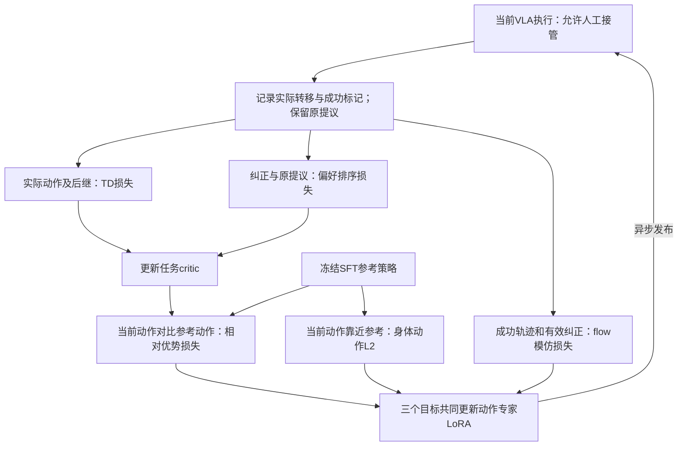

# VLA-Precision精读：价值校准、动作专家更新与Q-VGM比较

> [!abstract] 本次结论
> VLA-Precision使用自定义离策略flow actor–critic方法ACoB：真实执行转移做TD，人类纠正相对原提议的偏好校准critic，再以相对优势、flow模仿和参考动作约束更新动作专家LoRA。Q-VGM则把critic改进端点转为局部flow速度目标，避免全去噪链反传。泛称“用物理反馈校准critic、再更新flow”已有覆盖；本库此前候选需收窄。

> [!info] 证据范围与版本
> 阅读VLA-Precision v3全文17页与官方代码固定commit，检查方法公式、任务图、表I–III、消融与讨论；Q-VGM改读最新v5全文8页，不沿用v3的三套LIBERO结果。原文分别为 [[VLA-Precision-2609.04355v3.pdf]] 和 [[Q-VGM-2606.08015v5.pdf]]。下载校验信息见本目录下证据/2026-10-13-VLA-Precision精读/来源与核查范围.json。源码只在临时目录阅读，未安装、训练、操作机器人或复现成绩。

关联：[[VLA动作专家适应-条件利用、多解生成与闭环强化学习]]、[[π0.5-RealMan强化学习研究路线-算法与训练闭环]]、[[强化学习优势的数学本质-从序贯决策到具身选题]]、[[CounterAlign精读-反事实奖励与离线VLA后训练]]。

## 1. 它究竟使用什么RL算法

作者方法名为 **Asymmetric Co-Bootstrapping，ACoB**。按公式与代码，它属于离策略actor–critic；具有目标critic、较小ensemble TD估计、经验回放、连续动作可重参数化梯度。不能直接标为PPO、GRPO、标准TD3或SAC：没有PPO似然比/clipping，没有GRPO组内终局优势，也没有SAC熵目标。

Stage I用任务示范对π0.5全参数flow-matching微调；Stage II冻结VLM和基础动作专家，只更新动作专家内部LoRA。机器人采集自主/人工纠正转移，learner异步更新并发布新参数。部署产生动作的仍是π0.5动作专家，不是附加残差控制器或技能规划器。

论文证据：[v3 §III-A–B、Algorithm 1](https://arxiv.org/html/2609.04355v3)。代码参数filter只接受动作专家路径与LoRA路径交集，见 [configs.py:32](https://github.com/scy-v/VLA-Precision/blob/41edacde80d8c9d8146d610202299d71b0e79f7c/src/vla_precision/integrations/openpi/configs.py#L32)；输入/输出投影并非自动一起更新。

## 2. 输入输出、奖励与反馈

本文单臂基础表示含RGB、语言和机器人状态：

$$
q_t=[x_{0\to t}^{rel},\dot x_t,f_t,\mu_t,g_t]\in\mathbb R^{19},
\qquad u_t=[\delta x_t^{cmd},g_t^{cmd}]\in\mathbb R^7.
$$

依次为起始位姿相对TCP位姿、TCP速度、力、力矩和夹爪状态；输出为六维末端增量与夹爪指令，而非关节角。论文还有双臂和L20灵巧手平台，不能把单臂7维公式直接视为所有平台的全部手指动作定义。

采集名义15 Hz，当前精密任务采用短执行horizon $H_e=3$。UR5e使用force-mode阻抗控制，Franka使用力矩阻抗；精度收益涉及视觉、本体/接触反馈和控制器，不能全部归因于RL。

已公开的两个任务配置：完成检测为人工事件；普通低层步奖励$-0.01$，成功chunk末步替换为$10$。没有默认VLM成功判定器或毫米误差密集奖励。Replay Buffer保留转移，Correction Buffer保存有效纠正子集，Context Buffer复用冻结prefix。1:1混采回放与纠正子集不等于所有样本一半来自独立来源。

来源：[reward.py](https://github.com/scy-v/VLA-Precision/blob/41edacde80d8c9d8146d610202299d71b0e79f7c/src/vla_precision/robotics/tasks/reward.py)、[单臂任务配置](https://github.com/scy-v/VLA-Precision/blob/41edacde80d8c9d8146d610202299d71b0e79f7c/configs/stage2/tasks/insert_two_bottles_diagonal_rack.yaml)。这些是公开代码默认值，不自动代表9任务每次实验的完整运行配置。

## 3. 价值校准：TD学习后果，偏好约束原提议

每个critic有 $Q_k(\omega,a)=V_k(\omega)+A_k(\omega,a)$，$\omega=(o,q)$。critic按任务训练；actor有语言输入，不意味着同一critic已经支持所有指令。

实际执行chunk $a^{exec}$才有真实转移。目标与TD损失为：

$$
y=R^{(H)}+\gamma^H(1-d)\min_k Q_{\bar\phi_k}(s',G_\theta(s',\epsilon')),
\quad L_{TD}=\mathbb E\frac1K\sum_k[Q_k(s,a^{exec})-\operatorname{sg}(y)]^2.
$$

若模型提议 $a^{prop}$ 被人类纠正覆盖，原提议没有真实后继，不能使用纠正后的下一状态做它的TD。在有效干预样本 $c=1$ 上加入：

$$
L_{rank}=\mathbb E_{c=1}\frac1K\sum_k
\left[m_c-\left(A_k(s,a^{exec})-A_k(s,a^{prop})\right)\right]_+^2,
\quad L_{critic}=L_{TD}+\lambda_{rank}L_{rank}.
$$

含义是纠正动作应比原提议高出一定价值间隔，防止critic学会纠正后的成功、却仍高估原提议。这依赖有效人类纠正的偏好信息，**不是从同一状态分别执行两动作后得到真实反事实收益差**。干预标记与动作改变不是任意纠正都更优的数学保证。

证据：[论文式(5)–(10)](https://arxiv.org/html/2609.04355v3)、[agent.py:417](https://github.com/scy-v/VLA-Precision/blob/41edacde80d8c9d8146d610202299d71b0e79f7c/src/vla_precision/acob/agent.py#L417)。

### 3.1 Critic是否只训练优秀案例（2026-10-16补核）

不是。此次只读复核本地官方仓库HEAD仍为`41edacde80d8c9d8146d610202299d71b0e79f7c`，下列两文件相对HEAD无差异：`acob_stream/trajectories.py:99–105`逐条将整回合转移写入Replay，不以`succeeded`过滤，仅将`intervened`子集额外写入Correction；`acob/agent.py:527–540`对采到的实际动作转移做TD，没有按回合成功过滤，`:575–587`再叠加纠正偏好校准。特殊预处理来源可被配置为BC-only，不能将此来源mask误说成在线失败样本过滤。

失败回合的自主动作仍可用于critic TD；有效人工纠正即使没有救成整回合，也不因此从纠正数据中消失。被覆盖的原提案没有真实后继，只参与相对排序，不能称为实测失败或借用纠正后的后继做TD。选择性模仿属于动作专家FM-BC：`agent.py:624–631`使用`max(episode_succeed, intervened)`。因此“critic只学优秀案例”混淆了TD、偏好校准与BC的不同数据用途；失败回合也不意味着每个局部动作都应标成坏动作。

固定代码：[整回合提交](https://github.com/scy-v/VLA-Precision/blob/41edacde80d8c9d8146d610202299d71b0e79f7c/src/vla_precision/acob_stream/trajectories.py#L99)、[TD目标与损失](https://github.com/scy-v/VLA-Precision/blob/41edacde80d8c9d8146d610202299d71b0e79f7c/src/vla_precision/acob/agent.py#L527)、[BC筛选](https://github.com/scy-v/VLA-Precision/blob/41edacde80d8c9d8146d610202299d71b0e79f7c/src/vla_precision/acob/agent.py#L624)。本轮没有加载模型、仿真或训练。

## 4. 动作专家的完整目标与梯度

当前策略与冻结Stage-I参考共用context和初始噪声，生成 $a^\theta,a^{ref}$。每个critic先比较动作，再对差值取min：

$$
b_k=
\begin{cases}
A_k(s,a^{ref}),&c=0,\\
\max\{A_k(s,a^{ref}),A_k(s,a^{prop})\},&c=1,
\end{cases}
\qquad
\Delta A=\min_k[A_k(s,a^\theta)-\operatorname{sg}(b_k)].
$$

这与“分别取两个动作的min Q，再相减”不同。actor的软间隔目标为：

$$
L_{rel}=\mathbb E\left[
\kappa\,\operatorname{softplus}\left(\frac{m_\pi-\Delta A}{\kappa}\right)\right].
$$

差距不足时推动改进，超过间隔后梯度逐渐减小，但不会精确归零；仍依赖critic正确性。

- $L_{BC}$：flow-matching模仿成功回合的实际动作，以及失败回合中的有效人类纠正；普通失败动作不全部模仿。
- $L_{ref}$：同噪声下身体动作靠近冻结参考输出，属于动作L2，**不是KL**。
- $L_{AE}=w_{BC}L_{BC}+w_{rel}L_{rel}+w_{ref}L_{ref}$，权重$(0.25,0.50,0.25)$。

公开配置有$m_\pi=0,\kappa=0.05,m_c=0.05,\lambda_{rank}=50$；每个learner step两次critic、一次actor，100步critic-only warmup，每10步发布参数。这是更新安排，不是两时间尺度收敛定理。

**官方代码通过完整10步Euler flow反传到动作专家LoRA**。critic参数、参考分支、prefix停止梯度，但当前动作采样链没有逐步detach。冻结基础参数不代表无需穿过冻结层计算输入/LoRA梯度。

证据：[context.py:88](https://github.com/scy-v/VLA-Precision/blob/41edacde80d8c9d8146d610202299d71b0e79f7c/src/vla_precision/integrations/openpi/context.py#L88)、[agent.py:599](https://github.com/scy-v/VLA-Precision/blob/41edacde80d8c9d8146d610202299d71b0e79f7c/src/vla_precision/acob/agent.py#L599)、[求导入口](https://github.com/scy-v/VLA-Precision/blob/41edacde80d8c9d8146d610202299d71b0e79f7c/src/vla_precision/acob/agent.py#L828)。

## 5. 相对优势不自动修复错误梯度

以下为本次数学分析。同状态：

$$
A_k(s,a)-A_k(s,b)=Q_k(s,a)-Q_k(s,b).
$$

固定参考/比较分支时，线性减去参考值不改变单critic动作梯度。对唯一最小critic $k^*$，忽略batch平均：

$$
\nabla_\theta L_{rel}
=-\sigma\left(\frac{m_\pi-\Delta A}{\kappa}\right)
J_{G_\theta}^{\top}\nabla_a Q_{k^*}(s,a^\theta).
$$

它仍沿选中critic给出的方向走。真正变化是软间隔权重、ensemble选择、人类偏好训练与参考约束，“Q换A”本身没有创造更准确的物理方向。两动作排序正确，不保证两点之间每一个导数正确。

本文价值校准指TD加偏好训练；没有展示独立物理方向校准、概率校准曲线或真实SR单调提高定理。

## 6. 九项化学实验室操作

任务、分类和结果来自作者v3表I/§IV-A与[官方演示](https://vla-precision.github.io/)，未复现：

| 作者分类 | 任务 | 实际操作 | 作者SR |
| --- | --- | --- | --- |
| Contact-rich | Tube Rack Loading | 搬起离心管架并插入装载槽 | 100% |
| Contact-rich | 2 mL Vial Transfer | 连续把两个2 mL小瓶插入另一架的对角孔位 | 100% |
| Contact-rich | Cuvette Transfer | 连续转移两个透明玻璃比色皿到另一架对角槽 | 90% |
| Contact-light | Rubber Stopper Insertion | 将橡胶塞插入试剂瓶口 | 100% |
| Contact-light | Alcohol Lamp Extinguishing | 用盖帽覆盖酒精灯灯芯以熄火 | 100% |
| Contact-light | Pipette Tip Attachment | 对准移液枪吸头并压装 | 100% |
| Contact-free | Bulb Dropper Transfer | 使用胶头滴管吸取与分配液体 | 100% |
| Contact-free | Pipette Transfer and Ejection | 移液并退掉用过的吸头 | 100% |
| Bimanual coordination | Tube Brushing | 一臂固定试管，另一臂插入刷子并清刷 | 95% |

表I合计177/180次留出测试成功，均值98.3%；每任务20次。平均45.8分钟是online训练/任务，不包含全部示范采集、Stage-I SFT与安装；27.6秒是成功trial完成时间。

作者报告的任务几何容差包括吸头/管架约$\pm0.25$ mm、比色皿$\pm0.3$ mm、小瓶$\pm0.35$ mm；**不是RL训练后的平均轨迹误差实测值**。

四个平台为单UR5e＋两指夹爪、单UR5e＋LinkerHand L20、双UR5e＋两指夹爪、Franka Research 3＋两指夹爪。只有一个双臂任务，不能推成全部任务在双臂灵巧手上验证。这些结果未证明完整反应流程、化学产率/浓度、定量移液误差或中途修改规程能力。

## 7. 消融与复现边界

作者四任务消融的最终自主SR：完整96.25%，去critic偏好26.25%，去actor BC 20%，去相对优势8.75%。这是训练曲线指标，不能与180次留出SR混成同一统计。

去相对优势换成直接Q最大化，同时改变soft-margin、比较分支与聚合，不能只据此断言advantage天然优于Q。代码中去actor BC移除FM-BC，参考约束仍保留。

三项精密插入任务的SFT策略从$H_e=3$增加到6，作者平均SR由58.3%降到6.7%。这是SFT horizon分析，不能归为ACoB算法增益。

收益涉及纠正数据、短前缀、力/力矩反馈和阻抗控制，与现有SDK24设置不同。公开目前只有两任务配置；单臂配置允许评测干预，双臂关闭，复现自主SR时还要审计实际override及统计逻辑。静态默认配置不改变作者原报告，也不等于实测复现通过。

## 8. Q-VGM最新v5如何更新动作专家

离线critic用IQL数据支持内backup；在线用当前actor动作TD backup。冻结VLA prefix压缩为RL token，critic各层再次注入动作；部署不需critic。

先构造参考策略端点：

$$
\widehat A_{ref}=x_\tau+(1-\tau)v_{ref}(x_\tau,\tau).
$$

端点经少量归一化Q梯度步改进：

$$
A_{i+1}=A_i+\alpha\frac{\nabla_AQ(s,A_i)}{\|\nabla_AQ(s,A_i)\|_2}.
$$

v5只接受Q严格增加候选，第一次不改善就停；有限$J,\alpha$控制位移。gate来自同一critic，不是独立物理验证。随后：

$$
\widehat{\Delta v}_Q=\frac{\widehat A_Q-\widehat A_{ref}}{1-\tau},
\quad
L_{align}=\sum_{\text{late }k}
\left\|(v_\theta-v_{ref})-\operatorname{sg}(\widehat{\Delta v}_Q)\right\|^2.
$$

构造状态、端点和目标detach，仅对局部$v_\theta$求导，避免整个去噪链反传。默认$K=10,M=5,J=3,\alpha=0.05$。

理论从HJB与二次速度修正代价出发，局部光滑、导数有界且接近末端时，端点近似为$O((1-\tau)^2)$，速度指导为$O(1-\tau)$。不保证critic等于真实价值、接触点光滑或SR单调提升。

v5实验口径为四套LIBERO、三训练seed；离线每套150探索rollout，RL buffer不另加示范。平均SR84.6%→90.7%（offline）→98.4%（online），PPO97.4%。真实双臂为递麦克风、取杯、抬锅三任务，仅验证离线后训练。旧v3三套结果与预算保留历史，不与v5混用。

## 9. 两篇的关键差别

| 维度 | VLA-Precision v3 | Q-VGM v5 |
| --- | --- | --- |
| 数据 | 实机在线＋自主执行＋人类纠正 | rollout离线改进，再仿真在线 |
| critic监督 | TD＋纠正优于原提议的排序 | 离线IQL，在线TD |
| actor信号 | 成对相对优势soft-margin | Q改进端点转局部速度目标 |
| 训练范围 | 冻结base，仅action expert LLM LoRA | 冻结VLM，训练动作专家 |
| 完整采样链反传 | 官方代码是 | 避免，局部监督 |
| 参考策略 | 固定Stage-I参考 | 离线固定，在线EMA |
| 真实反事实验证 | 原提议未执行，靠纠正偏好 | Q改进候选未独立分叉测真实后果 |
| 实机证据 | 9化学操作、4平台 | 3双臂操作、离线后训练 |
| 代码 | 已公开，需机器人适配 | 当前官方仓库只有README |

[Q-VGM官方仓库](https://github.com/wzzzzq/Q-VGM)当前仍称代码将发布，不代表可运行实现。两篇各自任务的98.3%不能直接横比；一篇完整BPTT不稳定，也不证明另一篇LoRA训练必然不稳定。

## 10. 此前第一条创新方向需要收窄

泛称“真实反馈校准critic→价值梯度写进flow”不能作为已成立创新：

1. VLA-Precision已有真实TD、局部纠正排序、直接flow更新。
2. Q-VGM已有Q端点改进到局部速度监督。
3. **MAGE，NeurIPS 2020**已明确值准不代表梯度准，以近似动力学训练critic动作梯度。
4. **Deep Off-Policy Iterative Learning Control，L4DC 2023**结合真实后继与近似动力学Jacobian监督价值梯度，允许非可微模拟器有限差分。

[MAGE命题3.1](https://papers.nips.cc/paper/2020/file/03255088ed63354a54e0e5ed957e9008-Paper.pdf)在确定性策略条件下将actor梯度误差联系到$\mathbb E\|\nabla_a(Q^\pi-\widehat Q)\|$。这是理论基础，不能重包装为VLA新定理。

**仍值得检验的窄问题**：受扰/接触状态、实际短前缀执行与大flow动作生成结合后，有限Q引导更新能否产生真实有效的动作改进；有限交互预算怎样识别并纠正无效更新？这是问题候选，没有证明论文空白。

先区分三处故障：

- critic：建议动作的Q增益是否对应相同续作策略下真实回报增益？
- flow近似：一步look-forward是否偏离剩余参考ODE端点？保留flow Jacobian后是否消失？
- 写回：改进端点/速度目标是否被更新后的完整flow实际生成？

若仅第一项，MAGE/Deep-ILC与偏好排序是强近邻；仅第二项，精确VJP/更短近似是强基线；仅数据覆盖不足，同预算纠正SFT/真实回放可能更合适。

## 11. RoboTwin最小否决实验

固定任务、基座、观测、动作表示、执行前缀和时限。在已有SFT成功基础的短瓶子操作中，收集标准、位姿偏移和执行失败状态。完整状态恢复和动态扰动接口仍需单独验收。

同一仿真状态提出原动作、Q改进动作及同幅度随机方向动作。各自实际执行同长前缀，再以同一冻结续作策略完成任务；不能换动作却沿用原后继。记录完整成功、代价与Q差。

初版测有限方向的真实续作回报，不声称真实解析梯度。接触下可能非光滑，应报告有限步长效果。分叉调用、重复续作、仿真步数和GPU时间全部计入预算。

确认可重复失配后，再比较TD-only、TD＋偏好排序、Q-VGM式更新、可适配MAGE/Deep-ILC及拟机制；共享交互数据和权限。若标准排序、精确flow映射或等预算SFT已解决，否决该主线的算法创新预期。

本轮没有提出或实现已通过这些门槛的新算法。保留宽泛开题题目，普通PPO作为同协议基线，两篇作为机制边界，再根据诊断决定研究方法。

## 12. 本机克隆与RM65-B复现准备（2026-10-14）

官方仓库已克隆至 `/home/admin123/liminghe/vla-benchmark/VLA-Precision`，HEAD仍为本笔记固定的 `41edacde80d8c9d8146d610202299d71b0e79f7c`，工作树干净。新增部署方案见 [[本机-VLA-Precision-RM65B最小ACoB闭环复现方案]]，静态证据见 [[50-环境与部署/证据/2026-10-14-VLA-Precision-RM65B-ACoB静态核查/static_audit.json]]。

现有原生JAX/Orbax80000是SFT初始化候选，原24维统计SHA已核对；不需要先绕经RLinf PyTorch转换权重。源OpenPI215ab与目标2d70不同，实际恢复、非LoRA全叶匹配及零LoRA动作一致性尚未验收。官方默认双臂state38/action14及UR手爪规则不适用于SDK24；learner快路径还需显式手部缩放／臂delta，回放需实际执行长度及正确末态，完整ACoB需有效纠正对。原Full50 HDF当前不在本机，不能把历史索引当现成回放。

本轮只克隆、读源码／元数据与整理方案，未安装依赖、转换或加载权重、启动仿真或训练。原运行入口、资产及SFT/PPO记录保留；上述适配尚未实现，不代表原论文成绩或本机ACoB闭环已复现。

## 13. 后续自进化选题排重（2026-10-15）

新增 [[VLA-Precision后续自进化选题-近邻排重与先导验证]]，核查PACT、PreferenceFlow、FutureBridge-OPD、UniIntervene++、SEAR、VAD、HiRE、FIND与LWD等一手近邻。单独提出纠正偏好、学生续作验证、动态chunk、验证后蒸馏、多任务在线AE更新均已有先例。

目前只条件保留“学生能力变化导致旧纠正排序失效”和“终局标签也不可靠时的误奖传播审计”两项先导问题；需先证明系统性故障并超过直接近邻与普通TD/重标/纠正SFT基线，不能宣布全球首创。第10—11节有限前缀诊断保留，但加入prefix-conditioned critic或flow Jacobian本身不再作为主创新：SEAR与AGF已有直接覆盖。

此次更新是文献排重与研究判断，没有重新逐行审计2026-10-13固定代码、运行训练或操作机器人，原实证与代码核查日期不变。

## 14. ACoB框架图逐步讲解（2026-10-15）

本节针对“ACoB具体是什么技术，结合框架图介绍”。重新查看 v3 PDF 第4—6页的 Fig.2、Fig.3 和式(5)—(15)，并静态复核当前官方检出 `41edacde80d8c9d8146d610202299d71b0e79f7c` 的 `agent.py:417–745`、`context.py:88–123` 与 LoRA 参数筛选。未运行训练或真机，不改变已有实验的验收状态。

### 14.1 先按图定位三个不同层次

![[20-论文与模型/证据/2026-10-15-ACoB框架图解/VLA-Precision-v3-Fig2.png]]

上图提取自本库 [[VLA-Precision-2609.04355v3.pdf]] 第4页 Fig.2，保留原图内容。左侧 Stage I 是全参数 SFT；右上 Actor 是机器人采集端；右下 Learner 才是 ACoB 的优化位置。中间 ACoB-Stream 管理经验和策略状态流转，不是额外的 RL 奖励或策略。

| 图中部件 | 实际作用 | 需要防止的误读 |
| --- | --- | --- |
| Stage I 的 VLM 与 Action Expert | 用示范建立任务策略先验 | Stage II 并不继续全参数训练 |
| Stage II 的 VLM | 冻结多模态前缀，产生可缓存上下文 | 不是靠 RL 重训 VLM 的视觉语言融合 |
| Action Expert | 基础权重冻结，只更新专家内部 LoRA | 图中的火焰不代表整个动作专家基础权重可训练 |
| Critic 的 Visual Encoder、State Projection、A/V heads | 根据视觉、本体状态及候选动作估计任务价值 | 不是直接以 VLM 输出的语义奖励替代环境回报；critic 按任务训练 |
| Replay／Correction／Context Buffer | 分别保留实际转移、有效纠正子集和冻结前缀上下文 | 纠正数据也在 Replay 内；Context 不属于可学习的长程任务记忆 |
| ACoB-Stream | 缓存、按目标取样、异步发布训练参数 | 系统吞吐优化与 ACoB 学习目标应分开理解 |

### 14.2 将学习流单独展开

以下为根据原文与固定代码整理的示意图，并非论文原图：

图中相对优势在有效纠正样本上采用更严格的比较基线：每个 critic 内取参考动作与原提议的较高价值，详见第4节。**它不是直接以人类纠正动作作为 actor 相对优势基线。**

用“把小瓶插入试管架”作解释性例子：模型准备偏着向下插，人类接管并横移对齐后插入。系统记录同一状态下的原提议、实际纠正以及实际后继。实际纠正参与 TD 和行为克隆；原提议没有执行过，只有偏好比较信息，不能借用纠正后的下一状态构造它的 TD 目标。此例仅用于解释数据关系，不是本机实验结果。

### 14.3 三种动作、三种actor信号

- **当前动作** $a^\theta$：learner 根据当前 LoRA 在该状态重新生成；不一定等于回放记录中的旧提议。
- **冻结参考动作** $a^{ref}$：Stage-I SFT 策略在同状态、同初始噪声下生成。
- **原提议** $a^{prop}$：当时采集端在人工接管前提出、但被覆盖的动作；有效纠正时参与比较门槛。

动作专家总目标见第4节。三项分别解决：及时吸收高质量动作（FM-BC）、根据 critic 改进生成动作（相对优势 RL）、控制偏离原有能力的幅度（身体动作 L2）。公开配置权重 `0.25/0.50/0.25`，并不把三个学习阶段排成先后顺序。

RL 项通过当前生成动作反传：

$$
\nabla_\theta\mathcal L_{rel}
=\left(\frac{\partial G_\theta}{\partial\theta}\right)^\top
\frac{\partial\mathcal L_{rel}}{\partial a^\theta}.
$$

`G` 包含完整10步 Euler flow 生成。actor 更新时 critic 参数和比较分支固定，但保留 critic 对当前动作输入的导数；最终只更新动作专家 LoRA。部署由更新后的 VLA 直接出动作，critic 不必在线参与动作生成。

### 14.4 “非对称协同自举”应怎样理解

任务 SFT 策略开始时已具备一定能力，新 critic 的价值估计尚不可靠。人工纠正的模仿可以较快改善 actor；更好的 actor 产生更有用的经验，帮助 critic 通过 TD 与排序逐步校准；较可靠的 critic 再指导进一步改进。

这是作者对两种学习过程相互促进的解释。**代码没有依据 critic 置信度自动从 BC 切换到 RL 的调度器。**固定 critic warmup 后，三项 actor 损失共同优化。也不能把 target critic 和冻结 SFT 参考策略合并：前者随 critic 软更新，为 TD 提供目标；后者固定，为 actor 提供比较和行为约束。

沿用第5节限制：同状态相对优势差等于 Q 差，不能自动消除错误动作梯度；偏好排序正确也不保证连续动作空间中每一点的导数正确。该方法是可对照的动作专家后训练基线，不构成已解决所有多模态条件利用、场景泛化或无人自进化问题的证据。
