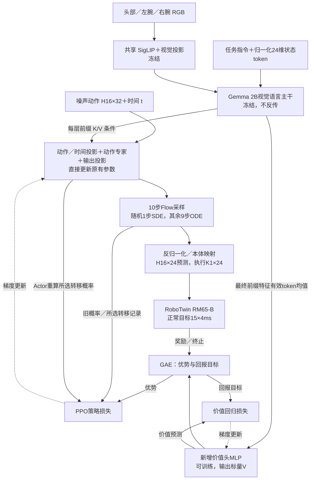
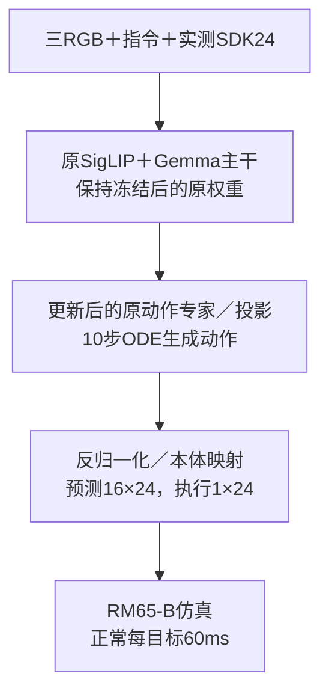

# 本机5090：RM65-B最小PPO闭环验证

关联：[[本机-Linux-RTX5090]] · [[本机-RLinf-RM65B-5090独立环境]] · [[RLinf-RM65B-双A6000最小PPO闭环验证方案]] · [[RLinf-VLA强化学习上手-RoboTwin与LIBERO]] · [[π0.5-RealMan强化学习研究路线-算法与训练闭环]]。

## 结论与边界

**当前单张RTX5090可运行π0.5＋Flow-SDE＋PPO的单环境计算闭环。** 已完成独立依赖、80000权重转换、SFT闭环、真实参数更新、更新权重参与后续采样、保存、训练状态恢复与独立评测。沿用SDK24、三RGB和60ms仿真时钟；冻结VLM，更新完整动作专家、动作投影／时间头和价值头，无LoRA。

**奖励学习信号验收未通过。** 三个T16窗口和一个T400窗口合计448个训练动作，奖励全部0；单场景配对SFT／PPO评测也都超时。因此没有成功率改善证据，不能将非零优势、非零梯度或权重变化解释为抓瓶任务已被RL学会。正式训练应先建立同协议下能偶尔获得真实任务奖励的起点，并补充留出评测。

成功分桶运行整卡显存峰值约29.3GiB；完整窗口最低剩余主存约2.87GiB。整机有8GiB swap，运行中其占用接近8GiB；这是整机统计，不能全部归于本任务，也不能将结果解读为无swap的32GB主存最低规格。当前适合B1实验，增加并行数或改FP32更新须重新测容量；64GB主存是后续扩展建议，不是本次通过的必要条件证明。

## 固定协议与版本

| 项目 | 本次实际配置 |
| --- | --- |
| 物理状态／动作 | SDK24：左臂6 rad、左手6 SDK、右臂6 rad、右手6 SDK；实测状态作输入 |
| 视觉 | 头、左腕、右腕三路原生480×640 RGB8；沿用模型内部缩放，未减少相机 |
| 时钟 | 正常目标15×4ms＝60ms；终态可提前停止，按实际tick记账 |
| 策略 | π0.5，内部32维／物理24维，H16、K1、10步采样；原Full50统计SHA保持 |
| RL | Flow-SDE noise_level0.3，PPO／GAE；B1、micro1、update_epoch1 |
| 参数／精度 | VLM477个tensor冻结；专家182、动作头8、value8可训练；现有实现采用选择性BF16／FP32小层，无FP32 master副本 |
| 短窗口 | T16／global16，环境本体回合上限400；每窗只做一次optimizer更新 |
| 完整窗口 | T400／global400，同样micro1、一次optimizer更新 |
| 成功与终止 | native＋1、明确失败−1、普通步／超时0；native不证明转直并连续保持 |
| 训练后评测 | Pi0Eval的ODE，400个目标、24秒仿真；不是训练SDE的成功率评估 |

60ms是仿真推进时间。预热后的策略查询中位数约145–147ms，不能据此称K1执行达到实体60ms实时控制。

原权重为本地下载的161来源80000，不是99999或新基座。RLinf、RoboTwin来源HEAD及未提交适配快照分别保留；复现必须包含这些适配文件，不能只克隆HEAD。完整环境版本、代码SHA和任务命令见证据与环境笔记。

## 转换与依赖验收

新venv实际Python3.11.15／Torch2.7.1+cu128；原Conda不变。SAPIEN3.0.0b1、MPLib0.2.1在新环境真实reset／render／step／close通过；最终pip check无冲突。转换兼容／序列化3项，加OpenPI合同与诊断37项，共40项针对性测试通过；它们不是全仓库测试总数。

CPU恢复仅params/assets，解Orbax metadata与terminal NNX value包装，并逐阶段释放视觉／语言转换缓冲，最终流式拼接单文件。**667个FP32目标tensor，共3,353,433,872元素，文件13,413,809,848字节**；51个源叶全部有限。转换25.28秒，进程RSS峰值约15.55GiB，最低剩余主存约6.03GiB，没有触发保护。

TensorStore小叶抽查13项／6,288,928个数值，目标逐值精确相等；覆盖动作／时间投影、视觉patch／位置编码及末端普通／自适应归一化。原统计SHA为 `34cbdd09c831e04549d6c4a4e2eb321fb975bdea13bb816ec8aa3a2332d1ccc5`。**未完成整模型逐值比对或同观察同噪声的JAX／Torch动作对齐**；仅模型完整加载和小叶正确不能宣称功能等价。本轮是RLinf计算及资源验证，不是原JAX策略效果复现。

## 实际闭环链及失败修正

1. SFT单场景2010完整运行400个目标、6000tick／24秒，查询与执行有限、无接口错误，结果超时。
2. 初次PPO从SFT更新1次并保存step1，随后默认稀疏patch同步在构造大批行索引时CUDA OOM；失败不是训练梯度阶段。原始失败报告保留。
3. 改用RLinf已有bucket同步，目标512MiB、原dtype、立即加载。加载step1后完整组哈希与optimizer198组step1逐项一致，继续更新到step2、step3并保存；step2权重参与下一轮采样。
4. 独立加载step3的full_weights，匹配667个策略tensor、缺失0；8个value_head额外键在无value的评测模式忽略。重新做同场景400步评测。
5. 加载step3训练状态，完整组哈希及198组optimizer step3一致；再采集400个当前策略动作并做第4次更新、保存step4。step4为容量／奖励探针，尚未独立评测。

四次更新的专家／动作头／价值头梯度有限、非零，三个组的完整参数哈希均改变；198个optimizer状态的真实step依次1→2→3→4且有限。冻结VLM完整SHA全程一致，无梯度。恢复检查比较所有参数组完整哈希；同步检查则比较6个代表tensor、版本号和后续采样版本，**尚不是全网络传输逐值审计**。

恢复验收直接核对模型与optimizer；scheduler及Actor RNG沿用源码加载路径，未单独逐值审计。环境与rollout RNG没有恢复到中断时状态，因此不声称续跑轨迹与不中断运行逐位一致。critic_warmup_steps本轮固定0；其他热身配置还需另验。

### 零奖励不等于没有反向传播（2026-10-13核对）

第一轮动作专家182个、动作头8个、价值头8个梯度tensor全部非零且有限；VLM的477个冻结tensor无梯度。四轮裁剪前总体梯度范数约858.81、1009.15、726.24、5.29，优化器198个状态的step依次到1／2／3／4；专家、动作头与价值头每轮参数哈希均变化。首轮动作投影抽样最大变化约5×10⁻⁶，价值头约10⁻⁴，表明更新确实发生。

当前GAE残差为奖励＋折扣后下一状态价值（带终止mask）−当前价值；即使奖励全0，未校准价值预测仍可产生非零优势，推动PPO策略与价值损失更新。它没有提供哪些行为完成抓瓶的正／负任务反馈，因此不能用这些梯度或参数变化证明任务能力改善，也不能以单场景超时断言“一点没学到”。独立配对评测对象实际是step3，step4尚未独立评测；四次更新首先验证计算链路。

本例value_after_vlm=true，Actor前缀特征在train_expert_only下由no_grad计算，价值头读取冻结VLM特征单独拟合。动作专家／投影的梯度来自PPO概率损失；不把专家梯度解释为价值损失透过主干回传，也不将此路径全部归因于detach_critic_input开关。源码为任务副本openpi/tasks/rl.py的_build_prefix_cache_for_actor与value_from_prefix调用。

当前配置拒绝对OpenPI启用algorithm.recompute_logprobs；没有绕过支持检查，沿用原Flow-SDE保存随机去噪转移的旧概率路径。初期PPO比值约0.99–1.00，梯度有限；不能称原flow最终动作精确边缘似然。旧方案“额外旧概率重算”仍需另行实现与验证。

另在新环境固定了Pydantic2.10.6／settings2.8.1避免Numpydantic schema导入失败；补齐RoboTwin的data／scripts源码辅助文件；限制Torch编译池为1并保持模型compile关闭；本机NCCL用loopback、禁IB／P2P，私有Ray object-store1GiB／8CPU，启用内部dashboard以支持失败清理。这些只作用于本任务环境／启动器。

## 配对评测与资源

两次评测的scene_spec、初始ID2010、原归一化统计、时限、成功标准一致。三相机像素与初始state24逐值一致，400组显式初始噪声也逐值一致；更新后动作输出已变化。结果均为success false、return0、400目标后truncated。仅一个新采样场景，不是留出集SR或原六个专家场景复现，不能直接对比既有JAX H16/K16结果。

| 运行 | 结束 | 墙钟耗时 | 整卡显存峰值 | 最低剩余主存 |
| --- | --- | ---: | ---: | ---: |
| SFT完整400目标 | 正常，任务超时 | 216.19s | 12.08GiB | 9.42GiB |
| patch初次PPO | step1已保存，之后同步OOM | 334.14s | 31.59GiB | 3.94GiB |
| bucket恢复step1→3 | 正常，2次新更新 | 154.37s | 29.27GiB | 5.25GiB |
| step3独立400目标评测 | 正常，任务超时 | 204.75s | 12.09GiB | 5.06GiB |
| bucket恢复step3→4／T400 | 正常，400采样＋1更新＋保存 | 413.90s | 29.23GiB | 2.87GiB |

最后完整窗口采样约175.11s；总413.90s还包含加载、恢复、反向更新与保存。不能拿不同阶段时间充当纯GPU吞吐。

整卡统计含桌面、仿真、NCCL和模型。RSS进程树求和可能重复共享／mmap页面，不用它声称私有主存需求。原仓库HEAD／tracked diff／untracked文件名与开始一致；vendor URDF前后SHA一致。结束检查96个已记录任务PID，无本任务模型／Ray／仿真残留，GPU回落851MiB。本轮无远程操作、实机IO或Git提交／推送。

## 复现与证据入口

持久任务根：`/home/admin123/liminghe/vla-benchmark/deploy/realman_gen4/rlinf_local_5090_minppo_20261013`。环境、代码、转换模型、所有原始输出与四个检查点均保留。根目录README、scripts/task_env.sh、run_isolated_rlinf.py和supervised_run.py给出隔离入口；重新运行要使用新标签／新输出目录，保留本轮历史结果。

长期证据：[[30-实验记录/证据/2026-10-13-RLinf-RM65B-本机5090最小PPO/acceptance_summary.json|验收总表]]、[[30-实验记录/证据/2026-10-13-RLinf-RM65B-本机5090最小PPO/paired_sft_vs_ppo_step3.json|配对评测]]、[[30-实验记录/证据/2026-10-13-RLinf-RM65B-本机5090最小PPO/small_leaf_audit.json|转换抽查]]、[[30-实验记录/证据/2026-10-13-RLinf-RM65B-本机5090最小PPO/SHA256_MANIFEST.json|证据SHA]]。资源、原生smoke、实际依赖、resolved配置和三角色JSONL随总表同目录保存；原始视频样本／逐目标NPZ保留在持久任务根reports。

后续先做同协议K1下的可成功SFT起点／固定输入JAX-Torch动作比较，再选择能产生实际任务回报的训练场景；随后才开展留出集、多个随机种子和RL增益实验。当前实验已结束，没有启动正式长训。

## 实际训练架构与最终模型框图（2026-10-13源码核对）

Actor就是π0.5本身：原有SigLIP、视觉投影与Gemma expert0冻结，原有动作／时间投影、Gemma expert1动作专家与动作输出投影更新；训练模式新增一个价值MLP，无LoRA／外置动作残差网络。图中实线表示前向或数据关系，虚线表示参数梯度更新。

训练时Actor与Rollout是上述同结构模型的两份副本，Actor反向更新，再通过bucket同步给Rollout；Rollout固定当前版本与仿真交互，不在每个环境step自行更新参数。Actor、Rollout和Env本轮共用一张5090；不是两个VLM串联做语义规划。

保存的训练checkpoint含已更新的动作端和价值头。最终独立Pi0Eval执行入口不构建价值头，加载667个策略tensor而忽略8个value参数，使用10步Euler ODE：

**最终执行网络仍是π0.5 VLA，网络动作端参数发生了更新。** PPO／GAE属于训练算法，Flow-SDE属于训练采样与概率计算机制，价值头属于训练分支；它们不是部署时外接的动作修正策略。本次独立评测采用上述ODE路径，而不是继续在线学习。

精确接口：24维状态经手单位÷1000和quantile归一化后，先与指令离散tokenize，再对保留的state数组pad32；π0.5没有连续state_proj→专家的额外直连。三相机共享视觉编码器，输入在模型内resize224²。动作专家通过attention读取逐层prefix KV；价值头读取最终prefix hidden的masked mean，是两种不同的特征连接。价值MLP维度2048→1024→512→256→1，8个参数tensor表示4层weight/bias，不是8个critic或8维价值输出。PPO概率项覆盖执行K1×24对应的选中随机去噪转移，不是H16×32最终动作的精确边缘似然。

源码依据：任务副本realman_dataconfig.py／realman_policy.py；openpi/training/config.py的ModelTransformFactory；openpi/tasks/rl.py的价值头构造、_build_prefix_cache_for_actor及采样／概率重算；sampling/rl_sampler.py的value_from_prefix；tasks/eval.py与保存后实际加载报告。本次仅补充源码解释和框图，没有再次运行训练或更改模型。

### ODE／SDE、价值预测与条件利用的边界（2026-10-13）

ODE是普通微分方程：固定观察与初始噪声后，沿学到的速度场确定推进。π0.5的ODE仍可能因初始噪声不同而生成不同动作，不把它称为完全无随机性。SDE是随机微分方程：在推进途中继续注入随机扰动，并使用相应修正的漂移。本次Flow-SDE随机选一个去噪步骤，其余九步用ODE；所选转移的均值、标准差与概率可计算，供PPO更新，独立Pi0Eval使用十步ODE。原理来源[πRL 4.2](https://arxiv.org/html/2510.25889v1)，实际行为另按本任务sampling/rl_sampler.py和tasks/rl.py核对；不宣称离散十步采样已证明精确边缘等价。

价值头读取VLM最终prefix hidden的masked mean，**预测当前策略从这个观察／任务出发的期望折扣回报，不给VLM特征自身的质量或因果贡献打分**。同一特征在动作专家更新后可能对应不同回报，价值头应跟随当前策略重新拟合。只有成功奖励唯一为1、其余回报0、gamma=1等特定条件下，理想状态价值才等于成功概率；本次native失败−1、gamma0.99，价值分数不能直接当作SR。

PPO的直接目标是提高当前条件动作策略的期望回报。冻结VLM后，它可以使专家改变对已有图像／语言／状态条件的使用方式，但也可能只改善动作时序、闭手或局部控制，因此SR提高不能自动归因为多模态特征利用改善。本次单瓶、固定指令、全零任务奖励尚不能验证该机制；后续可通过同场景换有效目标指令、同指令换布局以及相关／无关信息对照等匹配实验建立证据。此为机制解释及实验建议，不是新增实验结果。

### 当前架构的论文归属（2026-10-13原文核对）

主要方法来源为[πRL: Online RL Fine-tuning for Flow-based Vision-Language-Action Models](https://arxiv.org/html/2510.25889v1)，arXiv:2510.25889v1，2025-10-29。π0.5是原有VLA基座，πRL提供本次采用的Flow-SDE＋PPO后训练方法，RLinf是实现与训练框架。对应原文：§4.2／§4.2.3的Flow-SDE及单随机SDE步骤混合采样，§4.3.1的PPO／GAE，§4.3.2与Figure 4(b)的π0.5价值头接VLM输出，§5.1的RL阶段冻结VLM并微调动作专家。

本任务使用RLinf基于50f22ad9a7825eeaaf4180dca5300f2fa70758be的隔离副本及既有RealMan适配，实际配置为train_expert_only=true、value_after_vlm=true、flow_sde与PPO。RM65-B的SDK24、三相机、60ms控制以及RoboTwin环境接入属于本体与工程适配；当前没有引入新的RL算法或新的策略网络架构。可将这套方法作为πRL路线的本体适配基线，不称为原论文完整实验复现。

适用范围区别：原文§5.1说明其π0.5在LIBERO／ManiSkill实验中省略本体状态，而本任务保留SDK24状态token；本任务也沿用自己的预测H16／执行K1、十步去噪、奖励和评测合同。原文方法归属不代表已复现论文成功率，也不证明本任务改善了VLM条件利用。当前新增内容是论文原文与既有源码／配置的归属核对，没有新增训练或评测。

### πRL原文明确提出的局限（2026-10-13文献核对）

来源固定为[πRL arXiv:2510.25889v1，第7节](https://arxiv.org/html/2510.25889v1)，以下为作者报告，未在RM65-B上独立验证：

1. **噪声注入与分布保真**：ODE转SDE会导致训练采样表现下降。作者尝试Flow-CPS以减轻数值转换误差，观察到误差改善但RL收益有限；保持原动作分布并获得有效探索仍有改进空间。
2. **训练加速**：当前混合采样只随机选一个去噪步骤使用SDE、其他步骤使用ODE，设计较简单，作者将更快且更有效的混合采样列为后续方向。
3. **语义泛化**：作者明确指出ManiSkill分布外测试中，SFT和RL模型的语义泛化仍有限。该结论属于论文整体实验范围，不能将其当作本体RM65-B或本次π0.5＋Flow-SDE专项结果。
4. **真实机器人验证缺失**：论文实验仅在仿真中开展，没有物理系统上的实证；仿真提升不构成实机迁移证据。

相关优化边界：§5.3.5／§5.4报告噪声幅度、去噪步数与动作chunk需要权衡，π0.5＋Flow-SDE在LIBERO-Long训练中KL持续增长可能导致不稳定，余弦学习率调度改善该问题。§5.5的VLM LoRA联合更新在π0＋Flow-SDE／LIBERO-Long未展示明确增益，且需要更保守的优化；作者将场景变化有限、预训练表征已较稳健作为猜测。不能据此推出LoRA普遍无效或在RM65-B复杂场景中没有必要。

§5.2.2进一步将OOD收益有限归因于两点：SFT起点在OOD本身表现较差，以及为提高训练效率而冻结VLM阻止视觉特征适应环境。该归因属于作者分析，具体实验为ManiSkill的Flow-Noise路线，不冒充本次π0.5＋Flow-SDE的实证。语义OOD包含未见对象、变化指令以及额外对象／容器等干扰；提高分布内任务SR不自动解决这些测试。

本项目解释：冻结VLM的动作端训练可改变条件使用，但不会直接更新上游表征。若研究重点是多模态条件利用，应单独验证留出目标／指令／布局表现和条件反事实，而不能由训练集SR提升推断语义泛化改善。此为结合架构的研究判断；本次只核对原文并增量归档，没有新增训练、评测或模型变更。
