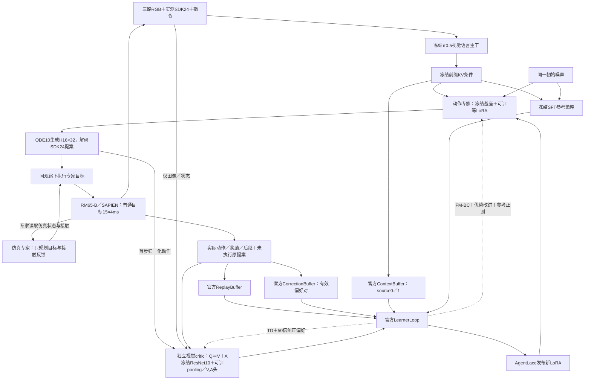

# RM65B完整ACoB仿真闭环补齐

> [!success] 本次最终结论
> 完整ACoB仿真适配版最小机制闭环通过：真实成功示范、FM-BC、纠正偏好校准、官方三Buffer／ActorLoop／LearnerLoop、更新发布与独立恢复均已实跑。无接管评测0/1，在第184步碰落瓶子，任务学习尚未通过。

## 任务与固定合同

用户授权在原计算闭环基础上补齐成功示范、真实纠正偏好、FM-BC、官方三Buffer及ACoB-Stream，先做最小机制验收。保留SDK24、三路480×640 RGB、每普通目标15×4ms=60ms；π0.5内部32维、H16、ODE10、K1执行。成功条件沿用upright_hold：抬离桌面至少1cm、偏角不超过15°、对向接触并持续保持1秒。成功提前终止可短于15tick，须有实际原生trace。

独立根：`/home/admin123/liminghe/vla-benchmark/deploy/realman_gen4/acob_fullsim_5090_rm65b_v1`。复用上一阶段独立Python依赖和原SFT80000，只读链接原机器人资产；新代码、数据、模型及缓存写入本任务根。原ACoB计算探针、原RoboTwin入口和资产不替换。

## 执行与验收顺序

1. 仿真专家只规划SDK24目标，全部物理推进经环境step；专家调用不得改变关节、drive、瓶姿态或tick。
2. 先生成至少一个实际upright_hold成功回合，保存N+1个真实观察、N条执行trace及三相机视频；失败数据保留且拒绝导入成功缓存。
3. 从真实连续动作提取H16 FM输入标签；本体配置仍沿用官方loss_horizon=K1，仅监督实际执行的首步，H16后缀使用真实未来轨迹以避免双向attention读到虚构尾部。末15条不足窗口仅用于TD／偏好，不以重复尾部补造BC。动作相对量全部相对当前观察的实测状态计算。
4. 成功示范进入官方ReplayBuffer，冻结VLM编码进入ContextBuffer（PREPROCESS）；在线同一观察保存VLA提案与实际专家接管，后继和奖励只绑定实际动作，进入ReplayBuffer及CorrectionBuffer（TRAINING）。
5. 原生ActorLoop与LearnerLoop并发，采用官方AgentLace共享内存参数传输；先critic warmup，再少量joint，启用官方0.25 FM＋0.5优势＋0.25参考正则、纠正偏好权重50。
6. 验收真实非零FM、有效偏好对、actor／critic非零梯度及更新；冻结VLM／base／reference保持不变；Actor必须安装并实际使用新LoRA采样。
7. 保存完整动态状态，独立进程恢复并再次采样／执行。机制闭环通过与任务SR提升分别报告；最小回合不建立论文性能复现结论。

## 前期失败与组件证据（保留阶段快照）

- `data/expert_demo_v1`：接近规划失败，0执行动作；耗时约204.5秒，失败证据保留。
- `data/expert_demo_v2`：耗时23.22秒，0执行动作，显存整卡峰值4.40GiB，未触发内存保护。16次IK均收敛、得到2个合法分支、93link FK审计通过，但两条直线关节路径撞瓶，因此未放行动作。正在补避障路径；不降低碰撞标准、不改接触物理。
- 数据与Buffer模块18项CPU测试通过：含官方Buffer/prefetch/cache、真实成功manifest、N+1观察共享、trace连续性、末端成功短步、拒绝伪纠正及外部路径。
- 静态交叉审查发现K1 action_chunk不能直接接H16 FM标签；已新增专属model_horizon_action_chunk，沿用相同SDK缩放／相对量／归一化／补32维。CPU回归8项通过、1项原codec路径未配置而跳过，含B2/H16与16次K1转换逐元素一致。
- `data/expert_demo_v3`：0执行动作，OMPL精确端点门拒绝。
- `data/expert_demo_v4`：实际400目标／6000tick／24秒，回报0、未接触瓶子、失败；耗时190.89秒、整卡峰值4.40GiB。接近路径本身通过完整mesh，但MPlib将腕关节目标加2π，显式回转连接后仅接近即需877步，超过原生400步。实际失败数据已被成功导入器拒绝。正在改精确目标避障搜索，不改速度或回合预算。
- ACoB-Stream模块16项CPU测试通过：官方共享内存真实callback、原生Actor/Learner循环的合成环境序列、无double-stack、pref50构造且保留旧probe默认、reward1/time0配置、超时mask及真实末端KV接线。fixture不构成完整GPU训练证据。
- 新任务已复制独立4.1MB tokenizer缓存并核对SHA，OPENPI_DATA_HOME／JAX／UV缓存均指向本任务；旧依赖环境只读复用。

- 后续交叉审查另修复SDK24手部连续统计、完成回合Pkl被同step空保存覆盖、Actor/Learner失败后缺Corr等待无法及时取消三项。官方Buffer与Loop默认UR入口行为保留，本体分支使用SDK24专属逻辑。
- 独立合成CPU审查确认source0/1的RL权重为[0,1]，SDK24 good/bad critic输入为[2,24]，有效偏好pair=1、loss=0.0025、梯度=0.04115；这是合成schema／梯度验证，不是模型训练。
- 当前额外回归22项运行：21通过、1项原codec路径未配置跳过，含分区JIT与完整state更新的动态结果等价。
- 原三仓库HEAD／status／tracked diff／所有未跟踪文件SHA、三个机器人资产SHA与旧任务237代码文件均与起始快照一致。

上述条目记录闭环运行前的阶段快照。最终真实验收见后文；组件fixture本身不构成GPU训练或物理成功。

## 成功专家示范与训练启动

`data/expert_demo_v7/dataset.json`已由真实reader独立通过：245条转移、246个实际观察、230个有效H16输入窗口；相邻current/next共享同一只读NPZ观察。实际3663个4ms tick／14.652秒，普通动作15tick，最后成功提前终止为3tick／12ms，末mask=0。

终端原生环境实测：瓶底间隙0.0276561m、偏角0.599052°、拇指／其他手指法向力2.30321／2.26861N、对向法线点积−0.999212、桌面支撑力0、连续保持1.000秒。成功来自本次固定的`upright_hold`协议；原RoboTwin的`native_success`字段仍为false，不能当作默认native判据或论文任务SR通过。场景初始为直立瓶，这个最小验收检验抓起／保持，不证明倒瓶转直能力。

专家最终修正只涉及独立辅助规划和控制策略：避开MPlib等价2π分支、辅助瓶3mm保守外包、原几何0.5mm连续下界复审；闭合阶段对缺失主指按原速率继续搜索，真实三指接触／当前LP可行／握持力稳定5边界后才抬升。物理资产、摩擦、接触参数、驱动、成功阈值和60ms合同均未改。专家成功不是VLA自主成功。

前六次尝试及原始失败证据保留，没有导入成功示范缓存。V7进程退出0、耗时123.17秒，整卡GPU峰值4.55GiB，未触发资源保护。

已启动`outputs/full_acob_stream_v1`：成功demo为source0、真实冻结VLM KV进入ContextBuffer；在线两完整教师接管回合建立source1纠正偏好对；B2、warmup1、joint3、CTA2（计划critic总8次）、偏好权重50／margin0.05。Replay容量Ndemo+416、Correction416、Context2048稀疏分片；Actor最多800个目标并最多2原生回合，不依赖随机规划路径长度等于demo。

纠正是专家给出的偏好标注：同一观察记录未执行的VLA提案与实际专家动作，TD只使用实际后继／回报；不声称独立执行过每个反事实提案，也不声称已证实每个提案的真实回报严格更低。

V1真实Stream首个在线回合成功：249条实际VLA提案、249条实际纠正、回报1；已落实际NPZ、JSONL及官方transition shards。第一次critic更新发现内部state丢失T轴，B2被原EncodingWrapper误当作T2而flatten成48维，Dense初始化24维故拒绝，完成参数更新数0。取消机制实际即时结束Peer等待，失败证据保留。V1耗时222.40秒、整卡峰值21.09GiB，未触发资源保护。

修复后Buffer／cache及Actor内部state统一[1,24]，B2 batch为[2,1,24]；原仿真接口和NPZ仍为SDK24[24]。真实EncodingWrapper＋实际Buffer current/next B2前向回归通过，负例明确复现旧错；proposal哈希固定物理state24字节协议，旧249对记录仍可核对。数据测试增至18项，Stream16项，专家可移植23项已在持久目录实际重跑通过。

## 最终完整机制验收：V2

V2整体独立核对通过，主收据为[[30-实验记录/证据/2026-10-15-RM65B完整ACoB仿真闭环/execution_summary.json|execution_summary.json]]。执行根仍为本页开头的`acob_fullsim_5090_rm65b_v1`，运行输出分别为`outputs/full_acob_stream_v2`和`outputs/full_acob_reload_v2`。

| 验收项 | 实际结果 |
| --- | --- |
| 成功示范 | 1回合、245转移，230个有效H16 FM输入窗口 |
| 在线纠正 | 两个真实接管成功回合，245＋244＝489对；每步先由实际VLA提案，再由专家执行并记录真实后继 |
| Learner更新 | 外层warmup1＋joint3；CTA2，critic实际更新8次、动作专家LoRA实际更新3次 |
| FM-BC | 三次actor更新均使用2个有效H16窗口，BC loss分别0.220359、0.0179220、0.0000999569 |
| 纠正偏好 | 有效pair每批1或2，权重50／margin0.05；8次critic更新的偏好loss均非零 |
| 优势／参考项 | 三次优势loss均非零；参考loss约3.81e-7、1.32e-6、6.33e-7，配置与实际前向均启用 |
| 梯度与参数 | actor梯度范数0.0166822、0.00389048、0.00227328；对应update norm约2.96e-5、4.28e-5、5.11e-5；critic亦非零 |
| 更新边界 | 动作专家10个LoRA参数叶均变化，共22,118,400个参数；VLM和原动作专家基座、冻结参考策略SHA全不变 |
| 参数发布 | Actor实际采样参数版本0和3；第二回合使用更新后的模型，非仅发布日志 |
| 三Buffer | 真正的官方Replay／Correction／Context；source0实际编码246观察、source1实际写491个唯一KV记录；ID水位803含预留空洞，不当作实际记录数 |
| 经验持久化 | Replay环容量661、Correction416；末可采样657／413，环覆写不代表总采集数。原始489对及官方两回合Pkl分片完整保存 |
| 保存／独立恢复 | 最终delta checkpoint396.41MiB，冻结SFT另按原路径加载；Learner的LoRA／优化器／step／critic／target／训练RNG全部按SHA精确恢复 |

三个batch的FM数值使用不同状态和噪声，不能据此声称训练收敛。参数变化／loss贡献证明机制工作，不能替代任务能力评测。

### 独立进程无接管评测

完整原生回合评测已执行，未加载任何专家接管。第184目标／2760tick／11.04秒出现`bottle_dropped_below_table`并由环境实际终止，成功false／回报0；终态瓶底间隙−0.131806m、偏角151.223°。初始／末观察、逐步动作／原生trace和三视图视频均保存于`outputs/full_acob_reload_v2`。

这次闭环的流程验收通过，任务表现失败。沿用上一阶段相同seed2010、K1、60ms、upright_hold的SFT原生基线为0/1、400目标超时；本轮没有重跑该历史基线。原生full SFT与LoRA图存在已记录的BF16数值差异，加上单seed和仅3次actor更新，不能把两条失败轨迹的差别解释为可靠增益或退化。

### 本机实际资源与范围

| 阶段 | wall秒 | 整卡显存峰值GiB | 进程树RSS峰值GiB | 最低可用主存GiB |
| --- | --- | --- | --- | --- |
| 专家V7 | 123.17 | 4.55 | 2.40 | 21.42 |
| 完整Stream V2 | 424.76 | 21.25 | 19.23 | 6.43 |
| 独立恢复＋自主评测 | 118.88 | 21.14 | 20.41 | 6.64 |

整卡值包含桌面和渲染，RSS求和可能重复共享页。60ms为每个普通目标的仿真物理时钟，本次不建立真机60ms墙钟实时控制结论。本次单环境B2最小配置未触发主存保护或OOM；不外推到更大并行、长训或多机吞吐。官方AgentLace共享内存传输与Actor／Learner线程已真实运行；跨机器网络部署尚未验收。独立恢复验证的是Learner训练动态状态，未声称恢复正在进行的仿真世界或Actor采样时钟。

当前测试矩阵共78项CPU通过、1项可选原codec路径测试跳过；本次所有模型／仿真进程已退出。原三仓库、原机器人资产与旧任务237代码文件经结束哈希核查均未变化。本轮未安装新依赖、未转换SFT权重、未执行真机／远端操作或Git提交推送。

### 当前实际框架

部署策略仍是π0.5加动作专家LoRA；仿真专家、critic与Buffer属于训练系统。Critic读取图像／状态／动作，不直接读取VLM的KV或指令。图中的接管是本次数据生成配置；无接管评测直接执行VLA提案。

### 视频末帧核查

成功专家回合末帧（三视图视频缩略副本；模型原始480×640 RGB保留在NPZ）：

![[30-实验记录/附件/2026-10-15-RM65B完整ACoB/expert_success_last_frame.png]]

独立恢复后无接管失败回合末帧；桌面瓶子已不在原位，与环境碰落终止一致：

![[30-实验记录/附件/2026-10-15-RM65B完整ACoB/autonomous_failure_last_frame.png]]

## 复现与验收入口

- [独立代码复现说明](/home/admin123/liminghe/vla-benchmark/deploy/realman_gen4/acob_fullsim_5090_rm65b_v1/code/VLA-Precision/README_RM65B_FULL_ACOB.md)
- `scripts/verify_fullsim_run.py`：按真实JSONL／native trace／参数／恢复收据交叉核对，写入fresh汇总文件，拒绝覆盖原验收记录。
- `code/RoboTwin/tests_acob/run_cpu_tests.py`：相对路径可移植的23项专家CPU回归，实际在持久副本执行通过并记录源SHA。
- 资源监控命令和确切参数：独立根`reports/*_resources/exit_report.json`。所有失败候选与V1失败训练均保留。

## 来源与关联

- VLA-Precision原提交：`41edacde80d8c9d8146d610202299d71b0e79f7c`。
- RoboTwin原提交：`931ce21f4f0e63feab661f349634d5a25bd92681`。
- 详细证据：独立根的`reports/`、`data/expert_demo_v*/`、`code/`；实验限定本机5090仿真，没有访问真机或远程服务器。
- [[2026-10-15-VLA-Precision-RM65B仿真复现启动与验收]]
- [[本机-VLA-Precision-RM65B最小ACoB闭环复现方案]]
- [[VLA-Precision精读-价值校准、动作专家更新与Q-VGM比较]]
- [[本机-Linux-RTX5090]]
