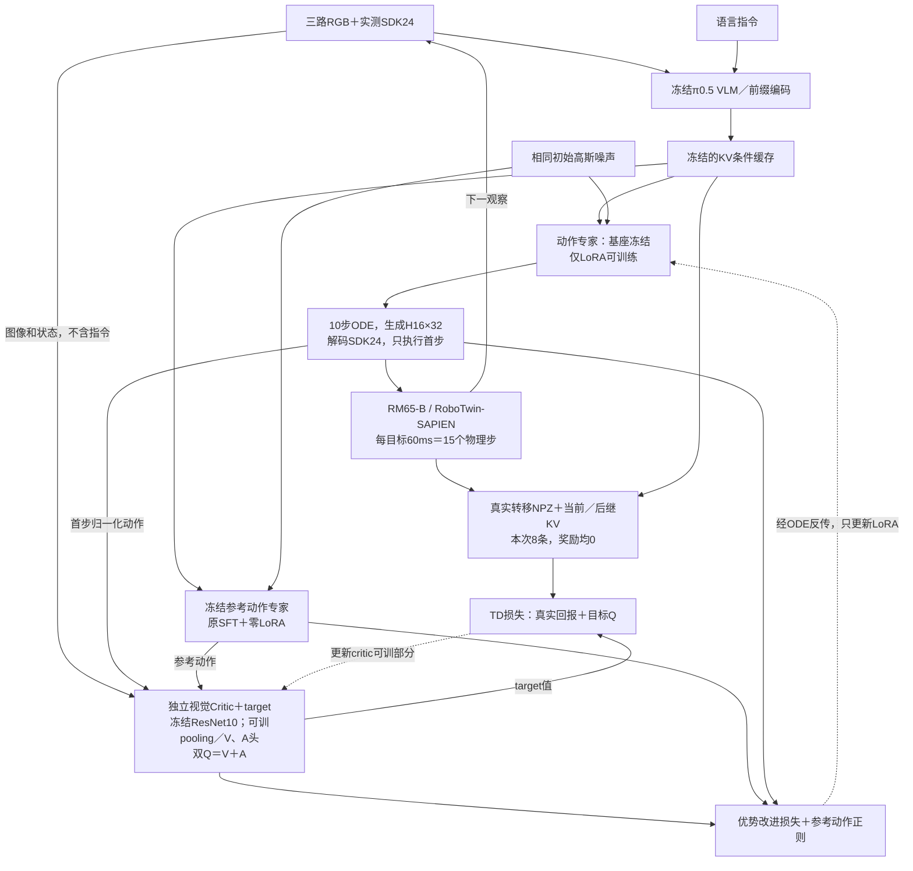

# VLA-Precision：RM65-B 仿真复现启动与验收

> [!abstract] 验收范围
> 本次用户授权制定计划并开始执行。在独立目录完成依赖、SDK24适配、SFT恢复、原生仿真基线和一次无纠正联合更新；完整ACoB的纠正数据、混合回放调度、成功率提升尚未验收。本实验不复现论文九项真机任务成绩。

关联：[[本机-VLA-Precision-RM65B最小ACoB闭环复现方案]] · [[VLA-Precision精读-价值校准、动作专家更新与Q-VGM比较]] · [[RM65-B接入RoboTwin仿真]] · [[本机-Linux-RTX5090]]。

## 1. 计划与固定合同

按以下顺序设置门槛，失败保留原始证据后定位，不启动长训：

1. 新环境按官方锁文件准备，真实GPU矩阵、卷积、反传通过。
2. 原生仿真桥验证reset／step／close、RGB、实测状态、实际物理步及末态。
3. 原生80000全部基础参数恢复；分别验证跨OpenPI版本、零LoRA计算图与cached sampler。
4. 独立原生SFT完整回合，测真实成功、回报、资源并保存视频。
5. 少量真实转移上的critic／专家LoRA更新，检查梯度、冻结参数、保存和重载。
6. 补成功示范与合法纠正对后，验完整Replay＋Correction＋Context及ACoB-Stream。
7. 确定有任务信号的共同执行协议，再开展同预算、留出场景、无接管的SFT／ACoB对照。

保持原SDK24顺序：左臂6 rad、左手6 SDK、右臂6 rad、右手6 SDK；三路原始480×640 RGB8；每正常目标15×4ms＝60ms。π0.5内部32维、H16、10步ODE，本轮最小执行K1。手 `/1000`／`×1000`、双臂delta、pad32和原24维norm SHA均保留。critic看24维连续动作，reference约束12个臂坐标，未套用UR二值夹爪。

运行根：

```text
/home/admin123/liminghe/vla-benchmark/deploy/realman_gen4/acob_local_5090_rm65b_v1
```

完整计划保存在该根 `IMPLEMENTATION_PLAN.md`；`code/VLA-Precision` 为独立源码副本，`venv`、cache、models、runtime、reports、outputs均隔离。仿真复用旧PPO任务中已验证的独立SAPIEN解释器与RoboTwin副本，只读引用原资产。原VLA-Precision／RoboTwin／RLinf代码、原SFT与原入口未改动。

## 2. 依赖与权重实际结果

| 项目 | 本机实际验收 |
| --- | --- |
| 环境 | Python3.11.15；`uv sync --frozen --group stage2`完成；首次Torch下载TLS失败后，HTTP/1重试成功，日志保留 |
| 核心版本 | JAX/JAXlib0.5.3、Flax0.10.2、Orbax0.11.13、Torch2.7.1、NumPy1.26.4、Optax0.2.8 |
| GPU | RTX5090、32607MiB、驱动595.99.02；实际矩阵／卷积／梯度通过 |
| critic权重 | 公开ResNet10，SHA256 `175745d43d30233eb01b5369465d1c24c11b8ee71ccb734cc1c1bca13e07f57b` |
| 原SFT | 原生JAX/Orbax80000，51基础叶、3353433872元素全部覆盖；旧SFT optimizer未恢复，无随机补齐基础叶 |
| 精度 | 磁盘参数实际FP32，推理／冻结基础参数按原生入口转BF16；模型配置中的BF16不等于磁盘保存dtype |
| 跨版本 | 原OpenPI215ab与目标2d70d在一个真实仿真观察、同显式噪声下，预处理输入、H16×32 normalized输出及H16×24 SDK输出逐位一致，最大误差0 |
| CPU验证 | 28项通过、0失败、0跳过，包含新增分区更新数值等价检查；不等于28项物理实验 |

`uv pip check`仍有1项元数据不兼容：LeRobot声明需要opencv-python-headless，而官方pyproject用`sys_platform==never`覆盖并提供opencv-python。已记录该例外；实际cv2及MP4生成通过，不宣称依赖检查全部通过，也未安装两套冲突的cv2包。

新增代码覆盖：RealMan输入／输出、DataConfig和配套full-SFT／LoRA profile、actor／JIT learner统一变换、SDK24 schema、独立进程JSON＋NPZ仿真桥、纯SFT评测、无纠正计算探针和动态状态检查点。原始机器人服务与训练入口未替换。

## 3. 仿真与SFT基线

原生桥seed2010通过：三RGB、实测SDK24、两个静态目标实际30tick／0.12秒、有效后继与worker正常退出。seed7因瓶子不稳定被原生`UnStableError`拒绝，失败记录保留，没有关闭稳定性检查。

纯SFT使用非LoRA原生`Policy.infer`，不构建critic或optimizer。固定seed2010、H16/K1/ODE10、最多400目标／24秒，主判据`upright_hold`：抓起至少0.01m、倾角不超过15°、有效对向接触、无桌面支撑并持续1秒。

| 指标 | 实测 |
| --- | --- |
| 回合完整性 | 400目标、6000物理tick、24秒，time-limit截断，worker退出0 |
| 成功 | 0/1；不是完整benchmark SR |
| 回报 | 0，400步均无正回报 |
| 接触／保持 | 未出现有效手指接触或保持，最大bottom gap约2.89微米 |
| 墙钟 | 总启动及运行约140.4秒；其中评测约125.4秒 |
| 显存 | 整卡峰值约13.06GiB，包含桌面／模型／渲染 |

视频：[[30-实验记录/证据/2026-10-15-VLA-Precision-RM65B仿真复现/sft_seed2010_three_views.mp4|SFT三视角完整回合]]。原始初末RGB、逐步SDK24／H16提案／噪声／实际tick、物体指标及视频留在任务输出 `outputs/sft_baseline_v1`。

K1属于本次共同最小接口协议，不能用历史K16成功样例证明本轮K1具有正反馈。正式效果实验前需补H16/K16原入口回归并选择共同K；K>1的有效m、尾部mask及FM标签链需另验。

## 4. 零LoRA对齐的修正与边界

最初对full-SFT与零LoRA设置的1e-5严格门槛失败，v3／v4原证据保留。三方对照得到：

- full no-LoRA原生图 → native zero-LoRA：H16 normalized最大差0.0048828125。
- native zero-LoRA → cached sampler：最大差0，完全一致。
- H16物理最大差：臂0.003674rad、手0.8153SDK；首个实际执行目标约0.000762rad／0.1838SDK。

差异定位到增加零LoRA分支后的低精度计算路径，现有证据不支持归因于缓存实现错误。后续明确区分：缓存实现仍需严格对齐；零LoRA初始化另用normalized≤0.01、全H16臂≤0.005rad、手≤2SDK的工程预算。后者经过v4归因后制定，**不冒充原1e-5门槛通过，也不证明初始SR完全相同**。研究对照同时保留原生full-SFT和零LoRA初始化策略。

## 5. 有界更新、资源问题与修复

采集8条真实K1转移：当前／后继三RGB、实测state24、完整实际SDK24命令、真实奖励／终止及对应KV。只接受完整15tick／60ms周期，没有伪造成功、示范或纠正对。8条奖励均0。

先1次critic warmup，再1次joint update，batch1。actor采用官方Stage-II学习率配置：warmup1000、peak1e-5、decay10000、end2.5e-6，首步约9.99e-9。loss权重FM／improvement／reference＝0.25／0.5／0.25；无成功或纠正时BC权重为0，纠正偏好项未启用。

| 验收 | 实测 |
| --- | --- |
| critic | warmup与joint均有非零有限梯度、非零更新 |
| 专家LoRA | joint梯度范数0.00112485，更新范数1.64629e-5 |
| 参数变化 | attention／MLP共5个LoRA-B逻辑叶改变；LoRA-A首步不变符合B从0初始化的结构 |
| 冻结对象 | VLM、原专家基座／投影和reference逐叶SHA不变 |
| 保存恢复 | LoRA、actor optimizer／step、critic／target／optimizer／RNG完整动态状态重载逐叶一致；冻结基座SHA绑定原SFT |
| 更新阶段资源 | 整卡峰值约17.81GiB；进程树RSS峰值约19.34GiB；主存最低可用约6.49GiB；无保护停止 |

失败修复分三类：

1. 初始验证把完整模型闭包进JIT，导致主存保护停止；改为显式参数输入，释放编译临时量，指纹改瞬时分块读取。
2. 上游完整agent进出JIT及旧reference持有使冻结基座产生额外透传副本；80%／92%显存池两次联合更新OOM均保留。
3. 采用分区更新接口：仍调用原`_update_impl`，只返回LoRA／optimizer／step／critic／metrics，JIT外复用原冻结基座与reference。CPU小模型验证critic warmup＋两次joint与完整状态接口的所有数值、optimizer、target、RNG及metrics一致；完整模型一次joint在原80%池下通过。未缩短H16、ODE10或改损失来通过验收。

约397MiB的动态检查点位于 `outputs/update_partitioned_v3/checkpoint`。此结果证明本机5090可承载该batch1无纠正机制算例，不能推出完整batch2混合数据、并发ACoB-Stream、大回放或长训容量。

## 6. 独立重载、下一阶段与未完成项

独立新进程已恢复冻结SFT＋新LoRA及训练动态状态，实际再执行8目标／120tick／0.48秒，进程退出0，后继转移均有效。该短窗未完成任务，不产生SR；整卡峰值21.04GiB，进程树RSS峰值19.25GiB，主存最低可用6.50GiB。

汇总：[[30-实验记录/证据/2026-10-15-VLA-Precision-RM65B仿真复现/execution_summary.json|完整执行回执]]；分阶段计划：[[30-实验记录/证据/2026-10-15-VLA-Precision-RM65B仿真复现/执行计划|执行计划]]。原三仓库HEAD／tracked diff／所有未跟踪文件SHA与开始快照一致，机器人两URDF及manifest SHA一致；没有把原未提交工作清空或搬走。所有本任务模型／仿真进程已经退出。

完整ACoB尚需：

- 确认仿真纠正采用专家还是人工；同一观察保存VLA原提案、实际被执行的纠正、真实后继和结果。普通示范不伪装成纠正，未执行提案不共用纠正产生的TD后继。
- 新建可成功的示范及合法纠正缓存。本机原Full50 HDF未找到，历史未验收候选HDF不自动当成有效示范；旧规划专家不是当前60ms环境的即插即用服务。
- 官方入口要求正的correction/replay比例与batch至少2；不能简单设0启动“完整ACoB”。当前独立runner未验收原Buffer／Stream调度、人工偏好50权重与成功FM数据链。
- 统一有实际任务信号的K和成功协议，完成留出种子的无接管SFT／ACoB配对；1次joint和全零回报不建立任务学习证据。

本轮没有访问实体机器人、远程服务器、启动长训或Git提交／推送。原资产、原模型与原运行入口保留；实际数据和失败证据均写在独立任务根。


## 7. 当前实际框架与完整ACoB的差距

2026-10-15再次只读核对独立运行代码及`resolved_probe_config.json`／`updates.jsonl`。当前是ACoB核心更新函数的RM65-B无纠正计算闭环，未验收完整VLA-Precision／ACoB-Stream。不是将原PPO价值头直接换名。



实线表示数据／前向，虚线表示参数更新。Critic不读取VLM token，也不直接接收语言；语言仅经冻结VLM条件影响动作。参考策略与当前策略共用相同条件和初噪声，参考输出停止梯度。状态在π0.5的离散状态token中进入前缀，动作侧继续消费缓存KV。

| 机制 | 当前状态 | 完整算法的差距 |
| --- | --- | --- |
| TD critic＋优势改进 | 已真实运行 | 目前仅critic warmup1次＋joint1次，critic价值尚未充分训练 |
| Reference动作正则 | 已接线，权重0.25；本次loss=0 | 零LoRA初始化与reference动作相同，不能说该项被关闭 |
| 成功／纠正FM-BC | 已接线，权重0.25；本次loss=0 | 没有完成的成功回合或实际干预样本 |
| 纠正偏好价值校准 | 未启用，权重0 | 缺同观察的原提案／真实纠正动作对 |
| 官方三Buffer与ACoB-Stream | 未跑通完整管理／发布循环 | 当前为NPZ转移＋KV缓存、分段采样／更新／重载 |

这一次actor实际非零驱动是优势改进项；没有正回报时，初始化critic及其TD拟合仍可产生非零动作梯度，不能据此建立任务学习证据。冻结ResNet10只固定预训练特征骨干，critic的pooling／bottleneck／V、A头仍可训练。分区JIT只改变运行时冻结参数的透传方式，原损失、H16、ODE10和优化器保留，不构成新的算法。

源码证据：独立副本`acob/agent.py:496–540,614–745,1014–1048`、`acob/vision.py:360–361,400–450`、`realman_acob_probe.py`；原commit `41edacde` 的`acob_stream/setup.py:222–226`、`buffers/replay.py:658–668`、`acob_stream/learner.py:118–138`。本次只读复核并补框图，未重新训练。


## 8. 完整机制补齐的后续独立记录

用户进一步授权使用仿真专家生成成功示范和纠正数据，并接入FM-BC、偏好校准、三Buffer及ACoB-Stream。新实验在另一独立根进行，进展与实际验收见 [[2026-10-15-RM65B完整ACoB仿真闭环补齐]]；本页前述无纠正计算探针结果保留为历史证据。
