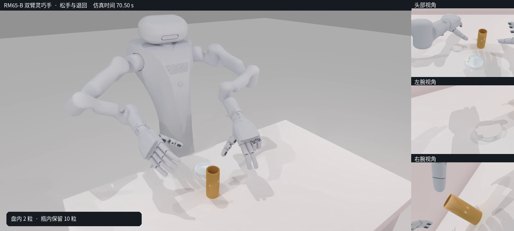

# RM65-B双臂灵巧手少量倒药演示

本次视频展示同一轮实际仿真的完整流程：双手协作开盖、放盖、收紧持瓶并试抬、少量倾倒、回正放瓶和松手退出。最终盘内有2粒完整胶囊，瓶内保留10粒。

- [演示版：63.04秒](presentation_partial_pour.mp4)：仅将原录像32.34–43.74秒的开盖接触调整段设为3倍速，画面有明确标注；倾倒、放瓶和退手保持原速。
- [原速完整版：70.64秒](complete_partial_pour.mp4)：1600×720、50fps，包含3,532个实际仿真时刻的画面。大画面为观察机位，右侧保留头部与双腕三视角。

## 本轮调整

持瓶阶段改为逐渐收紧、试抬和姿态修正，再进行缓慢倾倒。取盖结束至开始倾倒的实际时间由15.36秒减至3.60秒；加上缓倒、回正放瓶和退手，完整物理动作仍为70.62秒。演示版缩短片长包含明确标注的视频加速，不代表整段机器人运动物理提速。

## 验证与适用范围

从初始场景实际重放1,177个完整60毫秒动作窗口，物理时钟4毫秒，全部窗口下一状态与前一轮验证轨迹一致。没有通过恢复物体位姿来修复动作结果。原速视频和演示版均已完整解码，演示版没有拼接其他轮次或生成虚拟运动画面。

末端0.5秒内，药品几何归属始终为盘内2粒、瓶内10粒，无盘外药品；但药片仍有约1.153毫米微动。额外的1毫米位移检查未通过，连续低于0.015米/秒的条件仅122/126个观测通过。因此，本次交付为仿真动作演示，不称为严格静止验收通过或官方数据集采集成功。

当前采用固定seed的预松盖仿真模型，不代表完全拧紧盖、多场景成功率或真机能力。旧的全部12粒倒出任务及其数据保持独立。实验源码、原始轨迹和详细诊断留在本地，本次只公开本说明、两份视频及预览图。

关联记录：[[2026-10-22-RoboTwin实验室器皿导入与功能点标注]]。

## 文件校验

- 原速版 SHA-256：`723dade34f6646c00c7162ada9ad805b80df74e7c5385747ed7c8476c9b384b2`
- 演示版 SHA-256：`86597bc7a6a646b77fbb6a9bb385a6cb2a309bf607c5b25523e8660842a95671`
