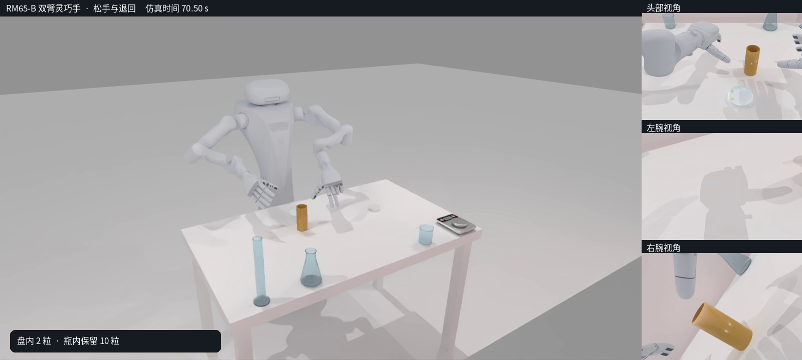

# 实验室陈设与全程原速少量倒药

[观看完整视频：70.64秒，1600×720，50fps](complete_partial_pour.mp4)

烧杯、锥形瓶、量筒和原RoboTwin电子秤放在桌面远端，中央保留药瓶与接收盘。四件陈设的完整脚印均在当前1.2×0.7米桌面内。根据实际肩部位置、URDF后代关节平移长度和连杆碰撞几何计算，陈设位于双臂的保守可达球之外，最小余量约39.97毫米。背景物体为初始静态陈设；烧杯、锥形瓶和量筒复用既有器皿及分块碰撞，电子秤复用官方外观和外包围盒碰撞。

视频使用固定观察机位并保留头部、双腕三视角，**全程1倍原速，没有局部3倍速段、镜头推拉或生成式插帧**。3,532个实际仿真时刻逐帧采样，相邻视频时间戳与实际采样间隔均为0.02秒。

左臂两段原先无接触的空载接近动作采用三点平滑，最大关节指令改变量约0.284°，两段指令峰值加速度分别降低约20%和18%。右臂、手指、接触旋盖及抓取倾倒段指令保持原有时序。这里的“原速一致”指视频时间映射一致，各操作阶段仍保留实际抓稳和缓倒所需的停留。

本轮先完整试跑，再从初始状态独立录制。两轮均实际执行1,177个60毫秒控制窗口；所有动作、下一状态及终点机器人与物体状态读回一致。最终盘内2粒完整胶囊、瓶内10粒，瓶子直立并由桌面承托，双手与瓶盖、瓶身均已卸载。没有通过恢复物体状态来修复任务结果。

末端0.5秒仍有约2.219毫米药片微动，连续低速检查114/126个观测通过；因此不声称严格静止验收通过。本次是固定seed、预松盖模型的仿真视频，未重新导出官方采集数据，也不代表真机或随机布局成功率。

关联记录：[[2026-10-22-RoboTwin实验室器皿导入与功能点标注]]。

视频SHA-256：`0ff3e82f022dae0d58418deecaa15a714f36d94f09e449dbd0f190295779be6c`。
